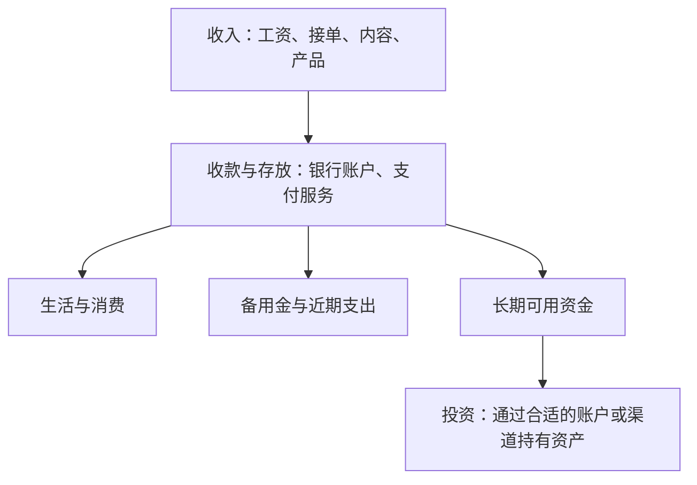

# 第一章｜全球金融基础设施地图

*A Map of Personal Global Finance*

更新日期：2026-10-13

“想接触全球资产，是不是应该先办一张港卡？”

这个问题很自然。刷到美股投资，有人提到券商；看到海外接单，有人推荐收款工具；再看 Crypto，又冒出交易所、钱包和稳定币。每一个都像是必须补上的一课。

如果跟着这些信息一路走，很容易变成：账户开了不少，依然说不清它们分别用来干什么。

我们先把问题换一下：**你希望自己的钱，能够做什么？**

是收到一笔海外客户的付款，支付国外的软件订阅，还是长期持有全球企业的股份？目的不同，需要的工具也不同。这本书就从这里开始：把收入、账户、支付和投资放在同一张地图上，看看它们怎样连接。

## 港卡、美元、美股，分别回答了三个问题

假设你在一家香港银行的账户里，放着一笔美元存款。

这句话里，其实有三件事：

| 你想知道什么 | 这个例子里的答案 |
|---|---|
| 钱放在哪家机构、什么账户里？ | 香港银行账户 |
| 用什么货币记录金额？ | 美元 |
| 你持有的具体是什么？ | 银行存款 |

钱存在香港，不代表它一定是港币；金额显示为美元，也不代表你已经投资了美国股票。

如果后来通过合适的证券账户买入一只股票基金，持有的东西就变了：从存款变成了基金份额。它的价格会随着持仓资产的变化而波动。

所以，“我有美元”和“我有美元资产”听起来接近，背后可能是完全不同的安排。美元存款、美国国债、美国股票，以及用美元报价的黄金，不能因为都带着“美元”两个字，就被当成同一种投资。

这里值得认识一个词：**资产敞口（Exposure）**。你可以把它理解为：什么东西涨跌，会影响你的钱？持有股票基金，主要关注它买了哪些公司；持有黄金产品，要关注黄金价格。报价用什么货币，还会带来汇率这另一层影响。

先分清“账户在哪里、用什么币、持有什么资产”，后面的很多问题就容易理解了。

## 把常见工具放回它们的位置

“全球金融基础设施”这个名字有点大。放到个人生活里，就是一套帮助你**收钱、存钱、付钱和管理资产**的工具与安排。

可以先看这张简图：

这张图画的是钱的用途。具体能用哪些账户和渠道，要结合所在地、服务资格及资金用途确认。

回头看那些频繁出现的名字，就能给它们找到位置：

| 名字 | 在这张地图中主要做什么 |
|---|---|
| 香港银行账户，也常被笼统称为“港卡” | 存放资金、收付款、兑换货币等；具体功能看银行与账户 |
| Wise、PayPal 等支付服务 | 处理特定场景的收款、付款或转账；不同地区可用功能不同 |
| 证券账户 | 用来交易和持有股票、基金、债券等证券 |
| ETF | 一种基金工具；买到什么，要看它跟踪什么、持有什么 |
| Crypto 钱包 | 管理密钥、查看链上资产并与区块链交互 |
| Bitcoin、USDT 等 | 链上的不同资产：Bitcoin 与挂钩美元的稳定币，用途和风险也不同 |

有些机构同时提供多种服务。例如，银行也可能提供证券交易。不过，即使都出现在同一个 App 里，存款、理财和股票仍然是不同的东西。

**一个账户的价值，取决于它是否解决了你的实际问题。**

## 同样一笔钱，三个人会有三种安排

来看三个假设场景。

**小林做设计，刚接到一份海外订单。** 他首先需要确认客户怎样付款、自己能用什么方式收款、费用多少，以及结算需要多久。此时，收款服务和银行账户的知识最有用。至于买哪只 ETF，可以晚一点再研究。

**小周已经有稳定工资，想为十年后的生活积累资产。** 她需要先想清楚哪些钱可以长期不用，再理解投资渠道、基金持仓和价格波动。对她来说，账户是入口，长期投资安排才是重点。

**小陈半年后要出国读书。** 他关心的是学费如何支付、生活费如何准备，以及汇率变化对预算的影响。这笔钱有明确的使用时间，不能仅因为某种资产“长期看好”，就忽略半年后必须付学费这件事。

三个人都可能接触外币和海外账户，但他们需要解决的问题并不相同。投资期限和承受亏损的能力，也会影响资金怎样分配。[^1]

这正是先看地图的意义：知道自己要去哪里，再选择路上的工具。

## 多开几个账户，就算分散风险了吗？

假设一个人有三个证券账户，但每个账户里买的都是同一只股票。这只股票大跌时，三个账户会一起受到影响。

把钱放在不同机构，和把钱投向不同资产，是两件事。

前者涉及服务是否连续、账户能否正常使用，以及机构如何保管资产；后者才直接关系到投资组合会怎样涨跌。讨论分散投资时，需要看底层持仓，而不只是看自己下载了多少个 App。[^1]

同样，银行里的美元存款和钱包里的美元稳定币，即使金额看起来接近，持有人面对的机构、权利和风险也不同。稳定币的挂钩机制放在[第十三章](../03-第三篇｜Crypto与链上金融/13-USDT、USDC与稳定币.md)展开，钱包的控制权则放在[第十四章](../03-第三篇｜Crypto与链上金融/14-交易所、钱包、私钥与链上安全.md)说明。

理解这些差别，比急着判断“哪个工具最好”更有用。

## 给自己画一张用得上的地图

读完这一章，可以拿张纸，写下这几项：

- **收入：** 目前从哪里来？未来想增加哪一种收入来源？
- **支出：** 日常花什么币？有没有留学、旅行或其他外币支出？
- **资金：** 哪些随时要用，哪些可以放得久一点？
- **工具：** 现有账户已经能解决什么问题？真正缺少的又是什么？

不用一开始就把五篇内容全部用上。暂时没有海外收款需求，就先理解概念；还没有足够的长期结余，就把收入能力和现金流放在更重要的位置。

这本书接下来的路径也就清楚了：第一篇讲账户、货币和支付；第二篇进入证券市场；第三篇理解 Crypto 与链上金融；第四篇讨论如何把个人能力连接到全球收入；第五篇再逐步补上实操。

当你再看到“先办哪张卡”这个问题时，希望你已经可以往前多问一步：**这张卡，要帮我完成哪件事？**

---

[^1]: [Investor.gov：资产配置与分散投资](https://www.investor.gov/introduction-investing/getting-started/asset-allocation)。本文人物场景为自拟示例，图表用于解释功能关系。

[下一章：赚美元、持有美元与美元资产](02-赚美元、持有美元与美元资产.md) · [全书目录](../目录.md)
