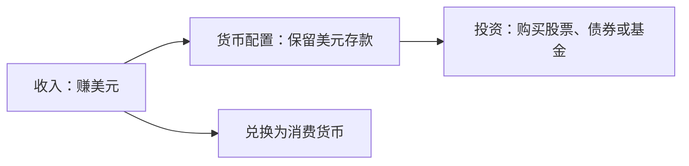
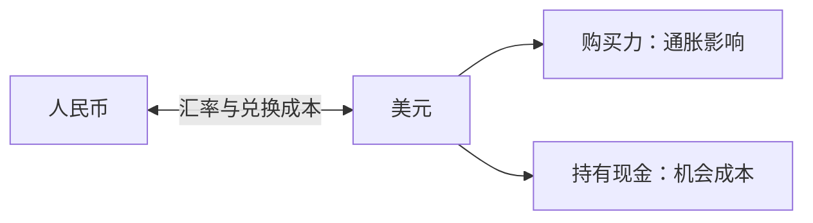

# 第二章｜赚美元、持有美元与美元资产

*Chapter 2: Dollar Income, Dollar Cash and Dollar-Denominated Assets*

更新日期：2026-10-12

很多人在开始接触海外投资后，会频繁看到几个词：美元、美元资产、美股、港卡、Wise、USDT。

它们看起来似乎都在讨论同一件事情——“把人民币变成美元，然后投资海外”。

但实际上，这里面至少涉及三件完全不同的事：

**赚美元、持有美元、持有美元资产。**

如果不能区分这三件事，之后理解港卡、美股、Crypto 和全球资产配置都会变得非常混乱。

---

## 一、赚美元：解决的是“收入从哪里来”

假设一个人在国内工作，每月领取人民币工资，那么他的收入货币就是人民币。

如果他通过海外自由职业、软件开发、YouTube、X/Twitter 创作者收入、海外数字产品等方式取得美元收入，那么他的收入货币就可能变成美元。

这首先是一个“收入来源”的问题，与买不买股票没有直接关系。

例如：

海外平台 → 获得美元收入 → 兑换人民币 → 在国内消费

整个过程中，甚至完全不需要购买任何投资产品。

它真正有吸引力的地方，在于一个人的劳动或产品可能开始接受全球市场定价，而生活成本仍然发生在本地。

这种模式常被称为“地理套利”：

**全球化收入 + 相对较低的本地生活成本。**

---

## 二、持有美元：解决的是“财富用什么货币储存”

赚到美元之后，并不意味着必须马上投资。

如果将美元保留在银行账户中，那么持有的是美元现金或美元存款。

这时需要关注的主要问题变成：

**汇率、通胀和机会成本。**

对于未来主要使用人民币消费的人来说，如果美元相对人民币升值，同样数量的美元可以换回更多人民币；如果人民币相对美元升值，则情况相反。

因此，持有美元本身已经是一种货币配置。

但美元仍然只是货币。

如果长期只持有现金，它同样会受到通货膨胀侵蚀购买力。

所以：

**美元是一种重要货币，但“美元”本身并不自动等于优质长期投资资产。**

---

## 三、持有美元资产：才真正进入投资

这里将“美元资产”作为日常说法，用来指美元计价或以美元支付现金流的投资；它并不是统一的风险类别，美元存款在广义上也属于资产。

如果把美元进一步用于购买：

美国国债、美股、ETF、货币基金等金融资产，那么就从“持有美元”进入了“投资美元资产”。

例如：

10,000 美元现金 → 购买标普 500 ETF 的基金份额 → 通过基金获得一篮子公司的股权敞口

从这一刻开始，投资者面临的不只是汇率变化，还有资产本身的涨跌。

因此，对于以人民币衡量最终财富的人而言，海外投资通常存在两层影响：

**第一层：资产本身涨跌。**

**第二层：美元与人民币之间的汇率变化。**

即使一项美股投资以美元计算上涨，如果同期美元相对人民币明显贬值，换算成人民币后的收益也会减少。

反过来，如果资产上涨的同时美元升值，则可能同时获得资产收益与汇率收益。

不考虑费用、税收及中途现金流时，人民币收益率可以写成：

`人民币收益率 = (1 + 美元计价资产收益率) × (期末 USD/CNY ÷ 期初 USD/CNY) − 1`

USD/CNY 在这里表示一美元对应多少人民币。假设资产以美元计算上涨 10%，美元兑人民币下跌 5%，人民币收益率为 `1.10 × 0.95 − 1 = 4.5%`；若美元上涨 5%，则为 `1.10 × 1.05 − 1 = 15.5%`。这是演示计算，不是收益预测。

---

## 四、美元计价，不代表它就是“美元资产”

这是海外投资中非常重要的一个概念。

黄金通常以美元报价，但黄金并不是美元。

比特币通常以美元报价，但它不因此成为美元现金或美元债权。

Apple 股票以美元交易，但投资者真正拥有的是 Apple 公司的股权。

因此，判断一种资产时，不能只看屏幕上显示的是不是“$”。

更重要的是问：

**这个价格背后，我真正拥有的是什么？**

例如：

| 产品 | 表面显示 | 真正持有 |
|---|---|---|
| 美元存款 | USD | 美元存款 |
| 美国国债 | USD | 美国政府债权 |
| Apple 股票 | USD | 企业股权 |
| 黄金 ETF | USD | 黄金价格敞口 |
| Bitcoin | USD | 加密资产 |
| USDT | USD 锚定 | 稳定币 Token |

USDT 就是一个典型例子。

1 USDT 的设计目标是维持在约 1 美元附近，但 USDT 本身不是银行账户中的美元，而是一种由发行机构发行、运行在区块链上的数字代币。

所以：

**USDT ≠ USD。**

---

## 五、美元资产和美国资产也不完全一样

一项资产至少可以从三个角度观察：

**在哪里上市？**

**使用什么货币交易？**

**底层资产究竟在哪里创造价值？**

例如一家美国科技公司可能在纳斯达克上市、使用美元交易，但它的收入可能来自全世界。

一只黄金 ETF 可能在美国证券交易所上市并用美元报价，但其核心风险仍然来自黄金。

因此：

**上市地点、计价货币和底层资产，是三个不同概念。**

---

## 六、理解全球投资，需要建立“五层货币意识”

未来看到任何海外金融产品，都可以依次问五个问题：

| 维度 | 核心问题 |
|---|---|
| 收入货币 | 我的钱是通过什么货币赚来的？ |
| 账户货币 | 我的现金目前存在哪里、是什么币种？ |
| 交易货币 | 买卖这项资产需要什么货币？ |
| 底层资产 | 我真正拥有的资产是什么？ |
| 消费货币 | 未来这笔财富最终在哪里使用？ |

掌握这五个问题之后，很多看似复杂的跨境金融概念都会变得清晰。

---

## 七、港币为什么经常和美元一起出现？

香港使用港币，但港币实行联系汇率制度。

香港金融管理局通过货币发行局制度，将港元兑美元维持在每美元 7.75—7.85 港元的兑换区间。这个区间描述制度安排，不代表个人换汇一定获得同样报价。[香港金管局：联系汇率制度](https://www.hkma.gov.hk/eng/key-functions/money/linked-exchange-rate-system/)

多币种账户则是银行提供的另一类服务，具体支持币种、费用与资格须以各银行条款为准。联系汇率制度与多币种账户功能应分开理解。

港卡真正重要的地方，并不是拥有一张香港银行卡，而是获得一个接入香港金融体系的多币种银行账户。

这将成为理解跨境收款、海外券商和全球资产配置的重要基础设施。

香港账户、多币种余额和投资账户属于不同层级。能否汇款及投资，须分别核对适用规则和服务资格，不能从拥有银行账户推导出跨境投资资格。

---

## 八、为什么全球投资总绕不开美元？

美元不仅是美国国内货币，也是目前全球最重要的储备、交易、融资和结算货币之一。

美元在国际融资、交易和储备中发挥重要作用。[美联储：美元的国际角色（2025 年版）](https://www.federalreserve.gov/econres/notes/feds-notes/the-international-role-of-the-u-s-dollar-2025-edition-20250718.html)

这形成了一种强大的网络效应：

**越来越多人使用美元 → 金融机构提供更多美元服务 → 更多资产以美元计价 → 更多人继续使用美元。**

因此，一个人学习全球投资，并不意味着必须看好美元永久升值。

更重要的是理解：

**美元是目前连接大量全球资产和金融市场的重要基础货币。**

---

## 九、真正的目标不是“把人民币换成美元”

海外资产配置的终点不应该简单理解成：

“把人民币换成美元。”

也不应该理解成：

“A 股不好，所以全部换成美股。”

更成熟的目标是：

**建立在不同国家、不同货币、不同资产类别之间进行配置的能力。**

一个真正意义上的全球化个人资产体系，可能同时包含：

人民币资产、美元资产、股票、债券、黄金以及其他风险资产。

投资者真正需要的不是某张银行卡或某一个券商账户，而是一套能够理解并使用全球金融市场的能力和基础设施。

---

## 本章要点

记住四句话：

**赚美元，是收入问题。**

**持有美元，是货币配置问题。**

**持有美元资产，是投资问题。**

**建立海外金融体系，是全球资产配置与金融基础设施问题。**

当这四个概念真正分开之后，港卡、Wise、美股、USDT、Bitcoin 等看似零散的名词，就会逐渐落入同一张全球金融地图之中。

下一章：

**《港卡究竟是什么？为什么越来越多人专门去香港开银行账户？》**

## 阅读说明

本章讨论概念与分析方法，不构成特定投资、开户或汇款建议。账户资格、跨境资金用途与税务要求应按具体情形核实。
