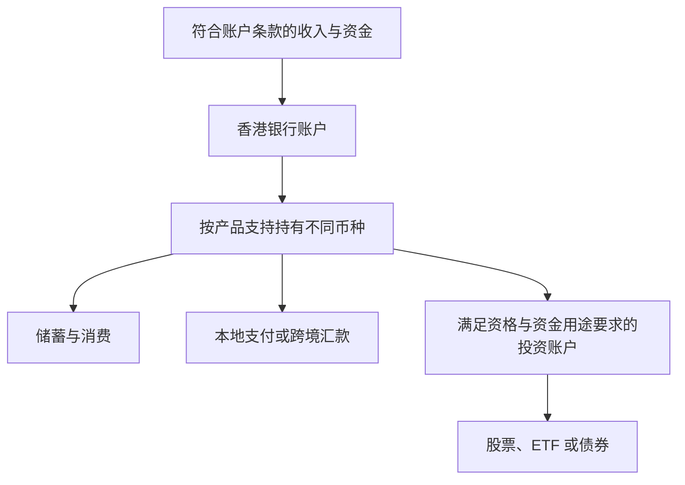

# 第三章｜香港银行账户与港卡：连接本地资金与全球金融体系的一个节点

*Chapter 3: Hong Kong Bank Accounts and Banking Cards*

修订：2026-10-14｜资料：2026-10-12

“要不要专门去香港开张卡？”先别急着查预约教程，试着把这句话补完整：**我需要这个账户，是为了……**

看一个假设情境：毕业两年的小许准备去香港旅行，也想保留一部分外币用于之后的学习和出行。他刷到许多开户攻略，最初觉得账户越多越方便。真正列出需要时才发现，他首先关心的是能否开户、怎样收付和维护；买美股则是另一组资格与资金用途问题。

带着这张需求单，“港卡”就不再是一个人人都该收集的通行证，而是一项可以逐项比较的银行服务。

## 先看账户能做什么，再看那张卡

许多香港银行提供综合账户，可以在同一客户关系下管理港币、美元、人民币等多种货币的存款。具体支持哪些币种，取决于银行和账户产品；并非所有香港账户都具备相同的多币种功能。

例如，一个多币种账户的界面可能显示以下余额。数字仅为示例：

```text
HKD   30,000
USD   10,000
RMB   20,000
EUR    1,000
```

不同币种可以分别存在，而不一定需要立即兑换成港币。

部分银行还提供多币种借记卡。例如，汇丰香港 Mastercard 借记卡支持在符合条件时从对应币种存款扣款；币种不受支持或余额不足时，可能触发兑换。消费前应核对扣款顺序、汇率和收费。[汇丰香港：多币种借记卡](https://www.hsbc.com.hk/debit-cards/products/mastercard-debit-card/)

因此，“港卡”更准确的理解应该是：

> **一个实名香港银行账户，以及它提供的支付、存款和可能的多币种服务。**

实体卡片、手机银行和 ATM，只是使用这个账户的不同接口。

中国大陆银行同样可以开立美元存款账户，因此“能够持有美元”本身并不是香港银行的独特优势。

更值得比较的是账户连接哪些服务，以及这些服务是否符合自己的实际需求。

香港银行体系同时连接香港本地支付体系、国际银行网络、美元金融体系以及成熟的证券和财富管理市场。

小许可以用下面这张图整理功能，先圈出自己确实需要的部分：



图示用于说明功能关系，不表示每个读者都能使用所有路径。

需要强调的是，银行账户解决的是资金存放与结算问题，并不自动解决跨境资金用途、证券投资资格或其他司法辖区的监管要求。

## 需要转账时，FPS 和 SWIFT 才有了意义

假如小许要支付一笔港币款项，他需要查的是收款方接受什么方式。如果以后有跨境汇款，才需要继续核对银行资料、币种和中转费用。两个场景里出现的英文词不同。

FPS 的全称是 Faster Payment System，即快速支付系统。

它连接参与的银行和储值支付工具，全天候运行，支持港币和人民币支付。转账时可使用已登记的手机号、电子邮箱或 FPS ID；银行也可能提供通过账户号码付款的方式，具体功能、限额和收费以服务机构为准。[香港金管局：FPS](https://www.hkma.gov.hk/eng/key-functions/international-financial-centre/financial-market-infrastructure/faster-payment-system-fps/)

从个人使用体验来看，可以将 FPS 理解为香港本地银行体系中的即时支付网络。

它主要解决的是：

> **香港本地账户之间如何快速转移资金。**

因此，参与机构之间的许多本地转账不需要使用国际汇款网络。多币种账户中有美元余额，并不意味着可以用 FPS 转移美元。

SWIFT 则属于另一层基础设施。

它并不是一家银行，也不是一个保存用户资金的钱包。

SWIFT 的核心作用，是为全球银行和金融机构提供标准化、安全的金融通信网络。

银行之间可以通过 SWIFT 传递付款指令。SWIFT 自身并不实际移动资金；资金转移由银行及其他相关机构完成。[SWIFT：Who we are](https://www.swift.com/about-us/who-we-are)

因此可以简单理解：

> **FPS 主要服务于香港本地快速支付；SWIFT 主要服务于跨境金融机构之间的通信。**

两者处在不同层级，不宜仅按“哪个更快”比较。对个人汇款而言，还需看具体币种、收款渠道、费用以及到账条件。

| 对比项 | FPS | SWIFT |
|---|---|---|
| 本章关注的功能 | 香港本地快速支付 | 金融机构之间传递支付等金融信息 |
| 币种 | 港币、人民币 | 取决于相关机构与汇款安排 |
| 用户使用方式 | 银行或支付机构提供的 FPS 功能 | 银行等机构提供的相关汇款服务 |
| 要核对的条件 | 登记信息、限额、收费 | 收款资料、机构要求、费用与到账安排 |

## 美元、港币和投资功能，要分别确认

香港实行联系汇率制度。

香港金融管理局通过货币发行局制度，将港元兑美元维持在一个相对稳定的区间，目前兑换保证区间为：

**1 美元兑 7.75～7.85 港元。**[香港金管局：联系汇率制度](https://www.hkma.gov.hk/eng/key-functions/money/linked-exchange-rate-system/)

这是制度层面的兑换保证区间，个人在银行换汇时仍会遇到买卖价差和可能的费用。它不代表银行承诺按某一个固定价格为个人兑换。

港币仍是独立货币，联系汇率制度使其与美元保持紧密联系。


银行存款与证券投资承担不同的功能。即使它们显示在同一个 App 或综合账户中，也要分别理解。

银行存款部分主要用于资金存放、兑换和支付。证券或投资账户则用于交易及持有股票、ETF、债券等产品。

因此，典型结构可能是：

```text
香港银行美元账户
        ↓
证券账户
        ↓
证券交易所
        ↓
股票 / ETF / 债券
```

拥有银行卡或存款账户，并不等于已经获准进行证券交易。证券交易需要通过提供相应服务的机构办理。

银行也可能提供证券服务。例如，汇丰香港提供投资账户，但开通投资功能仍需满足相应要求；其官网也列有中国内地投资者启用投资服务所需的声明。[汇丰香港：开立投资账户](https://www.hsbc.com.hk/investments/account-opening/)

因此，关键区别是“存款功能”和“证券服务”，不能简单归纳为“银行只管钱、券商才管投资”。

Wise 等支付服务也可能提供外币余额，但账户性质和资金保护安排与银行存款不同，下一章会继续比较。

## 开户前，小许还得核对什么？

香港银行需要遵守反洗钱和反恐融资等监管要求。

因此，银行在开户时通常需要确认客户的身份、地址和相关背景，并根据具体风险情况了解账户用途、预期交易活动以及其他信息。

各家银行的开户要求并不完全相同。

银行还可能根据客户情况收集 FATCA 和金融账户信息自动交换所需的税务资料。香港金管局的开户说明强调，银行要求并非统一清单，须按具体情况核实。[香港金管局：开户与账户维护说明](https://www.hkma.gov.hk/media/eng/doc/key-functions/banking-stability/consumer-corner/english/1-Account_Opening_and_Maintenance-English.pdf)

这意味着：

> **海外银行账户并不是匿名账户。**

它仍然是建立在客户真实身份和税务身份之上的金融关系。

香港实行存款保障计划。

截至本次核对，通常保障上限为**每位存款人、每家计划成员银行 80 万港元**。同一人在同一家成员银行的受保障存款合并计算，并非每个账户或每种货币各有 80 万额度。符合条件的外币存款也可受保障，赔偿以港币支付。

股票、基金、债券和虚拟资产不属于受保障存款；结构性存款、期限超过五年的定期存款及成员银行海外分行的存款等亦不在保障范围内。具体产品须核对银行披露。[香港存款保障委员会：常见问题](https://www.dps.org.hk/en/for-depositors/faqs/)

存款保障针对特定银行倒闭情形，不是对投资亏损、汇率损失或所有诈骗损失的保险。

对小许来说，这些资料最终要落到一张费用和维护记录上：是否接受自己的真实情况，是否有余额要求或账户收费，多久需要更新资料，常用币种怎样兑换，自己不在香港时怎样获得帮助。

做完比较，小许可能决定开一个能满足需求的账户，也可能发现现有工具已足够，暂时不用增加维护负担。这个假设案例没有规定唯一结果；关键是，他能说明每项功能对自己有什么用。

**钱从哪里来，以什么货币存在，最终用在哪里。** 想清楚这些，再去选账户，开户攻略才真正用得上。

下一章：[Wise、PayPal 与银行账户](04-Wise、PayPal与香港银行.md)。

---

小许为假设人物，机构例子用于说明功能。账户资格、费用及资金用途要求以最新条款为准；[来源索引](../参考资料/来源索引.md)。
