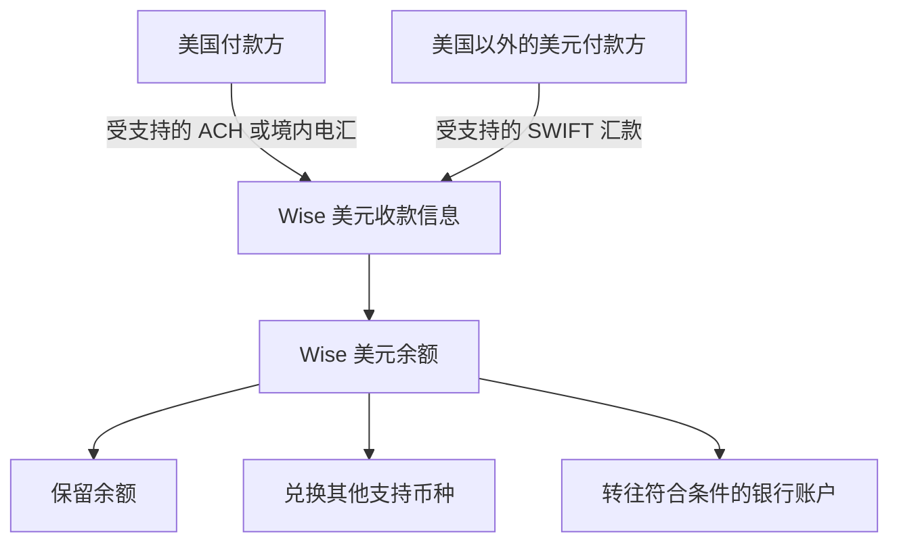

# 第四章｜跨境收款与支付：Wise、PayPal 与银行账户

*Chapter 4: Cross-Border Payments — Wise, PayPal and Bank Accounts*

修订：2026-10-14｜资料：2026-10-12

海外客户发来一句：“我可以用 PayPal 付，也可以银行转账，你怎么收？”

小许第一次接到这类问题时，才发现“有一个外币账户”和“能接这笔款”之间还有距离。这里沿用上一章的假设人物：假设他接到一笔 200 美元的设计任务，尚未确定收款工具，需要先核对真实居住地区、业务类型和可用提现渠道。200 美元只是报价情境，不是收入记录。

他可以从一笔具体交易出发：**客户怎么付，我能否收，钱何时能用，最后到手多少。** Wise、PayPal 和银行账户的区别，就藏在这几个问题里。

## 客户愿意付款，先确认自己能不能收

小许先核对服务是否接受自己的真实身份和这类商业款项，再查客户可用的付款方式。注册成功、持有余额、取得某种收款信息和申请卡片，可能分别有不同条件，不能因为朋友能用就直接给客户相同资料。[Wise：余额资格](https://wise.com/help/articles/2813542/where-do-i-need-to-live-to-hold-money-with-wise) · [美元收款信息资格](https://wise.com/help/articles/2810318/can-i-get-usd-account-details)

可以将几类工具放在同一张表中观察：

| 工具 | 本章关注的主要功能 | 与其他工具的关系 |
|---|---|---|
| Wise | 收款信息、换汇与跨境转账 | 可将符合条件的资金接入或转往银行体系 |
| PayPal | 在线付款与商户收款 | 商户收到款项后，可能需要安排提现 |
| 银行账户 | 存款、兑换和银行支付 | 提供现金管理与资金收付的账户基础 |
| 证券账户 | 证券交易与持有 | 在满足资格与资金用途要求时，将现金用于投资 |

这是一张功能表，并不是对每家机构全部业务的分类。银行可能同时提供证券服务，其他机构也可能提供不同类型的产品。分析时，应关注自己实际使用的那项服务。

同样，美元余额只是一个计量结果：银行中的美元存款、支付平台中的美元余额、证券账户中的现金与持仓，都需要按各自的权利和风险理解。

与 Wise 相比，PayPal 更常见的使用场景是在线交易。消费者通过 PayPal 向商户付款，商户通过自己的账户接收款项。

可以把它理解为互联网中的一个“收银台”：客户需要完成购买，商户需要确认收款。它的价值首先体现在付款体验和商业交易处理，而不是把个人现金配置为股票或债券。

这也解释了为什么，讨论海外收入时经常会遇到 PayPal，讨论证券投资时却不能仅凭拥有 PayPal 账户解决全部问题。**商业收款与证券投资，属于不同的金融环节。**

## 银行转账怎么找到你：从收款资料看 Wise

Wise 的重要能力之一，是让符合条件的用户获得不同货币的收款信息，并通过相应的支付网络接收资金。

例如，取得美元收款信息后，用户可以向美国付款方提供账号和银行路由号码（routing number）。对方可以通过受支持的 ACH 或美国境内电汇（wire）付款；来自美国以外的美元汇款，也可能使用 SWIFT。收到的款项随后记入用户的 Wise 美元余额。[Wise：美元收款方式](https://wise.com/help/articles/2827506/how-do-i-receive-money-with-my-usd-account-details)

这意味着，付款方在某些情况下可以使用熟悉的本地转账方式，而不必每次都办理传统国际汇款。用户收到资金后，再选择保留余额、兑换为其他支持的币种，或转往符合条件的银行账户。

这张图呈现的是收款与资金管理功能。实际能否使用某种收款方式，仍取决于用户资格、账户类型、付款来源和服务条款。

本地收款信息的英文是 **Local Account Details**。它的作用，是让付款方按照相应支付体系的要求，将资金发送给收款人。

美国付款资料中常见账号和银行路由号码，欧洲欧元付款常见 IBAN，英国付款常见账号和 sort code。这些名称可能陌生，但都可以理解为“让付款方找到正确收款位置的信息”。[Wise：收款信息的工作方式](https://wise.com/help/articles/5zoKjEdRMag0F7IsGBA8sK/how-your-wise-account-details-work)

这里需要区分两类名词：

- **账号、routing number、IBAN：** 说明付款需要哪些收款资料。
- **ACH、SEPA 等：** 说明付款通过什么支付体系处理。

本地收款信息可以改善某些跨境付款场景的体验，但“有收款信息”不等于“拥有当地居民的全部金融服务”。注册账户、持有余额、取得特定币种收款信息和申请卡片，也可能有不同的资格要求。[Wise：余额资格](https://wise.com/help/articles/2813542/where-do-i-need-to-live-to-hold-money-with-wise)、[美元收款信息资格](https://wise.com/help/articles/2810318/can-i-get-usd-account-details)

Wise 可以显示多种货币余额，也可以提供看起来与银行类似的收款信息。但这并不意味着用户直接开立了当地商业银行的传统存款账户。Wise 的美元收款说明明确区分了这两件事。

**收款信息说明别人如何付款，账户的法律性质说明资金由谁管理、受到什么保护。**

传统银行存款与支付服务余额，应分别理解。Wise 的相关账户服务采用客户资金保障安排（safeguarding），例如将客户资金与运营资金分开保存；具体方式因签约主体和地区而异。这与银行存款保障制度并不是同一种机制。[Wise：资金保护说明](https://wise.com/help/articles/2949821/how-wise-keeps-your-money-safe)

因此，判断一个账户时，既要看它能做什么，也要看实际提供服务的机构是谁。熟悉的品牌和相似的余额界面，并不能代替对条款的理解。

## 显示收到 200 美元，为什么还不能马上花？

完成一笔交易，并不意味着资金管理已经结束。商户还需要知道，收到的款项何时可用、能通过什么渠道提现，以及提现是否涉及换汇。

PayPal 官方列出的暂缓付款情形包括新卖家、交易模式变化、客户投诉和身份核验未完成。因此，账户显示收到款项时，资金未必已经可以提现。[PayPal：款项暂缓原因](https://www.paypal.com/c2/cshelp/article/why-is-my-payment-on-hold-or-unavailable-help126?locale.x=en_C2)

提现渠道和费用也与账户地区、产品及币种有关。收到美元，并不能据此认定可以将美元原币提往任何一个银行账户。商业交易费用、提现费用和币种转换费用，需要一起查看。[PayPal：商家费用与提现规则](https://www.paypal.com/c2/business/paypal-business-fees?locale.x=en_C2)

从资金管理角度看，支付账户中的余额可以服务于交易、退款和经营支出。更长期的现金安排，则需要结合资金用途、取用需求和适用保护机制另行考虑。

小许因此在报价和交付前，把收费、换汇、可提现时间、退款与争议规则一起读过。假如某种渠道的固定成本对小额订单太高，他可以与客户讨论其他自己确实可用的方式，而不是收完款后才发现无法提取。

第三章介绍过，香港银行账户可以提供存款、多币种管理和银行支付服务。因此，它可能成为个人金融体系中的一个资金节点：接收符合要求的款项，保留现金，进行兑换和支付，或与其他金融服务相连。

Wise 和 PayPal 与银行账户并不是相互替代的关系。前者可以提供跨境收款或转账能力，后者可以帮助处理在线交易，而银行账户承担存款与支付等功能。

不过，银行账户不一定要经过支付平台才能收款。有时客户可以直接向银行付款，有时收入平台只支持指定支付商。合适的路径应由付款方能力、账户条件和资金用途决定，而不是预先认定所有人都必须使用同一组工具。

拥有银行账户，也不自动取得证券投资资格。银行可能提供证券服务，但存款功能与投资功能仍应分别理解。

## 最后比的是完整路径

理解资金路径时，还需要认识支付背后的几个常见体系。

| 名称 | 主要含义 | 常见场景或特点 |
|---|---|---|
| ACH | 美国电子支付网络 | 工资入账、账单付款及其他电子转账 |
| SEPA | 单一欧元支付区及相关支付方案 | 参与地区之间的欧元支付，范围不只欧元区 |
| FPS | 香港快速支付系统 | 支持港币和人民币的快速支付 |
| SWIFT | 金融机构之间的通信网络 | 传递支付等金融信息，实际资金转移由相关机构完成 |

来源：[Nacha：ACH](https://www.nacha.org/what-ach)、[欧洲支付委员会：SEPA](https://www.europeanpaymentscouncil.eu/about-sepa)、[香港金管局：FPS](https://www.hkma.gov.hk/eng/key-functions/international-financial-centre/financial-market-infrastructure/faster-payment-system-fps/)、[SWIFT：功能说明](https://www.swift.com/about-us/who-we-are)。

这些名称不处在完全相同的层级。ACH 和 FPS 可以帮助理解具体支付网络；SEPA 还涉及欧元支付区和统一规则；SWIFT 主要提供金融通信。

因此，不能仅凭“走了本地网络”就认定某笔转账更便宜，也不能仅凭“通过 SWIFT”就判断最终到账时间。用户实际购买的是机构提供的具体收款或汇款服务，其费用、汇率和处理条件仍需查看。

全球金融基础设施的价值，在于让收入、账户与资金用途之间形成清楚的关系。增加账户之前，应先回答：钱从哪里来，付款方支持什么渠道，资金以什么货币到账，之后准备如何使用？

在此基础上，再比较账户与支付服务。比较成本时，应同时考虑收款费用、兑换汇率、提现或转账费用，以及可能的中转和银行费用。固定汇出金额与到账币种后，最终到账金额往往比单独的“手续费”更有解释力。

适合自己的体系不一定复杂。明确用途、了解账户性质，并能持续维护资料和交易记录，才能让这些工具真正服务于收入与资产管理。

这次假设交易的决定，可以这样记录：客户支持的方式 → 本人获准使用的服务 → 到账及可取用条件 → 实际费用 → 最终用途。哪一项没有答案，就先查清那一项。

支付完成后，钱可以用于生活、留作业务开支，也可能在满足相应条件后参与投资。账户越多不一定越好，能解释清楚一笔钱怎样进来、怎样用出去，才是这一章最值得带走的能力。

下一章：[中国大陆居民如何获得海外资产敞口](05-中国大陆居民如何获得海外资产敞口.md)。

---

小许与订单金额为假设情境。具体资格、功能和费用以实际签约主体及最新条款为准；[来源索引](../参考资料/来源索引.md)。
