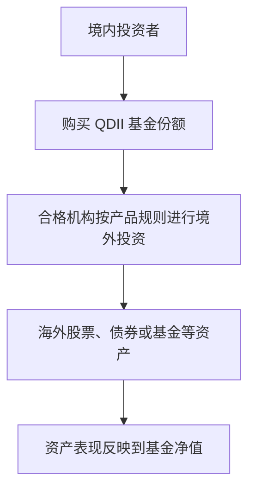
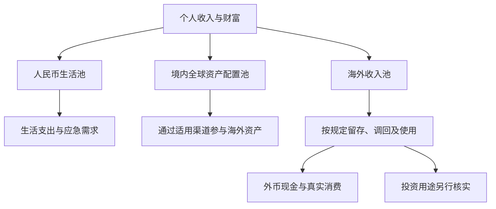

# 第五章｜中国大陆居民如何获得海外资产敞口

*Chapter 5: Accessing Overseas Assets as a Mainland China Investor*

更新与资料核对日期：2026-10-12

前四章介绍了货币、银行账户和跨境支付工具。这些基础设施让我们看清钱如何存放和流动，但还没有回答一个关键问题：希望投资海外资产的人，究竟可以通过什么渠道获得相应的风险与收益？

对中国大陆投资者而言，“存在投资渠道”和“能够方便、低成本地建立仓位”并不是同一件事。场外 QDII 基金可能限购，场内跨境 ETF 可能出现溢价。与此同时，香港银行账户、境外券商和海外收入，又让人产生新的设想。

理解这些问题，需要同时看清三层关系：**需要什么资产敞口、使用什么投资渠道，以及资金如何形成和使用。**本章主要讨论境内个人的常见情形；外汇管理中的身份分类与税务居民身份，应按各自规则判断。

## 一、获得海外资产敞口，不一定要直接拥有境外账户

资产敞口，是指财富受到某类资产价格变化影响的程度。购买一只投资海外股票的境内基金，也可以获得海外股票敞口，并不一定需要先开立境外证券账户。

QDII 的全称是 Qualified Domestic Institutional Investor，即合格境内机构投资者。通过相应基金，投资者购买基金份额，由具有资格的机构进行境外投资。

这个过程中，个人持有的是基金份额，而不是境外证券账户里的每一只股票。机构承担相应的跨境投资安排，投资者则承担基金及底层资产的风险。

港股通是另一种制度化渠道。符合条件的投资者可以通过境内证券账户，买卖规定范围内的香港上市证券。它有投资者适当性要求和标的范围限制，不能直接用来购买美国交易所上市的股票。[上海证券交易所：沪港通](https://www.sse.com.cn/services/hkexsc/home/)

这些渠道说明，获得海外资产敞口与自行建立境外账户体系，是两种不同的路径。

## 二、场外 QDII：按净值申购，也可能难以买够

场外 QDII 基金通常按规定的基金净值办理申购，不承担二级市场买入时的折溢价。不过，是否开放申购、每次可以买多少，可能受到基金额度、规模控制和运作安排的影响。

例如，万家基金在 2026 年 9 月 23 日的公告中，将相关纳斯达克100 QDII 基金代销渠道的单日单账户累计申购及定投限制调整至 10 元，直销渠道则另有 100 元的限制，A、C 类份额合并计算。限额边界及确认方式应以公告原文为准。[万家基金申购限制公告](https://epaper.cs.com.cn/zgzqb/html/2026-09/23/nw.D110000zgzqb_20260923_4-B029.htm)

这是一个历史案例，不代表该基金今天仍采用同样限额，也不能推广为所有 QDII 都每天只能购买 10 元。

但它说明了一种真实的摩擦：投资者即使有资金、愿意承担风险，也未必能够按照自己的计划建立仓位。因此，比较场外产品时，除了费用和跟踪表现，还要查看最新申购状态、销售渠道和份额确认规则。

## 三、场内跨境 ETF：可以买卖，不代表价格合理

场内 ETF 在证券交易所交易。个人买卖时支付的是二级市场价格，这个价格可能高于或低于基金净值或相关参考估值。

以嘉实纳斯达克100 ETF（159501）为例，基金管理人在 2026 年 9 月 18 日发布的公告列明：前一交易日收盘价为 2.095 元，收盘时基金份额参考净值 IOPV 为 1.8328 元，并提示较大溢价风险。[嘉实基金溢价风险公告](https://paper.cnstock.com/html/2026-09/18/content_2270242.htm)

按公告所列数值计算，价格相对该参考值高出约 14.31%：

`2.095 ÷ 1.8328 − 1 ≈ 14.31%`

IOPV 是参考估值，并不是保证可以按其成交或赎回的价格。跨境市场的交易时差、估值时点和汇率变化，也可能影响参考数值的解释。这个案例用于说明溢价问题，不作为实时交易报价。

因此，购买跨境 ETF 时，需要同时观察底层资产表现和买入价格相对基金价值的偏离。

## 四、溢价回落，可能抵消底层资产收益

用一个简化算例说明：假设某 ETF 的每份净值为 100 元，投资者以 114 元买入。后来净值仍是 100 元，但市场价格回到 100 元。

| 项目 | 买入时 | 溢价回落后 |
|---|---:|---:|
| 假设基金净值 | 100 元 | 100 元 |
| 二级市场价格 | 114 元 | 100 元 |
| 相对净值的溢价 | 14% | 0% |

在忽略费用的情况下，投资者收益率为：

`100 ÷ 114 − 1 ≈ −12.28%`

底层价值没有下降，投资者仍然亏损，因为买入时支付的额外价格消失了。14% 的溢价与回落后的 12.28% 亏损不同，是因为两者使用的计算分母不同。

跨境 ETF 的申购赎回、资金调度和套利机制，也可能受到额度、交易时间和产品安排的影响。当新增份额或套利受限时，二级市场需求可能将价格推高。溢价并不一定立即消失，也不能把某个统一比例当作所有产品的买卖标准。

## 五、投资渠道的便利性与限制，需要一起比较

| 路径 | 投资者主要持有什么 | 需要关注的条件与摩擦 |
|---|---|---|
| 场外 QDII 基金 | 基金份额 | 申购状态、限额、费用、跟踪表现与赎回安排 |
| 场内 QDII ETF | ETF 份额 | 折溢价、流动性、交易费用与申赎状态 |
| 港股通 | 规定范围内的香港证券 | 适当性条件、标的范围、交易与结算规则 |
| 自行建立境外账户体系 | 账户允许持有的现金或证券 | 本人资格、资金来源、投资渠道、税务及退出安排 |

境外证券账户可能让交易产品的选择更丰富，但它不会自动回答资金来源和适用规则。一个完整的方案，既要解释如何进入市场，也要解释将来如何卖出、使用或取回资金。

## 六、购汇、汇款、入金与投资，是四个不同环节

网络教程常把整个过程画成“人民币换美元，再汇到香港、转入券商”。实际上，它至少包含四个动作：

| 环节 | 需要回答的问题 |
|---|---|
| 购汇 | 为什么购买外汇，适用什么额度或材料要求？ |
| 跨境汇款 | 资金以什么性质和用途跨境？ |
| 证券账户入金 | 账户是否接受本人及该来源的资金？ |
| 证券投资 | 本人通过什么渠道、依什么规则参与投资？ |

某一步技术上可以完成，不代表其他步骤的条件已经满足。银行账户存在、转账成功、券商愿意开户，分别说明不同的事情。

境内个人的年度便利化购汇额度通常为每人每年等值 5 万美元。它便利的是符合规定的购汇业务，不是个人境外证券投资额度。[外汇局：年度便利化额度说明](https://www.safe.gov.cn/tianjin/2025/0714/2833.html)

外汇局的个人购汇说明同时要求如实申报用途，并明确不得将相关购汇用于境外证券投资等尚未开放的资本项目。[外汇局：个人购汇要求](https://www.safe.gov.cn/tianjin/2018/0628/920.html)

因此，不能把“额度内购汇”解释成“额度内可以自由买境外股票”。便利化额度也不等于所有合法经常项目用汇的绝对年度上限；额度外业务仍要根据实际交易和适用材料要求办理。

## 七、香港账户解决基础设施问题，投资资格需要另行判断

香港银行账户提供多币种存款、支付和汇款等服务。它可以成为管理资金的节点，但账户功能本身不改变一笔资金的性质，也不代替跨境投资渠道的要求。

《个人外汇管理办法》第十七条对境内个人参与境外权益类、固定收益类等金融投资作出了通过相应境内金融机构办理的规定。[中国人民银行：《个人外汇管理办法》](https://www.pbc.gov.cn/zhengwugongkai/attachDir/2025/11/2025111914195769090.pdf)

据此，分析境外证券投资时，不能只检查银行和券商是否接收资金，还需要核实本人身份及适用渠道。存在特殊身份、历史资产或其他制度安排时，也应按具体规则判断，不能仅凭一个通用账户教程作出结论。

## 八、海外收入，是另一种资金形成过程

如果一个人通过内容创作、软件销售、自由职业或海外客户取得收入，款项可能直接以美元或其他货币支付。这与“使用境内人民币购汇后汇出”是不同的资金形成过程。

不过，付款方来自海外，不足以单独确定所得的税务来源；收到美元，也不足以证明资金已经满足全部账户与用途要求。合同、平台账单、收款记录和实际提供的服务，需要能够相互对应。

《外汇管理条例》第九条允许境内机构、境内个人的外汇收入调回境内或存放境外，同时将相应条件和期限交由外汇管理规定确定。不能据此推导为所有收入都必须立即换成人民币，也不能理解成所有收入都可无条件留存境外。[《外汇管理条例》](https://www.safe.gov.cn/safe/2008/0806/5321.html)

“海外收入池”因此可以作为一种资金管理思路：理解收入怎样形成，存入什么账户，以及随后怎样使用。它不是新增的一项投资许可。

## 九、境外现金、真实消费与金融投资，应分别理解

| 用途 | 主要关注什么 |
|---|---|
| 外币现金管理 | 收入与留存条件、账户性质、流动性和汇率风险 |
| 真实境外消费 | 商品或服务是否允许，支付渠道是否支持，交易记录是否完整 |
| 境外金融投资 | 本人身份、适用投资渠道、资金用途与税务安排 |

如果收入与账户使用均符合相应要求，旅行、酒店、国际交通、软件或云服务等消费，可能由外币账户直接支付。这样可以减少某些重复换汇，但是否值得保留外币仍取决于实际支出需求和成本。

进一步购买股票、ETF 或境外债券，则进入另一类用途。**合法取得外币收入，不能单独证明境外证券投资的全部条件已经满足。**资金从未进入境内，也不能替代对本人适用投资规则的判断。

## 十、钱未汇回，税务义务也需要独立分析

外汇管理关注资金收支和使用；税务规则关注纳税人身份、所得性质和来源等问题。二者不能混为一谈。

《个人所得税法》规定，居民个人的境内、境外所得依法纳税。具体认定、豁免、税收协定及计算方法，需要结合个人情况判断；不能仅凭资金存放地点决定税务处理。[国家税务总局：《个人所得税法》](https://www.chinatax.gov.cn/n810219/n810744/n3752930/n3752974/c3970366/content.html)

居民个人取得境外所得，通常应在取得所得的次年 3 月 1 日至 6 月 30 日申报。符合条件的境外所得税，可按规定在抵免限额内抵免。[财政部、税务总局：境外所得政策公告](https://12366.chinatax.gov.cn/bzds/081/081-5-7.html)

尤其需要区分：境外平台付款、所得依法认定为境外所得，以及资金存放在境外，是三个不同事实。准备税务资料时，应保留收入合同、平台结算单和相关完税凭证。

## 十一、钱怎么出去，与钱怎么回来，都属于资金路径

许多教程重点介绍“银行转券商”，却很少解释资金最初如何形成，以及投资之后如何退出。

通过 QDII 投资时，境外投资与基金份额赎回由产品机制衔接。投资者仍应查看具体币种、赎回期限和暂停业务等安排。通过港股通投资，则依互联互通机制及账户规则完成交易和结算。

自行建立境外账户体系时，需要分别解释收入或本金、投资交易、股息与卖出所得，以及之后的资金用途。汇入境内和将外币兑换成人民币，也是不同业务，不能统称为“回来”。

银行可能根据资金性质要求收入证明、账户流水、证券记录或税务材料。资本项目收入的结汇也不能套用普通劳务收入的规则；《个人外汇管理办法》第十九条对此另有规定。

把投资所得汇回，并不会自动补足原始资金或投资路径缺少的条件。因此，退出安排应在投资前一并考虑，资料记录也应贯穿全过程。

## 十二、三个资金池：让不同用途清楚分工

可以用三个资金池，观察自己的收入、生活与投资需求：

| 资金池 | 主要用途 | 可能使用的工具 |
|---|---|---|
| 人民币生活池 | 日常支出、应急现金和境内财务安排 | 境内银行与相应金融产品 |
| 境内全球资产配置池 | 通过适用渠道获得海外资产敞口 | QDII、符合条件的港股通等 |
| 海外收入池 | 按规定管理外币收入及相应消费需求 | 可合法使用的银行或支付账户 |

这是一种分析框架，不表示资金可以在三个池子之间无条件划转。它帮助我们把消费、现金管理与投资需求分开，避免所有问题都围绕“怎样把钱转出去”展开。

## 十三、如何看待投资渠道的现实摩擦？

如果目标是获得某类指数或资产的长期敞口，可以先比较相关产品是否开放申购、跟踪什么资产、成本如何，以及场内价格是否显著偏离参考价值。

限购会影响建仓速度，溢价会增加买入成本；两者都是需要认真考虑的现实问题。它们也不能被用来反向证明另一条未经核实的资金路径已经合规。

如果目标还包括全球收入、跨境消费和多币种管理，则需要继续理解银行、支付服务、证券账户、税务身份和退出机制。交易界面的便利性，只是这套体系的一部分。

## 十四、判断跨境投资教程的五个问题

| 问题 | 要看清的内容 |
|---|---|
| 钱原来在哪里？ | 境内人民币、外币收入，还是既有境外资产 |
| 钱如何形成？ | 工资、经营收入、平台收益、购汇或投资所得 |
| 为什么能够跨境或留存？ | 对应的交易性质、制度渠道和适用条件 |
| 钱进入什么账户、购买什么？ | 支付余额、银行存款、基金份额或直接证券持仓 |
| 将来如何退出和使用？ | 消费、赎回、卖出、再配置、汇入与结汇，以及税务处理 |

一份只介绍银行和券商操作的教程，可以帮助理解界面，却未必已经构成完整的金融方案。只有资金形成、账户使用和退出安排都能解释清楚，才具备进一步判断的基础。

## 本章要点

中国大陆投资者可以通过适用渠道获得海外资产敞口，但实际使用仍可能遇到限购、折溢价和成本等摩擦。

香港银行与境外证券账户提供账户能力；海外收入提供另一种资金来源。它们都不能单独代替投资渠道、资金用途和税务规则。

建立个人全球金融体系，需要把收入、存放、消费、投资和退出连接起来，同时理解每个环节适用的条件。

下一章将介绍：**美股券商怎么选：开户、账户安全与资金进出。**

---

本章依据第五节补充后的成稿整理。基金案例均为有日期的历史公告，溢价算例为自拟演示；具体规则与业务状态应以最新官方资料及实际情况为准。完整出处见[来源索引](../参考资料/来源索引.md)。
