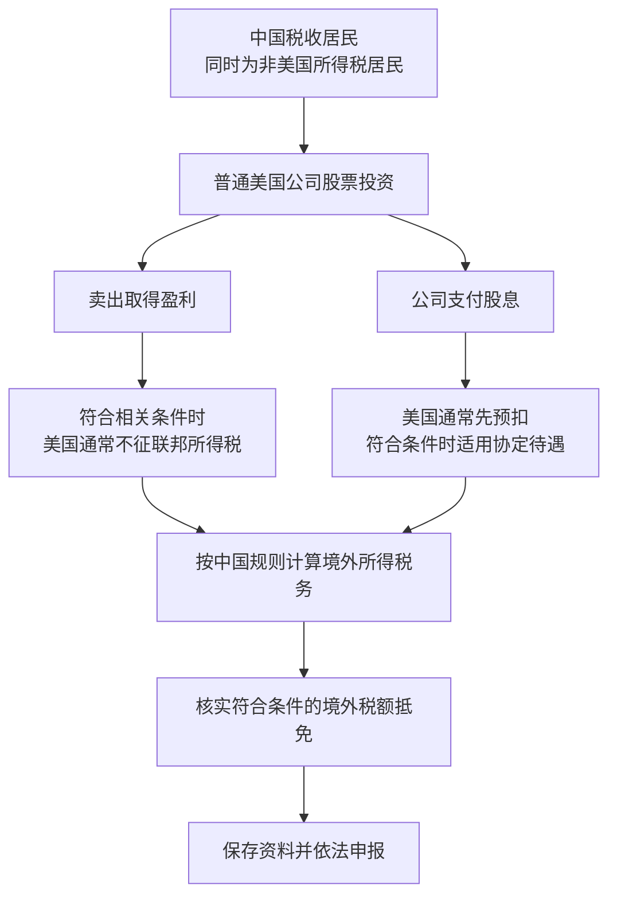

# 第七章｜中国居民投资美股，到底需要交哪些税？

*Chapter 7: Taxes on U.S. Stock Investments for Chinese Tax Residents*

修订：2026-10-14｜资料：2026-10-12

同一个证券账户，为什么卖股票时可能没扣税，收到分红时却少了一截？

看小许的两笔假设记录：一笔普通美国公司股票，10,000 美元买入、20,000 美元卖出；另一笔是 100 美元税前股息。他首先要做的不是把所有到账金额相加，而是区分**卖出盈利（Capital Gain）** 和**股息（Dividend）**。

下文假设小许长期生活在中国，属于中国税收居民，同时不是美国公民或美国所得税居民；投资的是普通美国公司股票。涉及移居、长期赴美、特殊产品时，要重新判断。所有金额是自拟算例，美元仅帮助理解比例，实际中国申报须按规定折算人民币。

## 卖出赚了 10,000 美元，账户没扣税就结束了吗？

在本章的典型情形下，非美国所得税居民当年实际在美国停留不足 183 天，相关收益不与在美国经营的业务构成有效关联，普通股票买卖资本利得通常不征美国联邦所得税。IRS 的非居民税务指南说明了这一规则及例外。[IRS：Publication 519，资本资产买卖](https://www.irs.gov/publications/p519)

例如，10,000 美元买入普通股票，20,000 美元卖出，产生 10,000 美元盈利。在上述条件成立时，这笔盈利的美国联邦所得税通常为零。

这里要特别区分：**“当年在美国不足 183 天”不等于“必然不是美国税务居民”。** 美国所得税居民身份还涉及绿卡等规则；实质居留测试一般会加权计算当年及前两年的在美天数。它与前面资本利得规则中的当年实际停留天数，不是同一个判断。[IRS：实质居留测试](https://www.irs.gov/individuals/international-taxpayers/substantial-presence-test)

因此，应先确认税务身份，再判断具体收益。美国不动产相关权益、合伙企业权益等特殊投资，也不能直接套用普通股票的结论。

中国个人所得税法规定，居民个人取得境内和境外所得，依照法律缴纳个人所得税。判断依据是税收居民身份，不能只看国籍、券商所在地或银行账户所在地。[国家税务总局：《个人所得税法》第一条](https://www.chinatax.gov.cn/n810219/n810744/n3752930/n3752974/c3970366/content.html)

转让境外企业股票取得的所得，通常涉及境外财产转让所得。其应纳税所得额一般为卖出收入减去财产原值和合理费用后的余额，财产转让所得适用 20% 的比例税率。[境外所得政策公告](https://12366.chinatax.gov.cn/bzds/081/081-5-7.html)、[《个人所得税法》第三、六条](https://www.chinatax.gov.cn/n810219/n810744/n3752930/n3752974/c3970366/content.html)

```text
卖出收入 − 财产原值 − 合理费用 = 应纳税所得额
应纳税所得额 × 20% = 按上述规则计算的税额
```

延续前例，假设忽略费用、汇率差异及其他调整，10,000 美元的盈利按 20% 计算，对应 2,000 美元的税额。这是理解比例的算例，不是直接以美元申报的结果，也不能据此自行假定全年所有交易盈亏都能相互抵扣。

**美国通常不征普通股票资本利得税，并不意味着中国税收居民的这笔境外收益天然免税。**

小许由此明白，券商显示的卖出款和自己最终能支配的税后收入不是同一个数字。他需要留好买入成本、卖出收入和费用记录，而不只保存一张盈利截图。

## 100 美元股息，先看预扣，再看抵免

美国公司向非居民投资者支付美国来源股息时，通常需要预扣美国税款。一般默认税率为 30%，符合税收协定条件时可能适用较低税率。[IRS：非居民税务指南，股息税务](https://www.irs.gov/publications/p519)

中美所得税协定第九条规定，符合协定条件的中国税收居民作为股息实益所有人，美国征收的税款原则上不得超过股息总额的 10%。这里的“实益所有人”，可以先理解为为自己取得这项收入的人。[IRS：中美所得税协定第九条](https://www.irs.gov/pub/irs-trty/china.pdf)

| 同一笔 100 美元普通股息 | 美国预扣 | 券商账户到账 |
|---|---:|---:|
| 按 30% 默认税率处理 | 30 美元 | 70 美元 |
| 符合条件并按 10% 协定税率处理 | 10 美元 | 90 美元 |

券商记录中的“Dividend Withholding Tax”，通常就是股息预扣税。10% 是本例美国这一端的处理，不是全球最终税负；也不能将它推广到所有 ETF 分配、REIT 分配或其他产品收入。

中国居民个人取得境外股息、红利所得，一般适用 20% 的比例税率，按收入额计算，而不是只看扣税后的到账金额。[《个人所得税法》第三、六条](https://www.chinatax.gov.cn/n810219/n810744/n3752930/n3752974/c3970366/content.html)

同时，中国允许符合条件的境外已缴所得税，在规定的抵免限额内抵免。其作用是将境外已经依法缴纳的税款纳入计算，减少同一所得的重复征税。[境外所得政策公告，第三至六条](https://12366.chinatax.gov.cn/bzds/081/081-5-7.html)

延续 100 美元股息的例子，假设投资者符合协定待遇，税款和凭证都满足抵免条件：

| 项目 | 简化金额 |
|---|---:|
| 税前股息 | 100 美元 |
| 按中国规则计算的税额：100 × 20% | 20 美元 |
| 美国已经依法预扣且符合抵免条件的税额 | 10 美元 |
| 在中国还需缴纳的税额：20 − 10 | 10 美元 |

这个例子说明的不是“每次分红都自动再扣 10%”，而是**先按中国规则算税，再核实境外税额能抵免多少**。

抵免须按规定申报并提供纳税凭证。错征、错缴或按税收协定不应征收的境外税款，不能简单全部拿来抵免。因此，发现预扣税率异常时，应先核对身份资料和税款性质。

这次记录让他注意到一个细节：申报时需要税前股息和预扣资料。如果只记“到账 90 美元”，后面就很难解释 100、10、90 三个数字之间的关系。

## W-8BEN 是账户资料，不是一张免税证明

W-8BEN 是个人使用的外国身份及相关预扣税声明表。对本章中的投资者，它主要帮助付款方确认：收入由非美国人士为自己取得，以及本人是否有资格主张税收协定待遇。

通常是在开户或税务资料更新时，向券商等扣缴义务人提供，而不是直接寄给 IRS。券商可能用电子流程收集对应信息。[IRS：W-8BEN 填表说明](https://www.irs.gov/instructions/iw8ben)

可以将它理解为“告诉对方应怎样识别我的税务身份和处理预扣税”。它不决定全部税务义务，也不会免除中国的境外所得申报。

填写时，要区分国籍、真实居住地址和税收居民身份。美国公民或美国所得税居民通常使用 W-9 等相应表格，不能仅因为人在境外，就沿用 W-8BEN。

按照一般规则，W-8BEN 自签署日起，通常有效至第三个后续日历年的最后一天。例如，2026 年签署的表格，一般有效至 2029 年 12 月 31 日。部分情形有不同有效期安排，应结合实际资料及券商要求确认。

如果情况变化导致表格信息不再准确，IRS 说明要求在变化后 30 天内通知相关机构，并提交新的 W-8BEN 或其他适当表格。[IRS：W-8BEN 有效期及情况变化](https://www.irs.gov/instructions/iw8ben)

所以，搬家、迁居或税务身份变化时，不应只等 App 提醒续期。账户信息需要随着真实情况更新。

## 把两笔收入放进同一份年度记录

卖出股票后，账户完整收到卖出款项，只说明该环节没有扣掉某项税。它不能证明本人在税收居民所在地没有税务义务。

券商按适用规则处理预扣和相关报告；中国居民个人就境外所得履行申报义务，是另一个环节。CRS 等账户信息交换安排，也不能替代个人申报。

境外所得政策公告规定，居民个人取得境外所得，应在取得所得的次年 3 月 1 日至 6 月 30 日内申报纳税。申报地点及抵免资料，应按公告和主管税务机关要求确认。[境外所得政策公告，第七至十条](https://12366.chinatax.gov.cn/bzds/081/081-5-7.html)

日常可以保存买卖记录、成本与费用明细、股息记录、税前金额和预扣税凭证。月结单有助于核对收入，但并不当然满足境外税收抵免的全部凭证要求。

假设投资收益继续留在海外券商，之后转到香港银行，或者用于境外消费。这个资金路径，本身不能证明所得不需要在中国申报。

对本章讨论的中国税收居民而言，应按适用规则判断境外所得，不能仅以“钱有没有汇回来”为依据。中国对居民个人境内外所得的基本规定，与资金最终存放在哪里，是两个问题。[《个人所得税法》第一条](https://www.chinatax.gov.cn/n810219/n810744/n3752930/n3752974/c3970366/content.html)

前几章建立的是资金地图：钱怎么赚、存在哪里、通过什么渠道投资和使用。本章补上税务地图：

| 地图 | 要回答的问题 |
|---|---|
| 资金地图 | 收入从哪里来，账户怎样连接，钱如何进出？ |
| 税务地图 | 自己是哪类税收居民，取得什么收入，哪里征税，怎样申报和抵免？ |

知道资金怎么流动，还要知道对应收入怎样记录和处理，个人金融体系才完整。



这张图对应本章的典型场景，不覆盖特殊产品和身份。遗产税则是长期持有与继承的另一条问题线，不能与每年的收入税混算。

## 持有时间更长，还要考虑继承

资本利得和股息属于生前收入问题；资产如何传给继承人，还可能涉及遗产税。

对于非美国公民、且不是美国遗产税居民的人，美国公司股票是典型的美国所在地资产。即使通过海外券商或名义持有人持有，也不会仅因券商在境外就改变这一属性。[IRS：非居民持有美国资产的遗产税说明](https://www.irs.gov/individuals/international-taxpayers/some-nonresidents-with-us-assets-must-file-estate-tax-returns)

这里的“遗产税居民”以去世时的住所（domicile）等事实判断，与所得税居民的测试不同。不能因为填写过 W-8BEN，就认为遗产税身份和处理也已解决。[IRS：非居民遗产税问答](https://www.irs.gov/businesses/small-businesses-self-employed/frequently-asked-questions-on-estate-taxes-for-nonresidents-not-citizens-of-the-united-states)

IRS 说明，相关非居民去世时，美国所在地资产的公允价值超过 60,000 美元，遗产执行人需要提交 Form 706-NA；相关应税赠与等因素也可能影响申报判断。实际应纳遗产税，还涉及资产范围、扣除、抵免及适用协定。

**60,000 美元是重要的申报门槛，不能简化成“账户超过六万美元，现在就收税”，也不能套用一个最高税率计算全部资产。** 这是继承安排的问题，值得在资产规模增加后单独考虑。

中美所得税协定影响股息等所得的处理，不能直接当作遗产税协定使用。截至本章核对日期，IRS 公布的具有遗产税或赠与税条款的协定国家名单中，不包括中国。[IRS：遗产税与赠与税协定名单](https://www.irs.gov/businesses/small-businesses-self-employed/estate-gift-tax-treaties-international)

因此，长期资产安排除了考虑收益，还需要理解实际持有的是哪类证券、由什么地区的实体发行，以及本人适用什么身份和规则。

同样在美国市场交易的产品，法律性质未必相同。基金注册地、发行实体和资产所在地等因素可能影响分析，不能只看交易所、计价货币或券商品牌。

这一章里，小许没有记住所有税法条文，却知道自己该留下什么：税务身份、交易成本、税前收入、预扣凭证和申报记录。遇到自己的情况超出上述假设时，也能带着具体材料向主管税务机关或专业人员确认。

下一章：[普通人值得长期关注的全球优质资产](08-美股市场：标普500与纳斯达克.md)。

---

金额与人物为假设，不是个人报税结果。适用身份、协定、费用、汇率和抵免凭证会影响实际处理；[来源索引](../参考资料/来源索引.md)。
