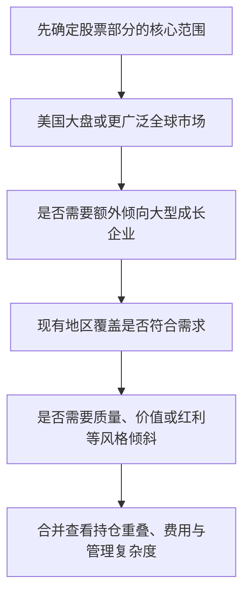
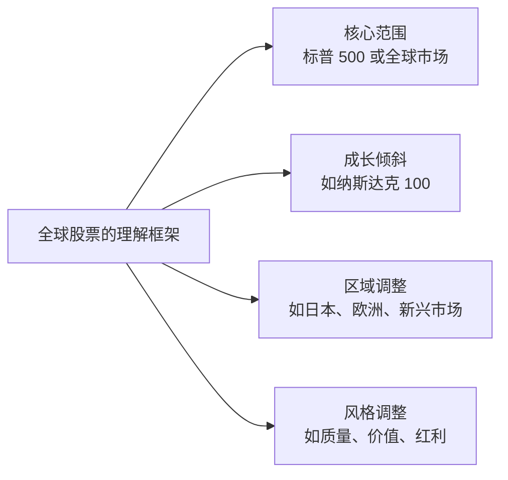

# 第八章｜普通人值得长期关注的全球优质资产

*Chapter 8: Global Assets Worth Understanding for Long-Term Investing*

更新与资料核对日期：2026-10-12

前几章已经讨论了投资渠道、证券账户和税务。接下来，问题从“能不能买、通过哪里买”转向“这些资产分别值得怎样理解”。

海外投资的范围远大于美股，美国股票也远不止纳斯达克里的公司。对于普通投资者，没有必要研究全球几十个国家和数以万计的产品。先认识美国核心资产、成长资产、全球与区域资产，以及不同风格的股票，就能建立一张实用的投资地图。

本章沿用这些资产的常见市场基准，着重说明它们在组合中承担什么角色。标题中的“优质”，指值得理解的企业资产与投资方向，并不意味着任何价格都值得买，或未来收益有保证。

## 一、标普 500：理解美国大型企业的核心入口

标普 500 包含约 500 家具有代表性的美国大型公司，是观察美国大盘股票的重要基准。它覆盖多个行业，不只包含科技公司，也包含金融、工业、消费、医疗和能源等企业。[S&P DJI：标普 500](https://www.spglobal.com/spdji/en/indices/equity/sp-500/)

其中不少企业的业务遍布全球。因此，这类资产的长期表现，既与美国经营环境有关，也受到全球客户需求和企业竞争力影响。它可以作为理解美国大型企业整体盈利能力的入口，常被用于股票组合的核心部分。

但“覆盖很多公司”与“每家公司权重一样”是两回事。标普 500 按自由流通市值加权，大公司对指数的影响更大，头部企业仍可能占据较高权重。[S&P DJI：美国指数编制方法](https://www.spglobal.com/spdji/en/methodology/article/sp-us-indices-methodology/)

所以，持有标普 500 可以减少只押注一家公司的风险，却仍然承担美国股票市场和头部公司的共同风险。“核心”描述的是组合中的角色，不代表价格稳定或不会出现大幅回撤。

## 二、纳斯达克 100：更偏向大型成长与创新企业

纳斯达克 100 包含在纳斯达克上市的约 100 家大型非金融公司，科技和消费等领域在其中具有重要影响。它也可能包含美国以外的公司，并不是按“美国科技公司”这一标签简单选股。[Nasdaq：纳斯达克 100 官方介绍](https://www.nasdaq.com/newsroom/what-is-the-nasdaq-100-guide-to-one-of-worlds-most-watched-indexes)

可以先用下面的区别理解两者：

| 观察角度 | 标普 500 | 纳斯达克 100 |
|---|---|---|
| 主要范围 | 美国大型公司，覆盖多个行业 | 纳斯达克上市的大型非金融公司 |
| 常见组合角色 | 美国大盘股票的核心部分 | 对大型成长与创新企业增加配置 |
| 需要关注 | 市场整体风险与头部公司权重 | 行业、头部公司和估值的集中风险 |

表中的“成长增强”是理解组合角色的方式，不是指数编制规则中的正式因子分类。纳斯达克 100 与严格按成长指标选股的成长因子指数，也不能直接画等号。

当大型成长企业盈利和估值同时上升时，这类资产可能表现突出；科技估值收缩或市场偏好转向时，也可能承受更明显的波动。过去跑得更快，不能证明未来始终领先。

因此，增加纳斯达克 100，更接近对某类企业和行业的主动倾斜。决定之前，要看自己已有多少相似资产，而不只是比较过去的收益曲线。

## 三、不想预测哪个国家胜出，可以关注全球市场

投资者不一定要长期判断美国、日本还是欧洲表现最好。另一种思路，是通过覆盖多个市场的组合，让各地区的企业共同参与自己的资产收益。

MSCI 的几个常见全球基准，可以帮助理解覆盖范围：

| 基准 | 市场范围 | 公司规模范围 |
|---|---|---|
| MSCI World | 发达市场 | 大盘与中盘 |
| MSCI ACWI | 发达市场和新兴市场 | 大盘与中盘 |
| MSCI ACWI IMI | 发达市场和新兴市场 | 大盘、中盘与小盘 |

World 的名字虽然含有“世界”，但不包含新兴市场；ACWI 范围更广，ACWI IMI 再进一步纳入小盘股。它们都按明确规则覆盖可投资市场，不意味着全球每一家企业都被纳入。[MSCI World](https://www.msci.com/indexes/index/990100/msci-world-index)、[MSCI ACWI](https://www.msci.com/indexes/index/892400/msci-acwi-index)、[MSCI ACWI IMI](https://www.msci.com/indexes/index/664204/msci-acwi-imi-index)

这些基准通常按自由流通市值分配权重，而不是让每个国家平均占一份。美国在全球股票市值中占比较大，因此全球组合仍可能高度受美国市场影响。[MSCI ACWI：指数资料](https://www.msci.com/documents/10199/255599/msci-acwi.pdf)

这种方式可以减少自己判断国家轮动的需要，却不会消除全球股市共同下跌的风险。广泛覆盖与低风险，是两个不同维度。

## 四、日本：理解另一套企业与产业结构

日本拥有汽车、工业制造、精密设备、消费品牌和半导体产业链等领域的企业。认识日本市场，可以帮助投资者把视野从美国大型科技公司扩展到另一套产业结构。

日经 225 是日本常见的股票市场基准，由东京证券交易所 Prime Market 的 225 只股票组成。它采用价格加权方法，并不是简单按公司总市值大小分配权重。因此，看日本资产时也要注意，具体基准代表的企业范围和权重安排是什么。[Nikkei：日经 225 指数说明](https://indexes.nikkei.co.jp/en/nkave/index/profile?idx=nk225)

日本市场可能为组合提供区域和产业上的差异，但这种差异不保证在美国股票下跌时，它一定上涨。两个市场仍可能受到同一轮全球经济变化的影响。

另外，最终收益还可能受到日元汇率影响。延续[第二章](../01-第一篇｜先看懂全球金融地图/02-赚美元、持有美元与美元资产.md)的思路，假设资产没有做汇率对冲，并忽略费用：

```text
日元计价的资产收益：+10%
每日元可兑换的人民币金额变化：−10%

人民币计价收益
= (1 + 10%) × (1 − 10%) − 1
= −1%
```

这个自拟算例说明，资产涨幅和汇率变化需要相乘计算，不能简单相加。基金用美元报价，也不当然意味着日元风险已经消失；是否对冲，要看具体产品安排。

## 五、欧洲：观察与美国不同的企业组合

欧洲拥有工业、金融、医药、能源、半导体设备和消费品牌等领域的企业。它提供的价值，是让投资者接触到与美国大型成长公司不同的地区和业务结构。

STOXX Europe 600 覆盖欧洲 17 个国家的 600 家公司，是观察欧洲股票的重要宽基基准。它包含多个行业，范围也不限于欧元区；欧洲资产不能统一理解为只有欧元这一种货币风险。[STOXX：Europe 600](https://stoxx.com/index/SXXP/)

配置欧洲资产，不需要以“欧洲一定会跑赢美国”为前提。更实际的问题是：加入之后，自己的地区、行业和企业来源是否有所变化？

不过，换一个地区并不等于完全换掉风险。欧洲也有科技企业，日本也可能高度暴露于半导体；不同地区的公司还可能共同依赖全球消费和投资需求。具体能分散多少，仍要查看所持产品的底层资产。

## 六、基金很多，为什么仍可能不够分散？

假设同时持有标普 500、纳斯达克 100、美国科技、AI 和半导体等五类基金。虽然名称不同，主要持仓可能反复出现同一批大型公司。

这时，产品数量增加了，承担的风险却可能仍集中于同一类企业。判断分散程度，应看公司、行业、地区、货币及投资风格，而不是只数基金代码。

可以用一个自拟算例理解持仓重叠：两只基金各占组合的 50%，某家公司在第一只基金中占 10%，在第二只中占 20%。那么，该公司对整个组合的权重为：

```text
50% × 10% + 50% × 20% = 15%
```

这不是任何实际基金的当前权重，只说明看组合时需要把重复持仓合起来。

同样，全球指数已经包含日本、欧洲和新兴市场时，再单独加入这些地区，主要是在增加它们的比重。这样做可以有理由，但不能把已有部分又当成完全新增的分散。

## 七、除了国家，还可以按照“因子”理解股票

国家划分回答“企业主要属于哪个市场”；因子投资则回答“我偏好什么特点的股票”。

这些特点可以是盈利质量、估值、分红、波动或价格趋势。通过规则选择这些股票，就会让组合相对普通市场基准产生某种风格倾斜。[MSCI：因子投资说明](https://www.msci.com/research-and-insights/blog-post/what-is-factor-investing)

| 因子 | 通俗理解 | 容易产生的误解 |
|---|---|---|
| Quality：质量 | 偏向盈利能力、利润稳定性和财务结构较好的企业 | 好公司在任何价格都值得买 |
| Value：价值 | 相对于盈利、净资产或现金流等指标，偏向估值较低的股票 | 股价低就是便宜 |
| Dividend / Yield：红利 | 偏向较高股息及可持续分红等特征 | 股息率越高越好 |
| Low Volatility：低波动 | 通过规则寻求较低波动的股票或组合 | 低波动就是保本 |
| Momentum：动量 | 偏向一段时间内价格表现较强的股票 | 最近涨得好，之后就一定继续涨 |

这张表只是帮助建立直觉。各指数选股、加权和调整方式不同，低波动策略也可能从整个组合的风险关系出发，而不是只挑历史波动最小的股票。[MSCI：因子指数分类](https://www.msci.com/indexes/category/factor-indexes)

因子表现会经历周期，可能长期落后于普通市场基准。增加因子，应当能解释希望改变什么，而不是因为又发现了一个听起来不错的基金名称。

## 八、质量因子：赚钱能力与买入价格要一起看

质量因子容易理解，因为它接近普通人对“好企业”的直觉：能赚钱，盈利相对稳定，财务负担合理。

以 MSCI 的质量指数方法为例，常见衡量包括较高的净资产收益率（ROE）、较稳定的年度盈利增长，以及较低财务杠杆。[MSCI：质量与高股息指数](https://www.msci.com/indexes/factor-indexes/quality-and-high-dividend-yield-indexes)

但财务质量较好，不等于未来股价必然上涨。如果市场已经为这家公司支付了很高的价格，即使业务继续发展，投资收益也可能不理想。

还需要注意，质量策略可能与现有宽基或成长资产持有相同公司。“质量”两个字，本身不能证明组合新增了一种独立的风险来源。

## 九、价值与红利：从另一种风格看企业

价值策略关注价格相对于企业基本面的高低。常见方法会参考市净率、预期市盈率或企业价值与现金流等指标，而不是只看一股卖多少钱。[MSCI：美国增强价值指数](https://www.msci.com/indexes/index/705973/msci-usa-enhanced-value-index)

红利策略则关注向股东分配现金的特征。不同规则可能强调股息率、持续分红或支付能力。高股息率有时也来自股价大幅下跌，所以需要区分“分红较多”与“分红是否可持续”。MSCI 的高股息策略也包含可持续性等筛选。[MSCI：质量与高股息指数](https://www.msci.com/indexes/factor-indexes/quality-and-high-dividend-yield-indexes)

这些策略可能增加金融、能源、公用事业或成熟企业的比重，但具体行业分布要看规则和当时持仓。价值、红利和成长之间也可能重叠，不能只按名称把它们当成彼此独立的资产。

因子的意义，是让组合具有自己理解并愿意承担的风格差异。对于普通人，并不需要把每一种因子都买齐。

## 十、新兴市场：增长故事之外，还要看投资条件

印度、东南亚、拉丁美洲及其他新兴市场，提供了不同的企业和经济发展路径。但“经济增长快”不能直接推导为“股票回报一定高”。

投资者的收益还与买入估值、上市公司的盈利分配、汇率、政策和公司治理等因素有关。一个被广泛看好的增长故事，也可能早已反映在价格中。

对于已经持有 ACWI 等广泛全球组合的人，新兴市场本来就是其中一部分。是否再增加某个国家，应理解为额外的区域倾斜，而不是完成全球配置必须做的一步。

先看已有覆盖，再判断是否需要增加，通常比不断收集热门国家的基金更容易管理。

## 十一、全球资产还包括股票之外的部分

股票代表企业权益，完整的资产组合还可能涉及债券、黄金、房地产、基础设施和现金管理。它们各自提供不同的收益来源，也有不同的风险。

| 资产方向 | 主要理解角度 | 需要区分的风险 |
|---|---|---|
| 美国国债等债券 | 利息与本金偿付 | 信用、利率、通胀与汇率；国债信用保障不等于价格不波动 |
| 黄金 | 贵金属价格及货币环境 | 价格波动；本身不产生企业利润或固定利息 |
| 房地产与 REITs | 租金、资产经营或其他房地产业务 | 空置、融资、利率和具体业务风险 |
| 基础设施资产 | 电网、交通、管道等经营活动 | 需求、监管、融资与项目风险 |
| 现金和货币市场资产 | 流动性与短期资金管理 | 具体产品的信用、费用和通胀影响 |

美国可交易国债有美国政府信用支持，但债券及债券基金仍要理解利率变化对价格的影响。长期债券基金不能只凭“美债”两个字当成现金使用。[TreasuryDirect：可交易国债](https://www.treasurydirect.gov/marketable-securities/)、[Investor.gov：债券基金风险](https://www.investor.gov/introduction-investing/investing-basics/glossary/bond-funds-and-income-funds)

REITs 的业务也并不完全相同，有些持有经营物业，有些投资房地产贷款等资产，风险需要分别理解。[Investor.gov：上市 REITs](https://www.investor.gov/introduction-investing/general-resources/news-alerts/alerts-bulletins/investor-bulletins-65)

这些方向本章先保留位置。具体用什么产品持有，以及费用、期限和税务如何影响结果，将在后续章节继续展开。

## 十二、用四个问题组织全球股票资产

原稿中的四层结构，可以转换成四个按顺序考虑的问题：



这四个问题不要求对应四只基金。一个广泛的全球组合，可能已经满足地区覆盖的需要；也可以决定不增加成长或因子倾斜。



第二张图中的分类会重叠，是理解组合角色的框架，不是四类互不相关的资产，也不是建议比例。

少量行业或主题观点，可以在明确核心之后再考虑。如果不断因为看好 AI、电网或某个国家而增加产品，却不知道整体覆盖和重复持仓，最终容易得到一组零散观点，而不是自己能解释的资产组合。

## 本章要点

普通人认识全球资产，可以先从标普 500、纳斯达克 100、全球市场、日本和欧洲，以及质量、价值、红利等投资风格建立地图。重点是理解各自提供什么覆盖，而不是寻找一个永远领先的市场。

分散程度取决于底层企业和风险来源。全球组合可能仍有较高美国比重，区域和因子产品也可能与已有持仓重叠。股票之外的资产，则需要从不同的收益机制继续理解。

有了这张地图，再选择持有工具会更清楚。下一章将讨论：[知道想买什么之后，到底应该买哪个产品？](09-VOO、QQQ、美债与美元资产工具.md) 从同类指数产品的差异，扩展到全球股票、美债、黄金与美元现金管理工具。 产品选择还要与前面讨论的渠道、账户和[税务](07-中国居民投资美股税务.md)衔接。

---

本章依据第八讲已整理的公开版成稿润色，保留全球资产、区域分散与风格因子的主线。框架用于理解组合，不给出适用于所有人的配置比例。指数范围及方法按官方资料核对，具体权重、成分与产品条件可能变化。完整出处见[来源索引](../参考资料/来源索引.md)。
