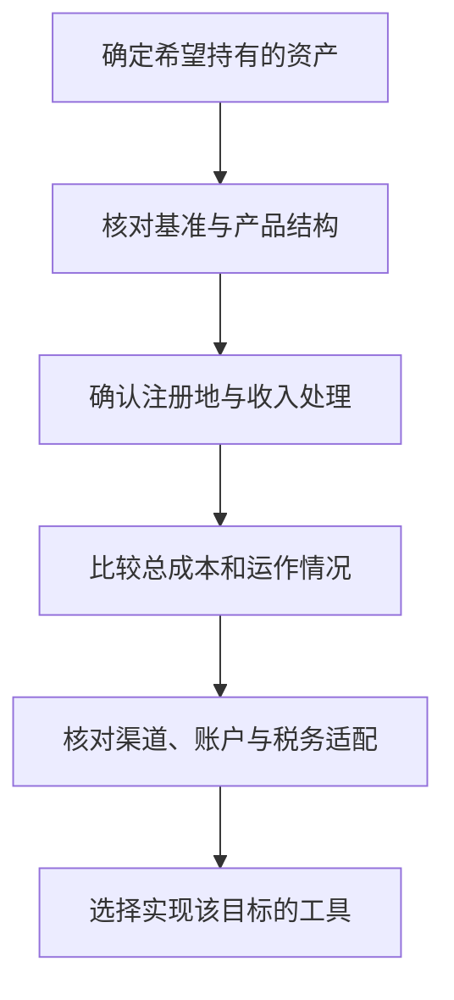

# 第九章｜知道想买什么之后，到底应该买哪个产品？

*Chapter 9: Choosing Products to Hold Global Assets*

修订：2026-10-14｜资料：2026-10-12

假设小许已经确定：这笔长期资金需要广泛股票覆盖，而不是再押一个热门行业。打开券商后，他却看见了许多相似代码。

这时最有用的动作，是把需求写在代码前面：**我想持有什么资产，通过什么可用渠道，准备怎样长期持有？** 下面的产品都是用来比较差异的例子，不需要买齐。

## 先筛选：需求、渠道和产品能否对得上

| 判断顺序 | 要回答的问题 |
|---|---|
| 底层资产 | 跟踪什么基准，包含哪些市场和公司规模，是否使用杠杆？ |
| 法律结构 | 注册在哪里，属于基金、信托还是其他证券结构？ |
| 收入处理 | 分配型还是累积型，是哪个份额类别？ |
| 总成本 | 年费率、价差、交易与换汇费怎样共同影响持有？ |
| 运作与流动性 | 运作历史、规模、跟踪表现和实际可成交情况如何？ |
| 账户与税务适配 | 自己能否通过适用渠道购买，持有和卖出如何处理税务？ |

资产、结构和账户条件应一起确认。税务问题也应在购买前判断，而不是等下单后才看。



小许先排除自己不能通过适用渠道购买、底层资产不符合目标的产品，再进入成本比较。如此一来，许多“热门代码”根本不需要加入候选名单。

## 同一指数，先比较真正会用到的差异

VOO、IVV、SPY 都以跟踪标普 500 为目标。对长期持有人，成本与账户适配值得先看；频繁交易或有期权需求的人，还会关心价差和相关市场。同样，QQQ 与 QQQM 都跟踪纳斯达克 100，但持有成本和交易特点不同。

| 产品例子 | 指数方向 | 年费率快照 | 用来比较什么 |
|---|---|---:|---|
| VOO、IVV | 标普 500 | 均为 0.03% | 同类低成本工具与账户适配 |
| SPY | 标普 500 | 0.0945% | 自己是否需要相应交易与期权功能 |
| QQQ、QQQM | 纳斯达克 100 | 0.18%、0.15% | 交易需要与持续持有成本 |
| CSPX | 标普 500 | 0.07% | 爱尔兰 UCITS 结构及累积型安排 |

以上保留 2026-10-12 核对的发行方资料快照，VOO 使用其中的 2026-06-30 资料；费率可能变化，也不包括个人全部税费。下单前重新查阅：[VOO](https://workplace.vanguard.com/assets/corp/fund_communications/pdf_publish/us-products/fact-sheet/F0968.pdf)、[IVV](https://www.ishares.com/us/products/239726/ishares-core-sp-500-etf)、[SPY](https://www.ssga.com/us/en/individual/etfs/state-street-spdr-sp-500-etf-trust-spy)、[QQQ 与 QQQM](https://www.invesco.com/us/en/insights/building-versatile-portfolios-qqq-innovation-suite.html)、[CSPX](https://www.ishares.com/uk/individual/en/products/253743/CSSPX)。

以假设全年固定持有 10,000 美元计算，0.18% 与 0.15% 对应约 18 美元和 15 美元。小许先看懂差额，再判断是否值得为此改变交易安排，而不是只凭较低费率立即下单。

## 注册地和收入处理，决定另一组差异

基金注册地、上市交易所和底层资产所在市场不同。爱尔兰注册的基金，也可能在伦敦用美元交易、主要持有美国股票。**UCITS** 是欧洲基金监管框架，不是一种资产类别，也不是个人统一免税的标签。[欧盟委员会：UCITS](https://finance.ec.europa.eu/financial-markets/financial-markets-policy/investment-funds_en)

具体影响需要分两层：资产向基金支付收入时怎样处理，个人持有份额、取得分配或卖出时怎样处理。相关税务和继承问题见[第七章](07-中国居民投资美股税务.md)，不能只凭券商所在地判断。

**分配型（Distributing）** 按产品安排发放现金，**累积型（Accumulating）** 把相关收入留在基金内再投资。例如，CSPX 属于所列的累积型份额。它减少了手动再投资，但不意味着整个过程没有税款或申报问题。

交易代码也不是全球唯一身份。同一份额可能在不同交易所使用不同代码或币种，购买前核对完整名称、交易所、币种和 ISIN。比较分配型与累积型回报时，别漏掉已经发给持有人的现金。

## 比较总成本，不要只盯着年费率或每股价格

比较年费率时，可以先换算成金额。假设全年持有额固定为 10,000 美元，0.03% 与 0.10% 的年费用约为 3 美元和 10 美元，相差 7 美元。这是量级演示，不是实际账户收益。

长期费用会积累，但换仓也可能发生佣金、买卖价差、换汇和税务成本。基金费用通常已影响净值与公布回报，不应重复扣除；比较历史表现时，要统一包含分红的总回报口径。

一只基金每股 800 美元，另一只每股 100 美元，不能据此判断第一只的底层资产贵八倍。

假设两种份额都对应 80,000 美元资产，分别切成 100 份和 800 份，就得到 800 美元和 100 美元的单位净值。单份价格主要与划分方式有关；真正的估值，要看底层资产与买入价格。

交易时还要看市价相对净值的折溢价。支持碎股的账户可以降低单份价格带来的门槛，但功能与规则应按券商要求核对。

比如，小许发现两个符合条件的工具只差很小的年费用，就会继续比较自己的交易频率、换汇和转出成本。已经持有的产品，也不必只因看到更低费率就立即换仓。

## 换一种资产目标，筛选问题也跟着变

**想覆盖全球股票，先看范围。**

VT 与 VWRA 都是全球股票产品，但它们并不是同一个指数的两个版本。

| 产品 | 跟踪基准 | 主要股票规模范围 | 收入处理 |
|---|---|---|---|
| VT | FTSE Global All Cap | 大盘、中盘与小盘 | 分配型 |
| VWRA | FTSE All-World | 大盘与中盘 | 累积型 |

两者都覆盖发达和新兴市场，区别还包括基金结构、股票范围、费用和上市安排。VT 的资料为 2026-06-30；VWRA 的范围和结构按官方页面核对。[Vanguard：VT 资料](https://workplace.vanguard.com/assets/corp/fund_communications/pdf_publish/us-products/fact-sheet/F3141.pdf)、[Vanguard：FTSE All-World 累积型](https://www.vanguard.co.uk/professional/product/etf/equity/9679/ftse-all-world-ucits-etf-usd-accumulating)

它们体现的是让多个市场共同参与组合的思路，不需要自己逐一预测国家赢家。但全球覆盖并不意味着每个国家平均分配，也不消除全球股票共同下跌的风险。

如果全球基金已经包含日本和欧洲，再买对应地区产品，主要是在提高该地区的组合比重。

例如，假设全球基金内日本权重为 5%，组合中有 80% 全球基金、20% 日本基金，那么日本的整体权重约为：

```text
80% × 5% + 20% × 100% = 24%
```

这是自拟算例，不是任何基金的实际当前权重。它说明“全球基金加日本基金”，是在表达额外偏好。

国家、行业与因子基金，都可以按这个方法合并查看底层覆盖。它们是否需要加入，应由组合目标决定，而不是为了收集更多市场。

**想安排美元资金，先看期限。**

美国国债具有较高信用质量，但不同期限的美债产品，价格表现可能差别很大。

| 产品示例 | 主要国债期限范围 | 主要理解角度 |
|---|---|---|
| SGOV | 0—3 个月 | 短期美元资金管理，利率敏感度较低 |
| IEF | 剩余期限 7—10 年 | 中期国债配置，价格会受到利率变化影响 |
| TLT | 剩余期限超过 20 年 | 长久期国债配置，对长期利率更敏感 |

范围按发行方资料核对。产品持仓会更新，“7—10 年”或“20 年以上”描述的是所投资债券的期限，并不是投资者买入基金后等待这些年就自动到期。[iShares：SGOV](https://www.ishares.com/us/products/314116/ishares-0-3-month-treasury-bond-etf)、[iShares：IEF](https://www.ishares.com/us/products/239456/ishares-710-year-treasury-bond-etf)、[iShares：TLT](https://www.ishares.com/us/products/239454/ishares-20-year-treasury-bond-etf)

SGOV 可以被理解为短期美元资金的“停车场”之一，但它仍是证券产品，涉及交易、结算、费用和汇率，并不是银行存款，也不等于货币市场基金。

长期美债则不能当作高利率版本的存款。市场利率上升时，其价格可能明显下跌；利率下降时，也可能上涨。债券信用质量高，与基金价格稳定是两个问题。

债券产品页面可能同时列出 SEC 收益率、过去分配收益率和历史总回报。它们回答不同问题，不能混用，更不能把其中一个数字当成未来一年保证到手的收益。

投资者除了问“现在产生多少收入”，还需要问“价格会怎样受利率变化影响”。基金公布的有效久期，可以帮助理解利率敏感度，但它也会变化。

比较总回报时，应同时计入价格变化和收入。即使收到利息，卖出时仍可能亏损；债券基金也没有普通单只债券那样统一的本金到期日。[Investor.gov：债券基金风险](https://www.investor.gov/introduction-investing/investing-basics/glossary/bond-funds-and-income-funds)

**想取得黄金敞口，先看持有的权利。**

IAU、GLDM 都提供与所持黄金价格相关的暴露。通过证券账户买卖，可以减少自行采购、保管和回收金条的操作。

但它们采用黄金信托结构，不能把所有股票 ETF 的监管与税务结论原样套用。发行方也说明，这些信托不是按美国《1940 年投资公司法》注册的投资公司。[iShares：IAU](https://www.ishares.com/us/products/239561/ishares-gold-trust-fund)、[State Street：GLDM](https://www.ssga.com/us/en/individual/etfs/spdr-gold-minishares-gldm)

证券份额与自己持有实物金条，使用方式不同；普通小额持有人也不应假定能直接提取金条。需要看保管、赎回和费用条款。

此外，黄金价格产品与金矿公司股票产品提供的暴露不同。后者还涉及企业经营、成本和管理风险，不能仅凭名称都有“黄金”就当成同类工具。

到这里，小许可以留下一张简短的选择记录：目标资产、候选产品、选择理由、总成本，以及尚需核实的税务和账户条件。产品名称以后可能变，判断顺序仍然能用。

下一章：[普通人的全球资产组合，到底应该怎么搭？](10-普通人的全球资产组合.md) 从“用什么买”转向“这笔钱该怎样分”。

---

小许为假设人物。费率保留注明日期的官方快照，交易前须复核；金额、权重与份额价格算例为自拟。完整出处见[来源索引](../参考资料/来源索引.md)。
