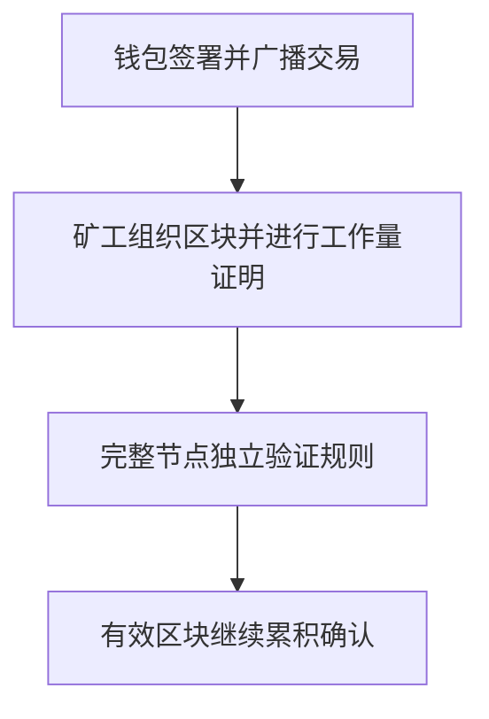

# 第十一章｜比特币到底是什么？为什么有人认为它有价值？

*Chapter 11: Understanding Bitcoin and Its Sources of Value*

修订：2026-10-14｜资料：2026-10-13；历史案例补充核对：2026-10-14

同样谈起 Bitcoin，有人说它是“数字黄金”，有人说它只是昂贵的代码。两边都很有把握，初学者反而不知道从哪里判断。

可以先抓住分歧的中心：**它怎样在没有一家统一记账公司的情况下转移资产，人们为什么愿意持有它，而这个理由值多少钱？** 前两个问题可以研究，最后一个没有公认的标准答案。

2010 年 5 月，论坛用户 laszlo 做过一次具体尝试：提出用 10,000 BTC 换两张披萨。几天后还没人接单，他追问是否报价太低；5 月 22 日，他在原帖确认交易完成。[当事人原帖](https://bitcointalk.org/index.php?topic=137.0)

从这个过程看，当时的难题很实际：能不能找到一个愿意接受这些币、替他提供现实商品的人？与其用今天的价格替他后悔，不如顺着这个问题理解：网络怎样让交换成立，市场又怎样形成价格。

## 一笔数字资产，怎么防止被花两次？

发一张照片给别人，自己还留着副本。数字支付如果也能这样复制，同一笔钱就可能同时付给两个人。这叫**双花（Double Spending）**。

银行通过自己的账簿和相关结算安排核对付款。比特币尝试让互不认识的参与者按照公开规则验证记录。2008 年 10 月 31 日，使用“中本聪”这一名字的作者发布白皮书，讨论无需可信第三方的点对点电子现金；网络于 2009 年开始运行。[白皮书发布邮件](https://www.metzdowd.com/pipermail/cryptography/2008-October/014810.html) · [比特币白皮书](https://bitcoin.org/bitcoin.pdf)

它诞生于金融危机期间，但不能只凭时间接近，就替作者补出全部动机。白皮书直接提出的，是数字支付中的信任和重复支出问题。

对普通读者，网络机制先理解到这里就够用了：

签名证明支出授权；矿工投入计算资源组织区块；完整节点检查交易与区块是否有效。矿工不能仅凭算力把违反规则的新增发行变成有效币。**工作量证明（Proof of Work）** 提高了改写历史记录的成本，但不意味着任何条件下都绝对无法重组。[Bitcoin 开发者指南](https://developer.bitcoin.org/devguide/block_chain.html)

这套网络没有一家“比特币公司”替所有人记账。现实中的交易平台、矿池和托管服务却仍可能集中；网络的特征不能直接当成每家服务商的保证。

## 2100 万枚，能说明什么，又不能说明什么？

按现行主网规则，初始区块补贴为 50 BTC，每经过 210,000 个区块减半。递减发行形成通常所说的约 2,100 万枚上限。减半按区块高度发生，不按固定日历发生；矿工收入还包括交易手续费。[Bitcoin Core：主网参数](https://github.com/bitcoin/bitcoin/blob/master/src/kernel/chainparams.cpp) · [补贴规则](https://github.com/bitcoin/bitcoin/blob/master/src/validation.cpp)

1 BTC 可以分为一亿聪（satoshi），所以不需要整枚使用。发行上限也不等于实际可流通数量，密钥丢失等情况会影响可支配数量。[Bitcoin.org：常见问题](https://bitcoin.org/en/faq)

支持者看重的是可验证的稀缺规则：不必相信某家公司声称“以后不会随意增发”，可以检查网络实际执行什么。

但把数量写得很少，并不能让一个东西自动值钱。还需要有人愿意持有、使用，并付出价格。**供应受约束，是一个机制；价格持续上涨，是另一个尚待市场证明的判断。**

## 价值争议，究竟争在哪里？

“代码可以复制，为什么这个网络有价值？”这句话问到了技术与市场之间的连接。复制程序并不难，复制原有网络的交易历史、用户、流动性和共同认可，却不是同一件事。

| 讨论的问题 | 支持者看重什么 | 仍然需要回答什么 |
|---|---|---|
| 稀缺性 | 发行规则可验证 | 未来需求是否足够，当前价格是否过高 |
| 转移与控制 | 可通过网络转移，自己管理签名权限 | 费用、安全、使用条件与纠纷怎样处理 |
| 网络认可 | 已有用户与交易基础设施 | 认可是否持续，会不会被竞争或政策改变 |
| “数字黄金” | 不依靠某家企业偿付，强调储值 | 波动很大，也没有黄金同样的历史和实物用途 |

股票可以从企业盈利、资产和现金流分析；债券通常有约定的支付义务。BTC 本身不承诺企业利润、利息或到期本金，市盈率和 ROE 无法直接套用。

这让估值更依赖对需求、市场结构和长期认可的判断，也使分歧难以用一张财务报表解决。认同技术价值的人，仍可能认为某个买入价格太高；不愿持有的人，也可以理解这项实验为什么值得研究。

把 BTC 交给平台“赚利息”，则额外加入了借贷、托管或其他安排。那笔收益不来自单纯持有 BTC 本身，需要继续看资金交给谁、怎样使用、谁承担损失。

## 买到相关产品，和自己持有 BTC 有什么不同？

2024 年 1 月，美国 SEC 批准部分现货比特币交易所交易产品上市交易，同时明确这不是对比特币本身的背书。这个历史节点改变了部分市场的产品入口，并没有回答“它一定值得买”。[SEC：现货比特币 ETP 批准声明](https://www.sec.gov/newsroom/speeches-statements/gensler-statement-spot-bitcoin-011023)

| 持有方式 | 自己面对的对象 | 主要多出什么责任或风险 |
|---|---|---|
| 自己管理密钥 | 可按链上规则支出的 BTC | 恢复资料、签名、错误转账与网络安全 |
| 留在交易或托管平台 | 按服务条款记录的余额或权利 | 平台经营、资产保管与提取条件 |
| 购买现货 ETP | 按产品安排持有 BTC 的证券份额 | 托管、费用、跟踪与证券交易安排 |
| 购买期货产品 | 通过期货形成的价格敞口 | 合约、展期与现货表现的差异 |

美国市场常称的“现货比特币 ETF”采用商品信托等结构，并非按《1940 年投资公司法》注册的普通股票 ETF。产品减少了自己管理私钥的操作，也引入了产品与托管安排；份额不能直接当钱包里的 BTC 转账。[Investor.gov：比特币与以太币 ETP](https://www.investor.gov/introduction-investing/general-resources/news-alerts/alerts-bulletins/investor-bulletins/ETPBulletinSeptember2024)

## 最后，回到自己的钱

比特币的风险不只来自价格，还来自密钥、平台、网络、诈骗和适用法律。对中国大陆读者，银发〔2026〕42 号通知明确其不具有与法定货币等同的法律地位，并限制相关业务与服务；2021 年旧通知同时废止。国外存在某种产品，不代表相关服务适用于自己。[中国人民银行等八部门：2026 年通知](https://www.pbc.gov.cn/tiaofasi/144941/3581332/2026020619591971323/index.html)

即使先只做纸面研究，也可以把风险算成金额。假设 BTC 占长期投资池的 5%，下跌 60%、其他资产不变，长期池减少 3%；如果占 20%，同样情景会减少 12%。这不是推荐仓位，也不是最大亏损，其他资产仍可能一起跌。

沿用[第十章](../02-第二篇｜真正进入海外证券市场/10-普通人的全球资产组合.md)的思路，生活现金与近期支出首先有自己的任务。“数字黄金”的称呼，不能把高波动资产变成应急金。

读懂 Bitcoin 后，不一定要得出“买”或“不买”的即时结论。能够分清网络机制、价值主张、购买价格和自己的承担能力，已经比只记住一条上涨故事更进一步。

下一章：[区块链、Ethereum 与 TRON](12-Ethereum、TRON与区块链网络.md)。从数字价值转移，继续看网络如何执行程序。

---

历史节点与机制见所列原始资料；仓位算例为假设，忽略未列费用和其他资产变化。[来源索引](../参考资料/来源索引.md)
