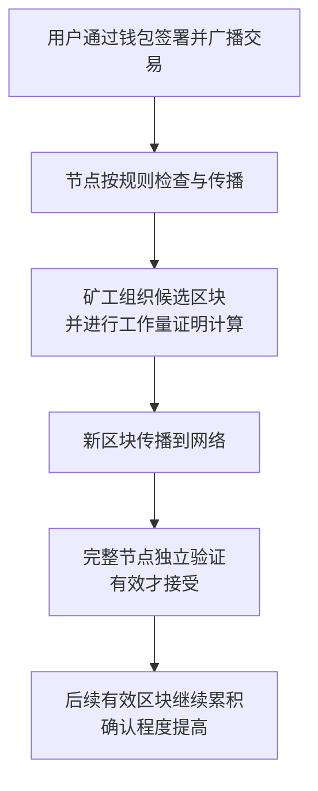

# 第十一章｜比特币到底是什么？为什么有人认为它有价值？

*Chapter 11: Understanding Bitcoin and Its Sources of Value*

更新与资料核对日期：2026-10-13

前十章讨论了银行、支付、券商、投资工具与资产配置。从本章开始，进入本书的第三篇：**Crypto 与链上金融**。

比特币（Bitcoin）是理解这一部分的起点。有人把它视为金融创新，也有人认为它只是没有价值的代码。要理解这些分歧，需要同时看三个问题：它试图解决什么，网络怎样运行，以及为什么有人愿意为它付出价格。

本章沿用原稿的普通读者视角，先介绍机制与价值判断，再讨论产品和风险。网络技术、市场价值与法律上的可用性，是需要分别理解的层面。

## 一、比特币诞生的背景：2008 年金融危机

比特币白皮书发布于 2008 年金融危机期间。当时金融机构的风险与政府救助，使人们更关注银行体系和货币制度中的信任问题。

2008 年 10 月 31 日，使用“中本聪”（Satoshi Nakamoto）这一名字的作者，在密码学邮件列表中公布了《Bitcoin: A Peer-to-Peer Electronic Cash System》，即《比特币：一种点对点电子现金系统》。2009 年，比特币网络开始运行。[白皮书发布邮件](https://www.metzdowd.com/pipermail/cryptography/2008-October/014810.html)

金融危机是理解这一时期的背景，但不能仅凭时间接近，就把作者的全部动机归结为金融危机。白皮书直接讨论的，是怎样实现不依靠可信第三方的点对点电子支付。[比特币白皮书](https://bitcoin.org/bitcoin.pdf)

## 二、它试图解决什么问题？

数字文件容易复制，一张照片可以发给很多人。但如果数字资产要承担支付功能，同一笔可支配价值就不能同时付给两个人。

假设一笔可用资金是 1 BTC，同时有人提交两笔各花掉这 1 BTC 的交易。问题在于：网络怎样判断哪一次支出有效，防止同一笔资金被重复使用？

这叫**双花问题（Double Spending）**。银行体系由相关机构记录和核对支付；比特币则尝试让互不认识的参与者，在没有统一账本管理者的情况下，对有效交易达成一致。

白皮书将数字签名与工作量证明链结合起来处理这一问题。签名帮助证明支出授权，网络还需要确定有效记录及其先后关系。[比特币白皮书](https://bitcoin.org/bitcoin.pdf)

因此，比特币的核心问题并非“如何让一串代码涨价”，而是“数字价值怎样被授权使用，并避免重复支付”。

## 三、核心创新：公开、可以独立验证的账本

比特币网络传播交易和区块，运行完整验证规则的节点可以独立检查它们是否有效。

这里需要修正一个常见简化：不是所有买币的人、所有钱包或所有参与者，都保存完整账本。完整节点、轻量钱包、交易平台，各自承担的功能不同。

公开账本意味着交易记录可以被检查，不等于真实姓名直接写在每笔交易上，也不等于使用者自动获得完全匿名的保护。



图中是便于理解的流程。节点验证、矿工出块和用户持币，是不同角色；网络判断的是协议有效性，而不是替用户判断交易在所有地区是否合法。[Bitcoin 开发者指南：区块链](https://developer.bitcoin.org/devguide/block_chain.html)

## 四、为什么叫“区块链”？

交易被组织到一个个区块（Block）中。每个新区块都引用前一个区块的哈希，把记录连接成链。

哈希可以先理解为根据数据计算出的摘要。过去数据一旦改变，对应摘要也会改变；后续区块的引用关系因此需要重新处理。


只有引用关系，还不足以保证安全。比特币还结合工作量证明，使修改历史记录需要重做相关计算，并与正常延伸的网络竞争。

因此，更准确的说法是：历史记录在相应网络条件下越来越难改写，而不是任何时候都绝对不能改变。短暂分叉和链重组，是需要理解的机制。[Bitcoin 开发者指南：区块链接与工作量证明](https://developer.bitcoin.org/devguide/block_chain.html)

## 五、没有总部，规则怎样运行？

比特币网络并不是由一家“比特币公司”统一控制的账户系统。软件、规则和记录公开，参与者选择运行相应的软件并接受其规则。

这并不意味着没有开发者、矿池、服务公司或协调过程。软件可以提出修改，但一家公司或一个开发者不能仅凭修改自己的代码，就让所有其他参与者自动接受新规则。

去中心化描述的是控制和验证方式。现实中的矿池、托管和交易服务仍可能集中，因此不能把网络层面的特征推广到每一家服务商。[Bitcoin.org：谁控制比特币网络](https://bitcoin.org/en/faq)

## 六、谁记录交易？矿工与节点有什么区别？

**矿工（Miner）**组织候选区块，通过计算寻找满足要求的结果；**完整节点**则按自己的规则检查区块和交易。矿工也可能运行节点，但两个概念不能混为一谈。

这种竞争计算的机制称为**工作量证明（Proof of Work）**。矿工投入设备、电力和运算资源，找到满足要求且被网络接受的有效区块后，才有相应的收入。

| 角色 | 主要做什么 |
|---|---|
| 钱包用户 | 管理支出所需的密钥，创建和签署交易 |
| 完整节点 | 检查交易与区块是否符合所运行的规则 |
| 矿工或矿池 | 组织区块、进行工作量证明计算 |
| 交易与托管服务商 | 向客户提供交易或保管服务，承担额外的机构风险 |

矿工收入包括**区块补贴与交易手续费**。补贴是按规则新增的比特币，手续费来自交易者支付的已有比特币。[Bitcoin 开发者指南：挖矿](https://developer.bitcoin.org/devguide/mining.html)、[Bitcoin Core：区块奖励检查](https://github.com/bitcoin/bitcoin/blob/master/src/validation.cpp)

投入算力不保证盈利，也不意味着能任意新增符合现行规则的比特币。

## 七、为什么常说总量约为 2100 万枚？

现行比特币规则限制新增发行。初始区块补贴是 50 BTC，主网每经过 210,000 个区块，补贴减半；目标平均出块间隔约为 10 分钟。[Bitcoin Core：主网参数](https://github.com/bitcoin/bitcoin/blob/master/src/kernel/chainparams.cpp)、[补贴计算规则](https://github.com/bitcoin/bitcoin/blob/master/src/validation.cpp)

| 主网区块高度范围 | 每个区块的补贴上限 |
|---|---:|
| 0—209,999 | 50 BTC |
| 210,000—419,999 | 25 BTC |
| 420,000—629,999 | 12.5 BTC |
| 630,000—839,999 | 6.25 BTC |
| 840,000—1,049,999 | 3.125 BTC |

表中是规则对应的补贴阶段，不含交易手续费，也不是实际可流通数量的统计。减半按区块高度发生，不按固定日历日期发生。

用理想化数列理解发行上限：

```text
210,000 × (50 + 25 + 12.5 + 6.25 + ……)
= 约 21,000,000 BTC
```

实际规则使用最小单位的整数计算，实际可用数量还受到奖励领取、不可支出记录和密钥丢失等影响。因此，“2100 万枚”通常是对发行上限的概括，不能理解成届时每一枚都可以流通。

1 BTC 可分为 100,000,000 satoshi（聪），所以总量限制不意味着必须购买或使用一整枚。[Bitcoin.org：总量与可分割单位](https://bitcoin.org/en/faq)

固定规则提供数字稀缺性的基础；稀缺性本身却不能保证市场愿意付出更高价格。

## 八、比特币和黄金，有什么相似与不同？

“数字黄金”是对比特币的一种理解方式，主要强调稀缺性及其不依靠某家企业偿付的特征。它是类比，不是两者风险相同的证明。

| 观察角度 | 黄金 | 比特币 |
|---|---|---|
| 供应来源 | 开采与回收影响可用供给，没有固定发行上限 | 现行协议下按补贴规则新增，约有总量上限 |
| 持有方式 | 实物或相关金融产品 | 密钥控制的链上资产，或服务商／金融产品安排 |
| 自身现金流 | 金属本身不产生利润或利息 | 持有 BTC 本身不自动产生企业利润或利息 |
| 使用历史 | 历史较长，也有工业和消费用途 | 网络自 2009 年运行，依赖数字基础设施 |
| 主要风险 | 价格、保管及产品结构等风险 | 价格、网络、密钥、机构与监管等风险 |

黄金供应并非固定数字，比特币也不具有黄金相同的物理用途。两者的具体持有产品，还可能分别增加费用和机构风险。

这种比较的目的，是帮助理解价值来源，不是据此推导相同的配置比例。

## 九、比特币是不是货币？

可以沿用原稿中的三个功能观察：

| 货币功能 | 要问的问题 | 理解比特币时的重点 |
|---|---|---|
| 交易媒介 | 能否被接受用于付款？ | 接受范围、费用、确认时间及法律条件 |
| 价值储存 | 能否跨时间保存购买力？ | 稀缺性主张与价格波动能否共同满足需求 |
| 计价单位 | 商品和债务是否主要用它标价？ | 报价币种与支付资产可能不同 |

比特币可以在某些场景中承担支付功能，支持者也关注价值储存，但不能仅凭名称中有“币”，就认定它具有法定货币的地位。

对本书的入门讨论而言，将它理解为一种特征鲜明、风险较高的数字资产，更有助于区分技术功能、投资用途与法律地位。

## 十、为什么有人认为它有价值？

“一串代码为什么值钱”可以拆成两个问题：这套网络有没有被人使用，以及人们为什么愿意持有其中的资产。

支持者通常关注可验证的发行规则、全球网络、转移能力和持续参与的用户群体。对它们的认可，构成市场需求的一部分。

复制开源代码并不困难，但复制一份代码，不能自动获得原网络的交易历史、已有资产和全部用户关系。这有助于解释代码本身，与运行中的网络为何需要分开看。

不过，市场需求会变化。没有企业利润或偿付承诺，意味着其估值难以像普通股票和债券那样从现金流出发计算。把它视为“共识资产”，也不能省略对网络使用、安全与替代选择的判断。

**供应受约束，与价格会上涨，是两件事。** 当需求、流动性或市场认可变化时，价格仍可能大幅下跌。

## 十一、为什么传统金融开始研究它？

比特币逐渐发展出交易、托管及相关金融产品，使一些传统金融机构能够研究或提供相应服务。

这说明资产与金融基础设施之间出现了新的连接，但不代表所有机构都接受它，也不代表所有 Crypto 资产获得了相同待遇。

一个明确的历史节点是：2024 年 1 月，美国 SEC 批准了部分现货比特币交易所交易产品份额的上市交易。SEC 同时说明，这不是对比特币本身的认可或背书。[SEC：2024 年现货比特币 ETP 批准声明](https://www.sec.gov/newsroom/speeches-statements/gensler-statement-spot-bitcoin-011023)

理解这个变化，应同时看产品安排、监管范围和底层资产风险。

## 十二、“比特币 ETF”意味着什么？

证券账户中的产品，与自己控制私钥的比特币，提供不同的持有方式。这与第九章区分“资产与承载产品”的方法相同。

| 方式 | 实际持有什么 | 重点理解 |
|---|---|---|
| 自己管理密钥 | 能按链上规则支出的 BTC | 密钥、备份、交易和网络风险 |
| 通过托管或交易平台 | 按平台安排记录的余额或权利 | 平台条款、提取条件与机构风险 |
| 现货比特币 ETP | 持有 BTC 的产品份额 | 托管、费用、跟踪和交易规则 |
| 比特币期货产品 | 通过期货取得价格暴露的份额 | 期货与现货差异、展期及产品风险 |


美国市场通常被称为“现货比特币 ETF”的产品，采用交易所交易商品信托等结构，并不是按《1940 年投资公司法》注册的普通股票 ETF。期货产品又是另一类安排。[Investor.gov：比特币与以太币 ETP 说明](https://www.investor.gov/introduction-investing/general-resources/news-alerts/alerts-bulletins/investor-bulletins/ETPBulletinSeptember2024)

产品可以减少投资者亲自管理私钥的操作，但网络和保管风险没有因此消失，而是由产品安排承担并传导。普通份额持有人也不能仅凭份额，就把它当成钱包里的 BTC 直接转账。

## 十三、它带来的金融问题，比价格更广

比特币提供了一个值得研究的实验：数字资产能否通过公开规则与分布式验证，减少对单一记账中介的依赖？

它将信任的一部分，从机构承诺转移到软件规则、密码学验证、经济激励和参与者共同接受的网络。理解这点，比单独讨论价格更有助于认识后续的区块链和智能合约。

但金融服务还包括身份、法律责任、纠纷处理、信贷与消费者保护等内容，不能仅凭有一套公开账本，就推导出全部金融问题已经解决。

## 十四、普通人可以从三个层次认识它

第一层关注短期价格与交易，这是投机和操作问题。第二层关注需求、周期、风险与仓位，这是投资判断问题。第三层研究机制以及它与传统金融的关系，这是理解金融创新的问题。

这三个层次可以同时存在，但不能用第三层的技术兴趣，替自己自动证明第二层的投资价值，更不能忽视第一层交易所带来的损失风险。

学习的顺序可以是：先理解机制，再判断价值与风险，最后才考虑是否存在适合自己的持有方式。

## 十五、比特币与股票的估值逻辑为什么不同？

股票代表对企业权益的持有，投资者可以分析盈利、资产、现金流与分配安排。比特币本身没有公司财务报表，也不向持有人承诺利润或利息。

因此，市盈率、市净率、ROE 等指标不能直接套在 BTC 上。比特币的判断更多涉及网络需求、供应规则、市场结构、竞争与持有者行为。

这并不意味着任何报价都合理，也不意味着无法分析。它意味着估值依据和不确定性，与普通企业权益不同。

把 BTC 出借或交给平台后取得收益，是额外的服务和风险安排，不能当成持有 BTC 本身天然产生的利息。

## 十六、主要风险来自哪些地方？

| 风险来源 | 需要理解的影响 |
|---|---|
| 市场价格 | 大幅波动可能使近期资金无法满足用途 |
| 密钥与操作 | 丢失支出所需资料、错误转账或泄露授权信息 |
| 服务机构 | 交易平台、托管人或产品安排发生问题 |
| 网络与生态 | 算力集中、软件、网络攻击及规则分歧等问题 |
| 监管与法律 | 地区间服务范围、交易限制及保护安排不同 |
| 投资者行为 | 杠杆、追涨杀跌、诈骗和不理解风险的产品 |

开放网络并不让各地法律要求自动消失。对中国大陆读者，2026 年 2 月发布的银发〔2026〕42 号通知明确，比特币等不具有与法定货币等同的法律地位，并对相关业务及服务作出限制；2021 年旧通知同时废止。国外产品存在，不能直接证明相关服务适用于自己。[中国人民银行等八部门：2026 年通知](https://www.pbc.gov.cn/tiaofasi/144941/3581332/2026020619591971323/index.html)

网络规则有效、平台可以操作、法律允许以及投资适合自己，需要分别核实。

## 十七、在个人组合中，可以怎样理解它的位置？

按照[第十章](../02-第二篇｜真正进入海外证券市场/10-普通人的全球资产组合.md)的框架，比特币需要作为一种独立的高风险暴露来分析，不能代替生活现金，也不能仅凭“数字黄金”称呼就视为稳定资产。

是否考虑这种另类资产，取决于资金用途、风险能力、适用渠道和已有暴露。认识它，并不要求一定配置。

可以用一个自拟压力算例说明仓位影响：假设它占长期投资池 5%，价格下跌 60%，其他资产不变，那么投资池减少 3%。若占 20%，同样情景的影响为 12%。

```text
5% × (−60%) = −3%
20% × (−60%) = −12%
```

这不是推荐仓位、实际回测或最大亏损。其他资产也可能同时下跌，杠杆还会改变结果。把风险换成可理解的金额，比先寻找一个“正确比例”更有用。

## 本章要点

比特币把数字签名、公开账本、工作量证明和发行规则组合起来，尝试在没有单一记账管理者的情况下，完成可验证的数字价值转移。

约 2100 万枚的上限解释了其数字稀缺性，但不能保证价格。它的价值判断还涉及网络使用与市场认可，自身不提供企业现金流。

自己管理密钥、通过服务商保管和购买相关证券产品，承担的责任与风险不同。理解机制之后，还要分别判断法律条件、产品安排与个人组合中的风险能力。

下一章将讨论：[**区块链到底是什么？Ethereum、TRON 又是什么？**](12-Ethereum、TRON与区块链网络.md) 从比特币的基础账本出发，进一步理解智能合约、不同网络及其原生资产，并为后续稳定币章节建立背景。

---

本章依据第十一讲专门整理的 GitHub 版成稿润色，保留原有十八节理解路径。发行表来自公开主网规则，不是流通量或价格预测；配置压力算例为自拟，忽略费用、汇率、现金流及其他资产变化。完整出处见[来源索引](../参考资料/来源索引.md)。
