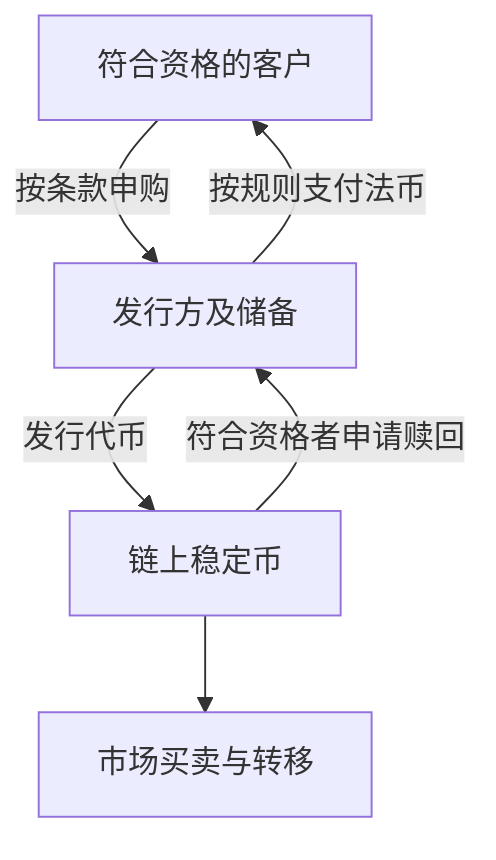

# 第十三章｜稳定币：为什么 USDT 可能比比特币更接近普通人的现实应用？

*Chapter 13: Stablecoins, USDT and Their Practical Role*

修订：2026-10-14｜资料：2026-10-13；历史案例补充核对：2026-10-14

如果有人说“我存了 1,000 美元”，接着给你看的是 1,000 USDT 的余额，你会把它当作同一件事吗？

**USDT 不是银行里的美元。** 它是以美元为挂钩目标的代币。看起来相近的金额，背后可能是不同的发行方、权利、保管方式和退出条件。这是理解稳定币最值得先记住的区别。

## 稳定的是价格目标，不是所有环节

稳定币（Stablecoin）试图让价格跟随某个参照。本章讨论 USDT、USDC 这类美元稳定币，目标是每枚接近一美元；并非所有稳定币都挂钩美元或使用同一种机制。

```text
1 USDT ≈ 1 USD
1 USDC ≈ 1 USD
```

“≈”表示目标。如果一项服务报价为 1,000 美元，用 BTC 计价可能需要承受报价到交付期间的明显价格变化；美元稳定币试图在链上提供更接近美元的计价单位。

但它既不是美联储发行的现金，也不是用户直接持有的央行数字货币。Tether 与 Circle 等私人发行方，通过储备及相应发行、赎回安排支持代币。

| 看起来都接近 1,000 美元 | 你需要继续确认什么 |
|---|---|
| 银行中的美元存款 | 银行的存款责任、账户条件及适用存款保障 |
| 自托管地址中的稳定币 | 发行方条款、储备、赎回、网络和密钥条件 |
| 交易平台中的稳定币余额 | 上述风险之外，再加平台保管与提取安排 |

价格目标相近，不会让这三种持有关系自动变成同一回事。

## 一个真实事件：USDC 为什么会脱锚？

2023 年 3 月，硅谷银行关闭后，Circle 披露约 33 亿美元 USDC 储备存款受到影响，约占当时总储备的 8%。USDC 出现脱锚。Circle 随后说明，监管处置让这笔存款可以全额取用，兑换安排随银行恢复营业而继续。[Circle：2023-03-12 公告](https://www.circle.com/pressroom/3-3-billion-of-usdc-reserve-risk-removed-dollar-de-peg-closes)

这段历史没有证明“稳定币一定会归位”。它说明，链上代币可以持续转移，支撑代币的银行储备和兑换服务却可能出问题。市场参与者还没拿到完整答案时，价格就会先反映不确定性。

设想一位持有人恰好在那个周末急需资金。他要面对的决定是：按当时可成交价格卖出，还是等待更多信息、承担继续变化的风险？这是从事件延伸的假设情境，并非真实受访者的经历。

如果某次交易只能按每枚 0.97 美元卖出，1,000 枚就对应 970 美元，少了 30 美元。这里的 0.97 是独立的自拟算例，不是上述事件的成交记录。**需要马上用钱的人，无法仅靠“设计上应该等于一美元”支付账单。**

## 储备在哪里，谁能直接换回美元？

Tether 说明 USDT 由储备支持，条款中的储备可包括现金、现金等价物及其他资产，不能理解为每枚代币单独对应一张封存钞票。Circle 则披露 USDC 的现金及现金等价资产安排，包括短期国债等，并提供第三方鉴证资料。[Tether：透明度](https://tether.to/en/transparency/) · [Circle：透明度](https://www.circle.com/transparency)

研究储备，要接着看资产质量、流动性以及报告时点。某次鉴证能帮助核对特定范围的信息，但无法承诺未来每一天都没有问题。



这个图里最容易被忽略的是“符合资格”。**在市场买到一枚代币，不代表能直接向发行方兑回一美元。** Tether 直接申赎有核验、最低金额和费用要求；USDC 直接赎回也要求符合相关资格与 Circle Mint 等条款。普通持有人经由市场卖出，则面对当时的买家、价格和渠道条件。[Tether：条款](https://tether.to/en/legal/) · [费用](https://tether.to/en/fees/) · [Circle：USDC 条款](https://www.circle.com/legal/usdc-terms)

两家的条款都不能当作银行存款保险。发行方还保留相应冻结、限制转移或服务的权限；自己掌握私钥，也不能消除代币的发行方权限。

## 都叫 USDT，为什么还要选网络？

Tether 在 Ethereum、TRON 等多个网络上发行代币，它们记录在不同账本里，不是同一份余额的几种皮肤。[Tether：支持的协议与合约](https://tether.to/en/supported-protocols/)

“USDT-TRC20”通常指 TRON 上的相应代币，“USDT-ERC20”常用于指 Ethereum 上的版本。ERC20 本身是代币标准，兼容网络也可能使用，仍要确认实际网络及合约。

发送方支持、接收方支持、资产与合约、地址及入账规则，要能对得上。网络不匹配时，不能期待平台按原流程到账；是否可找回也没有统一保证。第三方桥接或包装的同名资产，还增加了另一层服务风险。

转账也不一定只消耗稳定币余额。Ethereum 主网协议费用以 ETH 支付；TRON 的资源不足时可能消耗 TRX，平台另有提现费。具体机制见[第十二章](12-Ethereum、TRON与区块链网络.md)，保管与授权见[第十四章](14-交易所、钱包、私钥与链上安全.md)。

## 为什么有人把它当工具，又为什么不能当应急存款？

稳定币值得研究，是因为法币挂钩的计价单位可以和全天候网络、智能合约相连，用于某些交易与结算安排。但链上到账、平台入账、换成法币、银行到账，仍然是不同结果。银行和兑换服务不一定全天候运行，也并非任何地区、任何账户都能使用。

对中国大陆读者，银发〔2026〕42 号通知限制相关虚拟货币业务与服务。钱包能显示余额，不能代替业务资格、资金来源及用途的判断。[中国人民银行等八部门：2026 年通知](https://www.pbc.gov.cn/tiaofasi/144941/3581332/2026020619591971323/index.html)

还要区分“持有稳定币”和“把稳定币交给一个收益项目”。单纯持有 USDC 不获得储备资产利息；借贷、流动性服务或平台补贴产生的收益，需要另看资金用途、对手方和退出条件。[Circle：USDC 条款](https://www.circle.com/legal/usdc-terms)

RWA（现实世界资产代币化）同样如此。用稳定币购买某项链上资产，之后持有的权利取决于该产品文件；稳定币储备里有国债，也不表示持币者直接拥有对应国债或它的利息。

回到最初那笔“1,000 美元”：先问它存在哪里、由谁负责、怎样取回，再讨论是否方便。如果这笔钱负责下个月房租，价格目标本身远远不够。理解工具的意义，正是知道它在哪些环节有用，又在哪些环节需要另作安排。

下一章：[交易所、钱包、私钥与链上安全](14-交易所、钱包、私钥与链上安全.md)。

---

USDC 事件按发行方历史公告叙述；持有人困境与 0.97 美元算例为假设。历史处置不代表未来保证，具体储备和条款会更新。[来源索引](../参考资料/来源索引.md)
