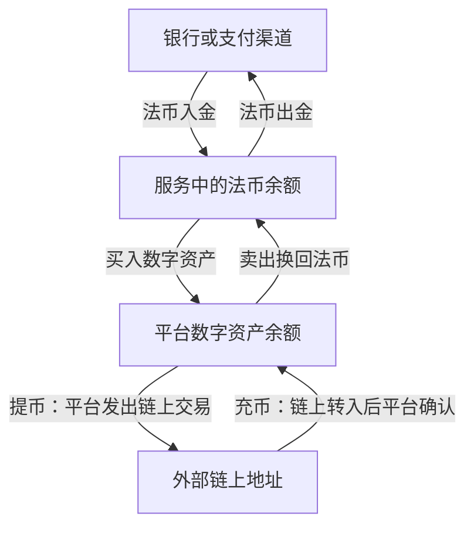

# 第十五章｜普通人如何理解和进入 Crypto 世界？

*Chapter 15: Understanding Crypto Participation and Its Financial Connections*

修订：2026-10-14｜资料：2026-10-13

一个按钮写 Deposit，另一个也写 Deposit：前者让你从银行转钱，后者却给你一个链上地址。为什么同一个英文词，会对应两种动作？

因为参与 Crypto 会跨过几本不同的账。**法币进出、平台买卖、链上转移**，不是同一个过程。先认清正在移动什么，比记住每家平台的按钮位置更有用。

对中国大陆读者，银发〔2026〕42 号通知严格限制相关虚拟货币业务与服务。下图用于理解概念，不能作为可直接使用的开户或资金路径。[中国人民银行等八部门：2026 年通知](https://www.pbc.gov.cn/tiaofasi/144941/3581332/2026020619591971323/index.html)

## 一张图，把入金、买卖和充提币分开



图中各条服务连接都以资格、条款和适用法律成立为前提，平台余额与链上控制权也不同。法币是美元、港币等传统货币；USDT 是代币，不属于银行法币余额。

在本章中，入金指通过允许的渠道，把法定货币转入相应账户或交易服务；出金则指把账户中的法币余额转出至支持的收款渠道。


实际界面可能使用 Deposit、Withdraw、Buy 等不同名称，有的平台还提供直接购买方式。理解时应先确认：移动的是法币，还是数字资产？

资金已转出、平台已收到、资金可用于交易、余额可再转出，也可能是不同状态。费用、付款人身份、资金来源和处理时间，需要查看具体规则。

充币、提币描述的是数字资产转移与平台账户记账，和法币入金、出金不同。

| 名称 | 通常表示 | 需要区分的环节 |
|---|---|---|
| 充币（Deposit） | 数字资产到达平台支持的充值地址 | 链上确认与平台内部入账 |
| 提币（Withdraw） | 平台按申请向指定地址发出数字资产 | 平台审核、发出交易与网络确认 |
| 法币入金／出金 | 通过支付渠道移入或移出传统货币 | 支付、账户余额及银行到账 |

例如，自托管地址中的 USDT 转入平台，涉及网络交易和平台确认；平台余额中的 USDT 转出，则由平台按相应规则发出资产。

不同平台还可能提供内部转账。要理解一次操作发生了什么，应查看其实际记录，不能仅根据按钮名称判断。

不一定要先买 USDT 再买 BTC。服务支持什么交易对，会决定交换方式。把资产卖成平台上的美元余额，也还没有完成银行出金。

## 交易发生在平台，买到的是什么？

现货交易（Spot Trading）以买卖资产本身为目标，区别于建立与资产价格相关的衍生品合约头寸。

假设买入 0.01 BTC，成交后账户记录相应资产数量。但若资产留在中心化平台，通常仍由平台或托管方管理链上密钥；账户余额不能直接等同于用户独立控制的链上资产。

| 情况 | 需要理解的对象 |
|---|---|
| 现货买入并留在平台 | 相应资产余额、客户权利与托管安排 |
| 转到自托管地址 | 链上记录及用户的签名控制条件 |
| 买入相关衍生品 | 合约头寸、结算规则与风险敞口 |

即使不使用融资，现货也有价格、平台和操作风险；“现货”这个标签本身不提供本金保障。[CFTC：虚拟货币交易风险](https://www.cftc.gov/LearnAndProtect/AdvisoriesAndArticles/understand_risks_of_virtual_currency.html)

Crypto 平台所称的“合约”常包括期货、永续合约等衍生品。它们让交易者获得与某种资产价格相关的敞口，但不一定交付相应代币。

合约与杠杆也不是同一个概念。杠杆表示以相对较少的自有资金承担较大的价格敞口，合约则有自己的保证金、结算和强制平仓规则。

可以用一个自拟简化算例理解：

| 条件 | 金额 |
|---|---:|
| 初始保证金 | 1,000 美元 |
| 10 倍敞口下的名义仓位 | 10,000 美元 |
| 价格向有利方向变化 5% 的简化盈亏 | ＋500 美元 |
| 价格向不利方向变化 5% 的简化盈亏 | −500 美元 |

同样的价格变化，对初始保证金的影响为 50%。实际还涉及维持保证金、手续费、资金费率和标记价格等，可能在理论亏损达到全部保证金之前就被强制平仓。

这些金额不是某个平台的真实报价或爆仓预测。不同产品的亏损责任也不同，不能预设亏损一定止于最初投入。[CFTC：杠杆与合约风险](https://www.cftc.gov/LearnAndProtect/AdvisoriesAndArticles/understand_risks_of_virtual_currency.html)

先理解合约条款与风险，才能判断自己看到的究竟是资产持仓，还是价格头寸。

## P2P 多出的是交易对手这一层

P2P 是 Peer-to-Peer，即点对点。在平台交易语境中，常指用户之间进行资产交换，平台可能提供报价展示、撮合、代币托管或争议处理等服务。

它与比特币网络本身的点对点通信，是不同层面的概念。也不能因为叫“点对点”，就认为整个交易没有机构参与。

P2P 还把对手方付款和资金来源问题带入流程。例如，伪造付款凭证、撤销付款、冒用第三方账户或把交易引到平台之外，都可能造成损失。平台自身的风险资料也提示了相关诈骗情形。[Binance：P2P 诈骗风险](https://www.binance.com/en/blog/p2p/6416111153825153913)、[第三方付款与中间人诈骗](https://www.binance.com/en/support/faq/detail/03a0b16b35344e72b308aea70888311c)

平台显示“已付款”与实际资金状态需要区分。即使某次款项已经到账，也不能由此证明资金来源可靠或交易符合适用法律。

因此，本章把 P2P 作为一种交易安排来解释，不把它视为绕过银行、身份核验或监管要求的通道。

身份核验也是服务的一部分，不能把通过 KYC 当成资产安全或所有功能可用的保证。[Coinbase：身份核验说明](https://help.coinbase.com/en-gb/coinbase/getting-started/getting-started-with-coinbase/id-doc-verification)

## 转移资产时，按一笔交易追到底

看一个假设情境：在法律和服务资格允许的环境中，小许想把已有代币从平台转到自己控制的地址。他先确认发送的资产、具体网络和接收方支持范围，再看平台费用与最低金额。这里借用人物说明判断过程，并不承接前文的海外收入或假定他具备相关交易资格。

同样叫 USDT，可能位于不同网络的代币合约中。资产名称相同，不表示发送和接收环境相同。

```text
资产与代币合约
       ↓
具体区块链网络
       ↓
接收地址及附加信息（如服务要求）
       ↓
接收服务的支持与入账规则
```

ERC20、TRC20 是代币标准，界面有时把它们作为网络简称。实际仍需要确认 Ethereum、TRON 或其他具体网络。

即使地址形式相同，也不能推断平台接受该网络的资产。有关标准、地址与控制条件的说明，见[第十二章](12-Ethereum、TRON与区块链网络.md)和[第十四章](14-交易所、钱包、私钥与链上安全.md)。

在允许开展相关业务的场景中，小额测试有助于验证当时的地址、网络及实际入账过程，减少第一次就转移较大金额的操作风险。

测试还应满足最低入账金额和费用规则。区块浏览器显示确认，与收款服务记入余额，可能并不同步。

小额测试的作用有边界：它不证明对方诚信、服务持续安全，也不保证后续信息未被替换。后续操作仍需重新核对，签名时也应理解实际授权内容。[Ethereum：安全与防诈骗](https://ethereum.org/security/)

接着，他检查平台是否已发出交易、网络是否确认、接收端是否实际识别余额。这三个结果不同；出现延迟时，先确认卡在哪一层，再找相应服务处理。一次成功测试也不能证明后续授权或对手方一定安全。

## 能读懂流程之后，再决定是否需要使用

| 常见错误 | 容易忽略的问题 |
|---|---|
| 看见别人赚钱就买入 | 资产逻辑、价格风险及自己的资金用途 |
| 尚未理解资产就使用杠杆 | 保证金、强平和实际亏损责任 |
| 相信“稳赚”“内部机会” | 对手方身份、利益冲突及诈骗 |
| 把助记词交给客服或陌生人 | 恢复资料意味着资产控制权限 |
| 只核对币名 | 网络、合约、地址和入账规则 |
| 把余额截图当作资产保证 | 托管、提现及账户权利的实际安排 |

这类错误有些来自对资产的不理解，有些来自对服务流程的不理解。安全学习应与金融认知一起进行，而不是等到大额交易之后再补课。

知识学习可以先通过文档、公开记录和纸面情境完成。观察账户与钱包，重点是能解释自己持有什么、由谁控制、发生什么条件才可以退出；不需要把买入当成学习的毕业考试。

现实中的稳定币储备、托管机构和证券产品还会连接传统金融。看见“上链”，继续追问实际权利和责任，才不会把新的界面当成新的保证。

下一章：[Crypto 投资与未来金融](16-Crypto投资周期与风险.md)。从读懂流程，进一步讨论怎样判断资产。

---

图示与人物为概念演示，不是可用资金路线。杠杆算例忽略费用、资金费率和具体维持保证金规则，不能用于预测强平点。[来源索引](../参考资料/来源索引.md)
