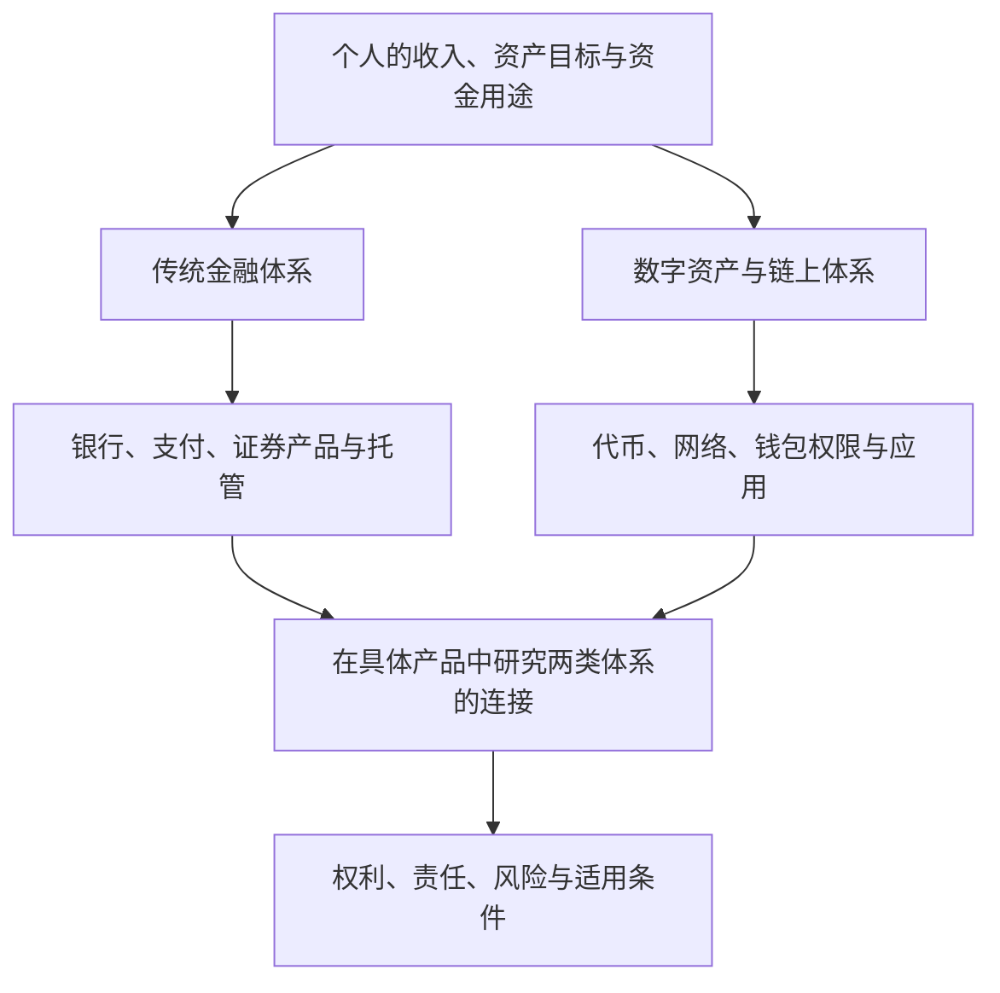

# 第十六章｜Crypto 投资与未来金融：BTC、ETH、稳定币应该怎么看？

*Chapter 16: Crypto Investing and the Future of Finance — BTC, ETH and Stablecoins*

更新与资料核对日期：2026-10-13

前面五章分别回答了几个问题：Bitcoin 为什么出现，区块链怎样运行，稳定币怎样连接美元体系，钱包如何管理资产控制权，以及普通人怎样理解 Crypto 的参与流程。

这一章作为 Crypto 篇的收束，把视角从技术与服务转回投资者：这些资产的价值依据有什么不同，它们有哪些风险，又应该怎样放进个人的全球金融认知中？

理解 Crypto，容易走向两个极端：认为所有项目都没有价值，或者认为它必然取代传统金融。更有用的做法，是逐项研究资产、网络、服务与权利，而不是给整个生态贴一个标签。

> Crypto 是一组仍在发展的数字资产与金融基础设施安排。技术创新、商业应用与投资回报，需要分别判断。

本章延续前文的一般读者视角。对中国大陆读者，现行银发〔2026〕42 号通知严格限制虚拟货币相关业务，也对现实世界资产代币化活动作出规定。下文用于理解资产与金融关系，不表示相关服务或投资路径对所有读者可用。[中国人民银行等八部门：2026 年通知](https://www.pbc.gov.cn/tiaofasi/144941/3581332/2026020619591971323/index.html)、[上海市政府转载全文](https://www.shanghai.gov.cn/rzfwgj/20260320/ca5d3b3b19504111a379d730560f4274.html)

## 一、Crypto 并不是一个单一资产

“投资 Crypto”这个说法过于宽泛。它可能指购买 BTC、ETH、某个应用代币，或者持有稳定币；这些行为面对的资产性质不同。

生态中还存在 DeFi 服务、NFT 和与现实资产相关的代币。“服务存在”与“可以买到代表其收益的资产”，也不是同一回事。

| 对象 | 常见定位 | 首先需要回答的问题 |
|---|---|---|
| Bitcoin／BTC | 点对点网络及其原生稀缺资产 | 谁愿意持有和使用 BTC，为什么？ |
| Ethereum／ETH | 智能合约网络及其原生资产 | 网络使用、安全需求怎样与 ETH 联系？ |
| 美元稳定币，如 USDT、USDC | 以美元挂钩为目标的代币 | 储备、赎回与实际流通如何安排？ |
| 其他公链或应用代币 | 特定网络或项目中的资产 | 代币有何用途、供应规则和持有人权利？ |
| NFT、现实资产相关代币 | 特定数字记录或权利安排 | 持有代币具体获得什么，如何执行？ |

分类可以帮助入门，却不能代替研究。一个项目叫“基础设施”，不表示代币一定有价值；一枚代币叫“美元”，也不表示拥有银行美元存款。

投资判断的起点是：**自己持有的对象究竟是什么？**

## 二、Bitcoin：为什么有人长期配置？

Bitcoin 的原始设计是点对点电子现金系统。一些投资者在此基础上，把 BTC 理解为可长期持有的数字稀缺资产，关注三个特点。

**第一，供应规则。** 按现行协议，BTC 发行上限通常表述为约 2,100 万枚，新发行数量按规则递减。这与公司可根据融资计划增发股票的机制不同，具体减半规则见[第十一章](11-Bitcoin到底是什么.md)。[Bitcoin.org：供应与网络规则](https://bitcoin.org/en/faq)

**第二，网络验证。** 完整节点按各自接受的协议规则验证交易，不依靠一家公司的内部账簿决定余额。开发者可以提出修改，但不能仅凭发布软件，就让所有参与者自动接受新规则。

**第三，转移与保管方式。** BTC 可以通过网络转移，也可以由用户管理签名密钥。这种技术机制与银行账户不同；实际使用仍涉及网络条件、保管能力及当地法律。

“数字黄金”是理解其稀缺性和持有动机的一种类比。黄金与 BTC 在历史、实物用途、波动和市场结构上都有差别，不能据此推导二者具有相同的投资表现。

尤其需要区分：供应稀缺与价格上涨。供应只是定价的一侧，市场需求和愿意支付的价格同样重要。**没有需求支撑的稀缺，不会自动带来投资回报。**

## 三、为什么部分机构关注 Bitcoin？

理解机构参与，可以从产品渠道、资产研究和金融业务三个角度入手，而不把“机构买入”作为投资结论。

### 1. 证券产品提供了另一种价格敞口

部分市场的 Bitcoin 交易所交易产品，让投资者通过证券账户持有产品份额，获得与 BTC 价格相关的敞口。投资者不必亲自管理链上私钥，但产品仍有托管、费用和跟踪方面的问题。

ETP 是交易所交易产品的统称。Investor.gov 在其美国市场说明中区分现货产品与期货产品，并指出所述现货 BTC、ETH 商品信托并非按《1940 年投资公司法》注册的普通基金。阅读时应以具体产品文件为准，不能只看“ETF”这个名称。[Investor.gov：比特币与以太币 ETP](https://www.investor.gov/introduction-investing/general-resources/news-alerts/alerts-bulletins/investor-bulletins/ETPBulletinSeptember2024)

### 2. 一些投资者研究另类资产

当研究货币购买力、全球配置和资产多元化时，一些投资者会把 BTC 纳入考察范围。但研究动机不是已验证的投资效果，不能直接把 BTC 当成稳定的抗通胀工具或避险资产。

### 3. 参与金融业务与承担价格风险不同

机构发行产品、提供托管、处理交易，与机构用自有资金长期持有 BTC，是不同的商业决定。前者可能获得服务收入，后者承担资产价格变化。

因此，看到一条机构参与的新闻，先辨认其参与方式，比直接推断“机构看好，所以价格会涨”更有意义。

## 四、Bitcoin 也存在明显风险

BTC 没有公司股东式的利润分配权，也不承诺像债券那样支付本金和利息。其市场价格依赖需求、流动性与持有者预期，高波动是不能忽略的特征。[Bitcoin.org：价格与风险](https://bitcoin.org/en/faq)

可以把风险分成三个层面：

| 层面 | 需要理解的风险 |
|---|---|
| 资产价格 | 大幅涨跌、估值分歧、需求与市场情绪变化 |
| 持有方式 | 平台或托管方失败、密钥遗失、诈骗与错误操作 |
| 外部环境 | 法律、服务资格、税务及交易条件变化 |

长期持有只描述时间安排，不保证风险随时间消失。某个资产过去恢复过价格，也不能证明下一次下跌之后必然恢复。

回撤与回本所需涨幅还不对称。用一个自拟例子说明：

| 原始资产价值 | 下跌后价值 | 跌幅 | 回到原值所需涨幅 |
|---:|---:|---:|---:|
| 10,000 | 5,000 | 50% | 100% |
| 10,000 | 2,000 | 80% | 400% |

金额单位不限；例子忽略费用和现金流，不是历史行情或未来预测。它解释的是分母变化：从较低的余额回到原值，需要更大的百分比涨幅。

BTC 可以成为研究对象，但不能因为被称作“数字黄金”，就放进需要稳定本金的资金层。

## 五、Ethereum：为什么 ETH 具有投资逻辑？

Ethereum 是智能合约网络，ETH 是其原生资产。开发者可以在网络上构建应用，但持有 ETH 并不等于购买某家公司股份，也不自动拥有所有应用的利润。

ETH 与网络的联系，主要可以从三个机制理解。

**支付网络费用。** Ethereum 主网交易与合约执行涉及 Gas，协议费用以 ETH 计价。用户看到的付款界面可以由应用代付或包装，但底层费用机制仍需要区分。[Ethereum：Gas 与费用](https://ethereum.org/developers/docs/gas/)

**参与网络安全。** Ethereum 使用权益证明，验证者通过质押等机制参与网络运行。质押奖励伴随运行、惩罚和退出条件；经由第三方参与还会加入相应服务或合约风险。[Ethereum：质押机制与风险](https://ethereum.org/staking/)

**发行与销毁。** ETH 有验证者奖励发行，也有协议费用中的销毁机制，不能简单套用 BTC 的固定供应上限。净供应变化取决于两者的实际关系，不保证永久通缩。[Ethereum：ETH 的用途与供应](https://ethereum.org/what-is-ether/)

这些机制为研究 ETH 提供了线索，但仍需判断：应用发展是否带来持续网络需求，这种需求怎样影响 ETH，以及购买价格是否已反映了过高预期。

> 网络有用，说明存在使用价值；代币值得投资，还需要研究价值怎样传递给持有人。

这一层联系，是从“了解区块链”走向“判断资产”时需要补上的问题。

## 六、Ethereum 也面临竞争

原稿列举了 Solana、TRON、BNB Chain、Avalanche 等网络。可以把它们作为多链生态的例子，而不把名单理解为投资推荐或性能排名。

不同网络在设计、资源计费、开发环境和信任条件上各有差异。用户、开发者和应用可能选择不同网络，也可能同时使用多个网络。

Ethereum 生态内部还有扩容网络与应用层的分工。因此，观察交易数量、用户数量或低费用时，需要确认统计覆盖的是哪个网络、哪类活动，以及它们怎样与主网和 ETH 联系。

判断 ETH 的长期逻辑，至少包含两个问题：区块链应用是否持续产生需求，以及 Ethereum 能否在这种需求中保持作用。

即使看好整个行业，也不能跳过具体网络、代币经济机制和买入价格的分析。

## 七、稳定币：为什么它可能具有重要现实用途？

美元稳定币的目标，是让代币价值尽量接近美元，便于在支持它的数字网络中计价和转移。这里主要讨论 USDT、USDC 这类发行方管理储备的稳定币，不把所有稳定币机制视为相同。

```text
美元挂钩目标：1 枚代币 ≈ 1 美元
实际市场价格、直接赎回资格和到账条件：分别核实
```

Circle 与 Tether 披露各自的储备安排，这说明稳定币与银行、托管及传统资产体系存在连接。发行方披露与第三方鉴证仍有具体范围，不能仅凭“有储备”就把持币等同于银行存款。[Circle：储备披露](https://www.circle.com/transparency)、[Tether：透明度说明](https://tether.to/en/transparency/)

稳定币还带来一个与 BTC、ETH 不同的问题：**作为工具的重要性，与价格上涨空间不同。**

美元稳定币希望接近一美元，通常不是依靠代币本身大幅升值来实现其用途。Circle 的 USDC 条款也明确，单纯持有 USDC 不获得储备资产产生的利息或回报，直接赎回受条款与适用法律约束。[Circle：USDC 条款](https://www.circle.com/legal/usdc-terms)

若平台展示“稳定币年化收益”，应继续研究收益来自借贷、投资、补贴还是其他安排。把稳定币交给某项服务后，新增的风险属于该项服务及其具体交易结构。

| 判断对象 | 核心问题 |
|---|---|
| 稳定币本身 | 储备、挂钩、赎回、冻结与流通条件 |
| 持有或转移渠道 | 平台托管、网络、地址和费用 |
| 附加收益服务 | 收益来源、资金用途、对手方及退出条件 |

稳定币的详细机制与风险见[第十三章](13-USDT、USDC与稳定币.md)。数字支付与现实资产相关业务，可能拓展其使用场景，但是否形成持续需求，仍需要实际应用和法律条件支持。

## 八、为什么许多山寨币需要更谨慎地研究？

Altcoin 常被译为“山寨币”，但市场用法并不统一，有时指 BTC 之外的代币。这里关注的是大量规模较小、记录较短、需求与权利不清楚的项目，不把这个标签作为统一的风险等级。

原稿强调真实需求、竞争与情绪。进一步研究时，还应把项目发展与代币价值分开。

| 研究问题 | 为什么需要回答 |
|---|---|
| 谁在使用，为什么使用？ | 区分持续需求与奖励驱动的短期活动 |
| 服务为什么需要这枚代币？ | 项目有应用，不表示代币不可替代 |
| 持有人获得什么权利？ | 治理、使用或其他安排，未必包含利润分配 |
| 供应和解锁怎样安排？ | 新增流通量可能改变现有持有人的处境 |
| 谁掌握关键权限？ | 识别升级、资金与运营上的集中控制 |
| 如何退出，谁愿意接手？ | 显示价格不等于大额交易能够按该价格成交 |

这些问题构成判断框架，不是打勾后就能保证安全的清单。项目可以真实存在，代币也可能因为设计、竞争或价格原因成为不理想的投资。

仅凭“技术先进”“社区热闹”或“下一轮热点”，难以说明长期价值。

## 九、Crypto 为什么容易出现明显的涨跌阶段？

价格变化可以从资金、预期、杠杆和流动性之间的相互影响来理解。以下图表是机制示意，不是固定周期模型。


FOMO（Fear of Missing Out，害怕错过）容易让人把别人的收益，当作自己必须行动的理由；下跌时，恐慌又可能让原本没有退出计划的人仓促卖出。

在使用杠杆的市场中，价格变化还可能触发强制平仓，加大损失；具体机制见[第十五章](15-理解Crypto的参与流程.md)。CFTC 的风险资料提醒了价格波动及杠杆对亏损的放大作用。[CFTC：虚拟货币交易风险](https://www.cftc.gov/LearnAndProtect/AdvisoriesAndArticles/understand_risks_of_virtual_currency.html)

历史上的涨跌阶段不能变成确定日历。减半、利率、产品资金流或某个技术事件，都不单独决定下一轮行情的时间和幅度。

因此，风险管理需要先回答能承受什么，再讨论希望赚到什么。

## 十、普通人应该如何看待 Crypto 配置？

是否配置，并没有适用于所有人的比例。期限、负债、现金流、风险能力与服务资格，都需要先于资产选择考虑。一般资产配置资料也把期限和风险承受能力作为核心因素。[Investor.gov：资产配置与分散](https://www.investor.gov/introduction-investing/getting-started/asset-allocation)

延续[第十章](../02-第二篇｜真正进入海外证券市场/10-普通人的全球资产组合.md)，可以从四个方向理解个人财富体系：

| 方向 | 主要任务 | 判断重点 |
|---|---|---|
| 现金流与安全资金 | 应付生活、应急与近期支出 | 可用性、本金风险和资金期限 |
| 长期金融资产 | 按目标研究股票、债券等资产 | 经济敞口、分散、费用与持有条件 |
| 另类或特定主题资产 | 研究黄金、BTC 等不同风险来源 | 持有理由、价格风险与整体损失承受能力 |
| 个人能力 | 提升职业、技能与业务能力 | 时间投入、收入来源和能力积累 |

这是帮助思考的分类，不是固定购买顺序。个人能力也不是与账户余额完全相同的可交易资产；它影响收入，却不能总在需要现金时立即变现。

另类资产可能提供不同敞口，但增加一个资产名称，不保证组合风险下降。不同资产可能在同一压力环境下下跌，因此仍要检查实际风险是否集中。

可以用一个自拟压力例子衡量仓位：假设可投资金融资产为 100,000 元，其中某类高风险资产为 5,000 元，其余资产暂时不变。

| 高风险部分的假设变化 | 该部分损失 | 对原始组合的影响 |
|---|---:|---:|
| 下跌 50% | 2,500 元 | −2.5% |
| 下跌 80% | 4,000 元 | −4% |
| 损失全部 | 5,000 元 | −5% |

5% 只是便于计算的假设，不是推荐比例。例子不使用杠杆，忽略费用、汇率与其他资产变化；实际整体损失可能更大。即使金额占比小，若影响生活安排或诱发不断加仓，也可能不适合持有。

不配置 Crypto，同样可以形成完整的个人资产体系。

## 十一、Crypto 与全球资产配置有什么关系？

本书前十章介绍收入、货币、银行、支付、券商、证券工具与组合。Crypto 篇补充数字资产、网络记录和程序化服务的理解，两者可以放在同一张金融功能图中。



这张图描述功能，不能作为“人民币 → 香港账户 → 海外券商”或“美元 → 稳定币 → 数字资产”的通用可操作路线。资金来源与用途仍需回到[第五章](../01-第一篇｜先看懂全球金融地图/05-中国大陆居民如何获得海外资产敞口.md)分别判断。

两类体系存在连接：稳定币可能以传统资产作储备，证券产品可以提供数字资产价格敞口，某些现实资产相关产品则使用代币记录或转移权利。

其中，美元稳定币、银行美元存款与央行数字货币，并不是同一种法律关系。RWA（Real-World Assets，现实世界资产）代币也要核对其对应权利、发行文件和资产保管；把记录写到链上，不能自动证明现实资产存在或权利可执行。

未来可能出现更多融合，也可能有部分模式失败。本章把“融合”作为值得观察的方向，而不是所有产品必然成功的预测。

## 十二、普通人学习 Crypto 真正的意义

原稿把学习意义分成金融基础设施、资本流动与资产判断三个方面。它们共同指向一种能力：读懂新的金融安排，而不被新术语牵着走。

**理解基础设施变化。** 看到“链上支付”“智能合约”时，能辨认谁负责记录、谁控制资产，以及现实服务由谁承担。

**理解资金与权利的连接。** 看到“数字美元”“链上基金”时，能区分账户余额、代币、产品份额和实际赎回权，而不把界面中的同一个金额视为同一种资产。

**提高判断能力。** 看到一个项目时，能追问真实需求、持有人权利、风险承担者和收益来源，并区分技术进步与市场炒作。

这三类能力，可以通过学习资料、阅读文件和比较案例获得，不要求先投入资金。

## 十三、Crypto 篇最终总结

经过六章学习，可以把前面的概念重新放回各自位置：

| 领域 | 已建立的理解 | 容易混淆的地方 |
|---|---|---|
| Bitcoin／BTC | 点对点网络、供应规则与原生资产 | 稀缺性不保证价格上涨 |
| Blockchain | 验证与记录的技术安排 | 链上记录不自动证明链外事实 |
| Ethereum／ETH | 智能合约平台与原生资产机制 | 网络发展不自动等于代币回报 |
| TRON | 另一种公链及其资源规则 | 网络效率不能代替资产与服务判断 |
| Stablecoin | 挂钩目标、储备与流通安排 | 稳定币不等同于银行存款 |
| Wallet | 查看记录、管理权限与签署操作 | 钱包界面与资产控制条件不同 |
| 交易与托管服务 | 法币进出、资产交换与保管关系 | 余额、链上控制和合约头寸不同 |

Crypto 既有技术与金融应用，也有价格投机、失败项目和诈骗。理解它，需要同时保留创新与风险两方面的视角。

投资判断则进一步要求：看懂资产本身、理解持有方式、评估购买价格，并检验损失能否由自己的财务安排承受。

## 十四、Crypto 篇结束

至此，**第三篇｜Crypto 与链上金融**完成了六章的认知路径：

1. [第十一章：Bitcoin 为什么出现，为什么有人认为它有价值？](11-Bitcoin到底是什么.md)
2. [第十二章：区块链、Ethereum 与 TRON 怎样运行？](12-Ethereum、TRON与区块链网络.md)
3. [第十三章：稳定币怎样连接美元与数字网络？](13-USDT、USDC与稳定币.md)
4. [第十四章：交易所、钱包与私钥怎样决定控制关系？](14-交易所、钱包、私钥与链上安全.md)
5. [第十五章：普通人怎样理解参与流程？](15-理解Crypto的参与流程.md)
6. [第十六章：BTC、ETH、稳定币怎样放进投资判断？](16-Crypto投资周期与风险.md)

回到本书最初的问题：普通人如何建立自己的全球资产体系？Crypto 是需要理解的变量之一，而完整体系还包含收入能力、货币与账户认知、资产配置，以及风险管理。

从认识世界，到理解资产，再到提升自身价值，这才是本书贯穿两篇内容的目标。

**Crypto 篇完。**

## 本章要点

BTC、ETH 和美元稳定币对应不同的资产机制。BTC 的稀缺性需要需求支撑，ETH 的网络用途需要进一步研究价值传递，稳定币的支付用途也不等于价格升值或自动生息。

技术发展、项目成功和持有人收益，是三个需要建立联系的问题。产品渠道与机构参与，可以改变接触方式，却不能消除资产本身的风险。

个人配置应从期限、现金流与损失承受能力出发。学习 Crypto 可以扩大金融认知，是否投入资金仍是一项独立决定。

下一章：[**全球收入：为什么“赚美元”可能比投资美元更重要？**](../04-第四篇｜从投资全球到赚全球的钱/17-全球收入：为什么赚美元比投资美元更重要.md) 将开启第四篇，从资产配置转向个人能力、全球客户与持续收入。

[上一章：理解 Crypto 的参与流程](15-理解Crypto的参与流程.md) · [返回全书目录](../目录.md)

---

本章依据用户本次提供的第十六章完整成稿润色，保留十四节顺序与 Crypto 篇收束主题。图表为概念整理；回撤与仓位金额为自拟简化算例，不是历史回测、推荐比例或收益预测。未来金融融合与代币判断框架为编辑分析，不是官方预测；具体服务、权利与适用条件仍以实际文件为准。完整出处见[来源索引](../参考资料/来源索引.md)。
