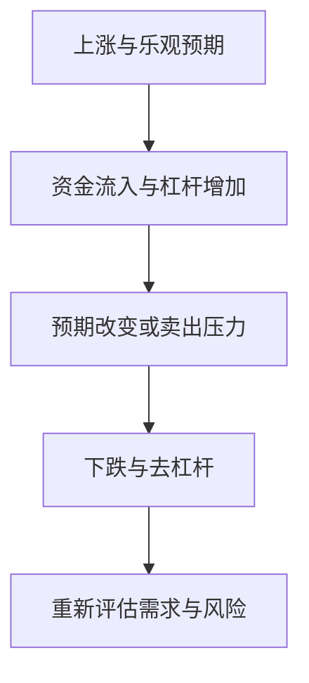

# 第十六章｜Crypto 投资与未来金融：BTC、ETH、稳定币应该怎么看？

*Chapter 16: Crypto Investing and the Future of Finance — BTC, ETH and Stablecoins*

修订：2026-10-14｜资料：2026-10-13

看完 Bitcoin、公链、稳定币、钱包和参与流程，一条新闻可能依然让人心动：“某家大机构入场了”“某个网络用户暴增了”。

这时先多问一句：**这条变化，究竟怎样影响我准备持有的那项资产？** 技术有进展、项目做成生意、代币持有人赚到钱，中间还有需要证明的联系。

本章把前面学到的机制用在投资判断上。中国大陆相关业务与服务仍受银发〔2026〕42 号等规则限制，不能由国外产品存在推导自己可以参与。[中国人民银行等八部门：2026 年通知](https://www.pbc.gov.cn/tiaofasi/144941/3581332/2026020619591971323/index.html)

## 同样叫 Crypto，判断依据却不同

| 对象 | 值得研究的联系 | 不能跳过的问题 |
|---|---|---|
| BTC | 发行约束、网络认可与持有需求 | 稀缺性之外，谁持续愿意持有，买入价格反映了多少预期？ |
| ETH | 网络费用、质押安全、发行与销毁 | 应用使用怎样影响 ETH，竞争与扩容怎样改变这种联系？ |
| USDT、USDC | 储备、挂钩、兑换与支付用途 | 工具有用，不等于代币会升值或自动生息 |
| 其他网络或应用代币 | 特定用途、供应及持有人权利 | 项目成功以后，价值是否真的传递给这枚代币？ |
| 现实资产相关代币 | 法律文件、托管与退出安排 | 链上记录对应什么可执行权利？ |

BTC 的发行规则不提供企业利润；ETH 不是以太坊生态里所有公司的股份。研究 ETH 时，Gas、权益证明、增发与费用销毁都有关，净供应也不是永久通缩的承诺。[Bitcoin.org](https://bitcoin.org/en/faq) · [Ethereum：ETH 的用途与供应](https://ethereum.org/what-is-ether/)

稳定币又是另一种逻辑。USDC 条款说明，单纯持有代币不取得储备资产的利息。若界面展示一项稳定币收益率，应该继续查明借贷、投资、补贴或其他安排，以及新增的风险。[Circle：USDC 条款](https://www.circle.com/legal/usdc-terms)

因此，“我看好链上金融”还不足以支持一笔购买。需要具体到：准备持有什么，持有人获得什么，哪些变化会让自己的判断不再成立。

## 看到好消息，沿着价值传递再走一步

假设小许看到一个项目宣布用户增长。他先把三个问题写下来：用户是付费使用，还是为了领取奖励？业务需要这枚代币吗？即便业务收入增加，持币者有没有相应权利？这是用于练习的假设情境，不对应某个实际项目。

如果查到的只是“治理投票权”，就不能擅自把它当成利润分配权。如果新增供应和大额解锁在后面等待，现有持有人也要考虑稀释和卖出压力。价格界面看似活跃，还要核对流动性，不能把一个小额成交价当成大额退出价格。

同样，机构参与也要拆开看。发行产品、提供托管或撮合交易，可以带来服务收入；机构用自有资金买入，则承担价格风险。它们不是同一种决定。现货 ETP 让部分投资者能通过证券账户取得敞口，仍然存在托管、费用和产品结构风险。[Investor.gov：BTC 与 ETH ETP](https://www.investor.gov/introduction-investing/general-resources/news-alerts/alerts-bulletins/investor-bulletins/ETPBulletinSeptember2024)

小许可能在这一步就停下来：有些权利和数据还没找到，暂时无法说明购买理由。这不是错过了学习过程，而是研究已经帮助他识别出缺失的证据。

## 周期不能预测成日历，损失却可以先算

价格上涨时，乐观叙事吸引新资金，杠杆又可能放大涨幅；预期逆转后，卖出、强平和流动性收缩可能互相加强。FOMO，也就是害怕错过，容易让人把别人的盈利变成自己的购买理由。

这张图描述可能的反馈，不是固定周期。减半、利率、产品资金流或技术升级，都不能单独确定下一轮行情的日期与幅度。[CFTC：虚拟货币交易风险](https://www.cftc.gov/LearnAndProtect/AdvisoriesAndArticles/understand_risks_of_virtual_currency.html)

无法提前知道涨跌，不妨先算坏结果。假设某项高风险资产金额为 5,000 元，没有杠杆，其他资产暂时不变：

| 假设变化 | 剩余金额 | 已损失金额 | 回到最初 5,000 元所需涨幅 |
|---|---:|---:|---:|
| 下跌 50% | 2,500 元 | 2,500 元 | 100% |
| 下跌 80% | 1,000 元 | 4,000 元 | 400% |
| 损失全部 | 0 元 | 5,000 元 | 不能靠零余额自身上涨恢复 |

下跌一半，需要翻倍才能回来。过去某次恢复过，并不能保证下一次也恢复；使用杠杆时，还可能在等待之前就被强制平仓，风险见[第十五章](15-理解Crypto的参与流程.md)。

如果这 5,000 元属于即将支付的学费，和属于已留出生活开支后的长期资金，后果完全不同。小金额或小比例也不自动适合所有人，尤其当一次亏损会诱发不断补仓时。

## 最后保留一份能反驳自己的投资记录

可以把一次研究写成短段落：我为什么关注它，证据在哪里，买入价格意味着什么；如果需求、供应或权利发生哪些变化，我会承认判断需要修改；最坏情况下，损失会影响哪些生活安排。

这比只写“长期看好”更有用。还要分开检查资产风险与保管风险：看对价格方向，仍可能因平台、密钥或授权问题失去资产；购买证券产品，则要理解该产品的托管与权利安排。

Crypto 与传统金融的连接会继续值得观察。稳定币依赖储备与兑换，现实资产代币依赖链外权利，部分证券产品连接数字资产价格。谁在记账、谁保管资产、谁承担责任，这些前面反复追问的问题，在新技术中仍然存在。

到这里，Crypto 篇可以收束为一种判断习惯：**读懂机制，追问权利，检查价格，再回到自己的生活。** 是否投入资金，是独立于知识学习的决定；不配置 Crypto，同样能够形成完整的个人资产体系。

下一篇把视角从“已有的钱怎样投资”转向“怎样创造更多收入”。对于本金不多的年轻人，这个转向可能更有影响。

[下一章：为什么“赚美元”可能比投资美元更重要？](../04-第四篇｜从投资全球到赚全球的钱/17-全球收入：为什么赚美元比投资美元更重要.md) · [全书目录](../目录.md)

---

人物、金额与涨跌为假设演示，忽略未列出的税费及其他资产变化；反馈图不是市场预测。[来源索引](../参考资料/来源索引.md)
