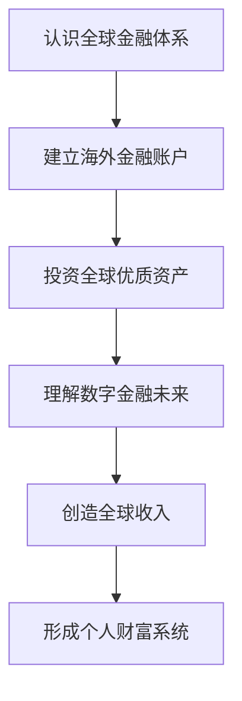

# 《中国人的全球资产基础设施指南》

> 从港卡、美股、Crypto到海外收入，建立个人全球金融体系

**v2.0 · 19 章初稿 · 五篇阅读体系 · 持续更新**

[开始阅读](第一篇｜先看懂全球金融地图/01-全球金融基础设施地图.md) · [全书目录](目录.md) · [实操手册](第五篇｜实操手册/README.md) · [更新日志](更新日志.md)

## 为什么写这本书？

过去，普通人的财富体系主要围绕人民币收入、国内银行、国内投资市场和房地产展开。

随着全球资产流动、美元体系、AI 和数字金融的发展，我们接触到越来越多的新问题：港卡有什么用？美股怎么买？Crypto 改变了什么？个人能不能通过互联网获得海外收入？

这些问题连接在一起，指向同一件事：**自己的财富，如何连接全球？**

这本书面向普通中国用户，帮助你理解全球金融体系，并逐步建立个人全球资产、收入和金融基础设施。读懂账户和工具只是起点，更长远的目标，是把收入能力、资产积累与生活需要连接成一套自己的金融体系。

## 本书解决什么问题？

1. 世界金融体系是什么？
2. 中国普通人如何进入全球金融市场？
3. 如何投资全球优质资产？
4. 如何理解 Crypto 和数字金融？
5. 如何创造全球收入？

全书沿着一条主线展开：

## 推荐阅读路线

| 阶段 | 从这里开始 | 你会读到什么 | 当前进度 |
|---|---|---|---|
| 1 | [先看懂全球金融地图](第一篇｜先看懂全球金融地图/README.md) | 美元、港卡、跨境收款与资产敞口 | 第 1—5 章 |
| 2 | [真正进入海外证券市场](第二篇｜真正进入海外证券市场/README.md) | 券商、税务、指数、投资工具与组合 | 第 6—10 章 |
| 3 | [Crypto 与链上金融](第三篇｜Crypto与链上金融/README.md) | Bitcoin、网络、稳定币、钱包与风险 | 第 11—16 章 |
| 4 | [从投资全球到赚全球的钱](第四篇｜从投资全球到赚全球的钱/README.md) | 全球收入、创作者与个人金融体系 | 第 17—19 章 |
| 5 | [实操手册](第五篇｜实操手册/README.md) | 准备、开户、平台收款与钱包实践 | 七个条目待编写 |

第一次接触这些主题，可以从第一章顺序阅读；已有基础，也可以从最关心的一篇开始，再按章内链接补齐相关知识。

## 适合读者

- 想投资美股，先弄清账户、工具和税务的人；
- 想了解 Crypto，建立基本判断框架的人；
- 想建立海外账户，理解不同账户用途的人；
- 想探索美元收入，连接全球客户和用户的人；
- 想提升全球金融认知，逐步搭建个人财富体系的人。

## 关于这个版本

v2.0 完成了五篇目录和书籍首页的重构，19 章初稿已归入前四篇。第五篇已建立实操手册条目，后续逐项编写。

这一阶段保留现有章节正文，仅调整文件路径、阅读链接和篇次引用。下一阶段再逐章优化开头、案例与总结，让内容更容易读、理解和分享。

本书以 Markdown 持续维护，后续可整理为 PDF 或电子书。图片资源统一放在 [assets](assets/README.md)，用于封面、流程图、章节配图和分享素材。

[风险说明](风险说明.md) · [来源索引](参考资料/来源索引.md) · [版权与转载说明](版权说明.md) · [更新日志](更新日志.md)
