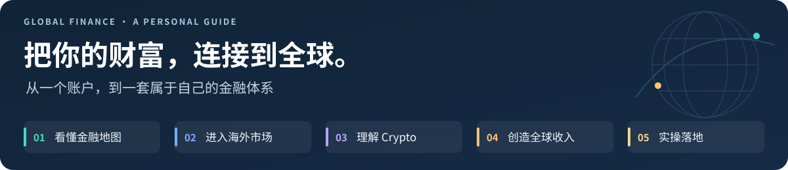
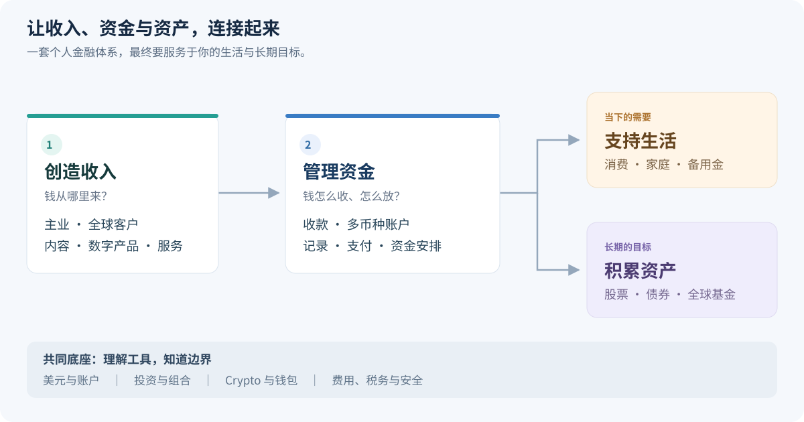

# 《中国人的全球资产基础设施指南》

> 从港卡、美股、Crypto到海外收入，建立个人全球金融体系

**还在上大学，或刚工作几年：面对 AI、投资和全球收入，怎样找到自己的方向？**

从一个中国青年的学习与探索出发，把散落在社交媒体里的知识，整理成一张看得懂、用得上的全球财富地图。[为什么写这本书 ↓](#project-story)

**19 章已整理 · 五篇阅读体系 · 写给大学生与初入职场的青年 · 持续更新**

[🌏 金融地图](#part-1) · [📈 海外证券](#part-2) · [🔗 Crypto](#part-3) · [🌐 全球收入](#part-4) · [🛠️ 实操手册](#part-5)

## 📚 五篇目录，选一章开始

港卡有什么用？美股怎么买？稳定币在做什么？普通人怎样赚取海外收入？**从你最关心的问题开始，逐步把这些知识连接起来。**

<table>
<tr>
<td width="50%" valign="top">

<h3>🌏 第一篇｜先看懂全球金融地图</h3>

先弄懂美元、港卡与跨境收款，知道每种工具解决什么问题。

<a href="01-第一篇｜先看懂全球金融地图/01-全球金融基础设施地图.md">01 · 全球金融基础设施地图</a> 
<a href="01-第一篇｜先看懂全球金融地图/02-赚美元、持有美元与美元资产.md">02 · 赚美元、持有美元与美元资产</a> 
<a href="01-第一篇｜先看懂全球金融地图/03-香港银行账户与港卡.md">03 · 香港银行账户与港卡</a> 
<a href="01-第一篇｜先看懂全球金融地图/04-Wise、PayPal与香港银行.md">04 · Wise、PayPal 与香港银行</a> 
<a href="01-第一篇｜先看懂全球金融地图/05-中国大陆居民如何获得海外资产敞口.md">05 · 中国大陆居民如何获得海外资产敞口</a>

</td>
<td width="50%" valign="top">

<h3>📈 第二篇｜真正进入海外证券市场</h3>

从券商、税务到 ETF，把“想投资”变成一套清楚的判断。

<a href="02-第二篇｜真正进入海外证券市场/06-美股券商怎么选.md">06 · 美股券商怎么选</a> 
<a href="02-第二篇｜真正进入海外证券市场/07-中国居民投资美股税务.md">07 · 中国居民投资美股税务</a> 
<a href="02-第二篇｜真正进入海外证券市场/08-美股市场：标普500与纳斯达克.md">08 · 值得长期关注的全球优质资产</a> 
<a href="02-第二篇｜真正进入海外证券市场/09-VOO、QQQ、美债与美元资产工具.md">09 · VOO、QQQ、美债与美元资产工具</a> 
<a href="02-第二篇｜真正进入海外证券市场/10-普通人的全球资产组合.md">10 · 普通人的全球资产组合</a>

</td>
</tr>
<tr>
<td width="50%" valign="top">

<h3>🔗 第三篇｜Crypto 与链上金融</h3>

理解 Bitcoin、稳定币与钱包，看懂数字金融的机会和风险。

<a href="03-第三篇｜Crypto与链上金融/11-Bitcoin到底是什么.md">11 · Bitcoin 到底是什么？</a> 
<a href="03-第三篇｜Crypto与链上金融/12-Ethereum、TRON与区块链网络.md">12 · 区块链、Ethereum 与 TRON</a> 
<a href="03-第三篇｜Crypto与链上金融/13-USDT、USDC与稳定币.md">13 · USDT、USDC 与稳定币</a> 
<a href="03-第三篇｜Crypto与链上金融/14-交易所、钱包、私钥与链上安全.md">14 · 交易所、钱包、私钥与链上安全</a> 
<a href="03-第三篇｜Crypto与链上金融/15-理解Crypto的参与流程.md">15 · 普通人如何理解 Crypto 参与流程</a> 
<a href="03-第三篇｜Crypto与链上金融/16-Crypto投资周期与风险.md">16 · BTC、ETH、稳定币应该怎么看？</a>

</td>
<td width="50%" valign="top">

<h3>🌐 第四篇｜从投资全球到赚全球的钱</h3>

把个人能力连接到全球市场，让收入与资产积累形成循环。

<a href="04-第四篇｜从投资全球到赚全球的钱/17-全球收入：为什么赚美元比投资美元更重要.md">17 · 为什么“赚美元”可能比投资美元更重要？</a> 
<a href="04-第四篇｜从投资全球到赚全球的钱/18-X、YouTube、数字产品与海外创作者收入.md">18 · X、YouTube、数字产品与创作者收入</a> 
<a href="04-第四篇｜从投资全球到赚全球的钱/19-海外收入如何进入个人金融体系.md">19 · 海外收入如何进入个人金融体系</a>

</td>
</tr>
<tr>
<td colspan="2" valign="top">

<h3>🛠️ 第五篇｜实操手册</h3>

<strong>筹备中：以下七个条目待编写。</strong> 后续逐项补充准备事项、操作步骤与官方入口。

<a href="05-第五篇｜实操手册/01-去香港前准备什么.md">01 · 去香港前准备什么</a> ·
<a href="05-第五篇｜实操手册/02-香港开户指南.md">02 · 香港开户指南</a> ·
<a href="05-第五篇｜实操手册/03-Wise与PayPal使用指南.md">03 · Wise与PayPal使用指南</a> ·
<a href="05-第五篇｜实操手册/04-美股券商开户指南.md">04 · 美股券商开户指南</a> ·
<a href="05-第五篇｜实操手册/05-X创作者变现指南.md">05 · X创作者变现指南</a> ·
<a href="05-第五篇｜实操手册/06-YouTube创作者收益指南.md">06 · YouTube创作者收益指南</a> ·
<a href="05-第五篇｜实操手册/07-Bitcoin钱包实践指南.md">07 · Bitcoin钱包实践指南</a>

</td>
</tr>
</table>

[从第一章顺序阅读](01-第一篇｜先看懂全球金融地图/01-全球金融基础设施地图.md) · [打开独立目录](目录.md) · [查看更新日志](更新日志.md)

## 💡 为什么写这本书？

**一个中国青年对未来财富体系的探索**

如果你还在上大学，或者刚毕业几年，也许正在想：我该学什么、做什么，才能慢慢建立自己想要的生活？

过去，我们熟悉的成长路径相对明确：学习、进入职场、获得收入，再通过储蓄和投资积累财富。但今天，AI 正在改变工作的方式，职业环境不断变化，海外市场和新的金融工具也进入了视野。眼前的工作要找，未来的方向也想看清。

**一个普通中国青年，该怎样在这样的时代里，找到自己的位置？**

这也是我想通过这个项目，慢慢弄明白的问题。

### 从个人学习，到整理一张全球财富地图

这个项目源于我的个人学习和探索。在了解股票、基金之后，我逐渐接触到美元体系、海外资产配置、美股、Crypto 与区块链，以及全球互联网收入。

一路看下来，我发现有价值的信息并不少。它们散落在 X（Twitter）、YouTube、知乎和各类教程里：有人讲港卡，有人讲 ETF，有人分享海外接单，也有人讨论 AI 和“一人公司”。

但信息越多，越容易遇到另一种困惑：每一块似乎都值得了解，却不知道它们之间有什么关系，更不知道哪一块与自己现在的处境有关。

“逐水草而居”“现金为王”“不买房车”“不结婚生子”等等说法，也在不断引出新的问题：工作与生活能否有更多地点选择？手里的钱该怎样保留余地？买房、投资和个人成长之间，又该怎样安排？这些观点值得理解，也需要放回自己的生活里判断。

于是，我想把零散的信息整理起来，让普通青年能够顺着一条清楚的线索，逐渐建立属于自己的全球财富地图：

> **看懂全球金融 → 理解海外账户与参与方式 → 认识全球资产 → 理解数字金融 → 探索全球收入。**

### AI 时代，普通人也可以把问题问得更深

过去，面对英文资料、金融术语和陌生的海外平台，很多问题会卡在第一步。现在，我们可以借助 AI 翻译资料、拆解概念、比较不同观点，再回到原始资料中核对。

这让我觉得，一个普通青年也有机会逐步理解那些曾经显得很遥远、很有门槛的知识。AI 给出的解释仍需要核实，但它让我们更容易开始，也更容易继续追问。

所以，这份指南尤其想写给**中国大陆的在校大学生，以及刚毕业几年的青年**。你可以从还没有多少本金、还没接触过海外账户的地方开始，一边学习，一边判断自己需要什么。

### 希望这本书，能给你多一些选择

整理这些内容，是希望回答一个长期的问题：**在全球化和 AI 时代，一个普通中国青年，如何建立自己的财富认知体系？**

书里会讨论账户、投资和收入，也会不断回到个人能力与现实生活。比起急着寻找下一只会涨的资产，更希望你能看清各种选择背后的逻辑，逐渐拥有自己的判断。

把它放在 GitHub，是为了持续修订，也方便大家阅读、分享和提出问题。未来还会整理成 PDF 合集，让这些知识更容易被带走、读完和转发。

> **提升认知，连接世界，利用 AI，管理财富。希望这本书能陪你多看懂一点世界，也多拥有一点选择未来的能力。**

## 🧭 你现在最想解决哪个问题？

| 你的问题 | 建议先读 | 读完先弄清什么 |
|---|---|---|
| 港卡、Wise、PayPal 到底有什么区别？ | [第 3 章](01-第一篇｜先看懂全球金融地图/03-香港银行账户与港卡.md) → [第 4 章](01-第一篇｜先看懂全球金融地图/04-Wise、PayPal与香港银行.md) | 银行账户、收款与支付各自的用途 |
| 想了解美股，应该从哪里开始？ | [第 5 章](01-第一篇｜先看懂全球金融地图/05-中国大陆居民如何获得海外资产敞口.md) → [第 6 章](02-第二篇｜真正进入海外证券市场/06-美股券商怎么选.md) → [第 7 章](02-第二篇｜真正进入海外证券市场/07-中国居民投资美股税务.md) | 参与方式、券商选择与税务基础 |
| VOO、QQQ、美债这些名字怎么区分？ | [第 8 章](02-第二篇｜真正进入海外证券市场/08-美股市场：标普500与纳斯达克.md) → [第 9 章](02-第二篇｜真正进入海外证券市场/09-VOO、QQQ、美债与美元资产工具.md) → [第 10 章](02-第二篇｜真正进入海外证券市场/10-普通人的全球资产组合.md) | 资产、投资工具与组合的关系 |
| Bitcoin、USDT、钱包和交易所怎么连起来？ | [第 11 章](03-第三篇｜Crypto与链上金融/11-Bitcoin到底是什么.md) → [第 13 章](03-第三篇｜Crypto与链上金融/13-USDT、USDC与稳定币.md) → [第 14 章](03-第三篇｜Crypto与链上金融/14-交易所、钱包、私钥与链上安全.md) | 数字资产、稳定币与资产保管 |
| 本金不多，能不能先尝试赚美元？ | [第 17 章](04-第四篇｜从投资全球到赚全球的钱/17-全球收入：为什么赚美元比投资美元更重要.md) → [第 18 章](04-第四篇｜从投资全球到赚全球的钱/18-X、YouTube、数字产品与海外创作者收入.md) | 全球收入的机会与创作者业务模式 |
| 已经有海外收入，接下来怎么管理？ | [第 19 章](04-第四篇｜从投资全球到赚全球的钱/19-海外收入如何进入个人金融体系.md) | 收款、消费与长期资产积累怎样衔接 |

## 🗺️ 一张图，看懂个人金融体系

**收入从哪里来，资金怎样管理，最后怎样服务于生活？** 把这三个问题放在一起，账户、支付、投资和海外收入就有了各自的位置。

图中展示的是功能关系。各类工具的用途、适用条件与选择方法，在对应章节展开。

## 📖 怎样读，更容易用起来？

1. **第一次接触：** 从第一篇开始，先分清收入、货币、账户和资产。
2. **已经有明确问题：** 按上面的选读表进入对应章节，再补齐相关知识。
3. **准备实际操作：** 结合章节中的官方资料核实当时条件；第五篇实操手册会逐项完善。

阅读时，可以给自己留三个问题：**它解决什么问题？我现在需要吗？下一步还要确认什么？**

## 🔖 收藏、分享与更新

如果这本书对你有帮助，可以 **Star 收藏仓库**，方便回来查看更新；也可以把具体章节分享给正在研究港卡、美股、Crypto 或海外收入的朋友。

**当前进度：** 前四篇 19 章已完成首轮阅读梳理，持续修订案例、表达与资料。第五篇七个实操条目待编写。

**最近更新 · 2026-10-14：** 合并碎片化小节，补充人物决策与有来源的历史案例；精简项目故事。详细记录见[更新日志](更新日志.md)。

---

本书用于知识学习，不构成投资建议。具体操作请结合自身情况与当时规则判断。

[风险说明](风险说明.md) · [来源索引](参考资料/来源索引.md) · [版权与转载说明](版权说明.md) · [全书目录](目录.md)
