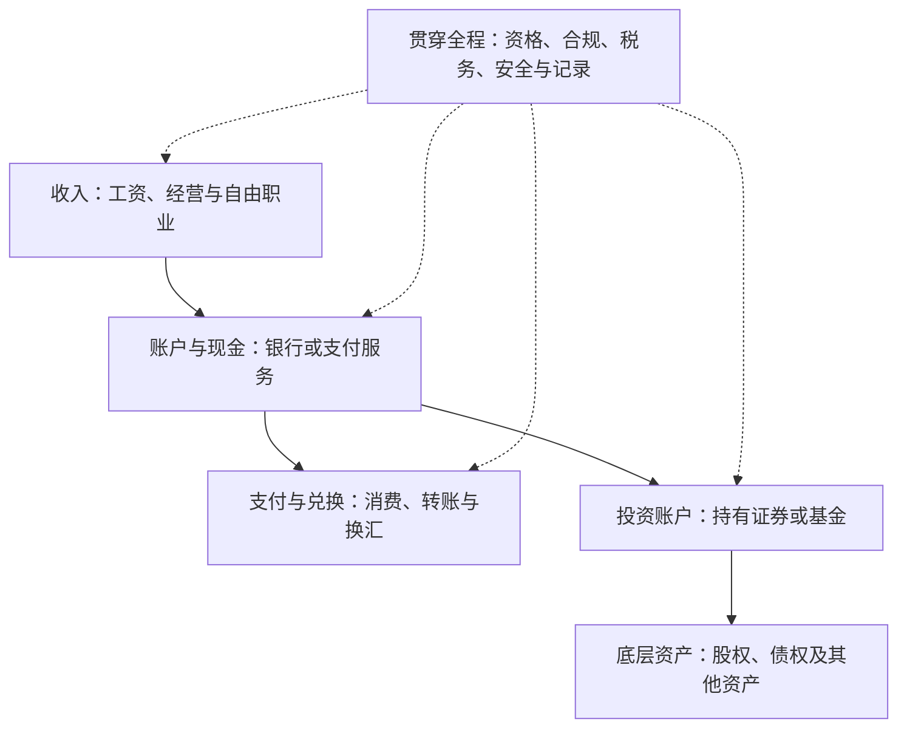

# 第一章｜全球金融基础设施地图

*Chapter 1: A Map of Global Financial Infrastructure*

更新日期：2026-10-12

初次接触海外金融时，港卡、Wise、券商、美元、ETF、USDT 和 Bitcoin 往往一起出现。它们看起来都与“全球资产”有关，却解决不同的问题。把它们放在同一张地图上，才能看清自己需要什么、哪些工具可以配合，以及风险落在哪里。

所谓个人全球金融基础设施，是一个人接收收入、存放现金、兑换货币、支付转账、持有投资和管理风险所依赖的账户、服务与制度。它提供使用金融市场的能力，本身并不保证投资回报。

## 一、先分清工具和资产

银行账户是账户，银行卡是使用账户的一种工具，美元是货币，股票是资产。一个海外账户可以提供服务，却不自动使存放其中的每一项资产更优质。

可以先用下面的表给常见名词定位：

| 名词 | 在地图中的位置 | 首先要弄清的问题 |
|---|---|---|
| 银行账户、港卡 | 存放现金与支付的接口 | 钱存在哪个机构？账户支持什么服务？ |
| Wise 等支付服务 | 收款、兑换和转账服务 | 当前居住地与用途能否使用具体功能？ |
| USD、HKD、CNY | 货币 | 余额用什么单位计量？最终花什么货币？ |
| 券商账户 | 投资交易与持有的接口 | 签约主体是谁？可交易什么？如何托管？ |
| 股票、债券、ETF | 投资资产或基金份额 | 底层权利、收益来源和风险是什么？ |
| 加密资产交易平台 | 数字资产交易与平台托管 | 平台负责什么？提款条件是什么？ |
| 自托管钱包 | 管理签名权限的工具 | 谁控制私钥？如何备份与恢复？ |
| Bitcoin、USDT | 不同机制的数字资产 | 为什么有价值？风险由谁承担？ |

这张表用于概念分类，不是机构推荐名单。支付机构账户与银行存款的法律属性和保障安排可能不同，要查看具体签约主体与条款。

## 二、把整个体系拆成五层

第一层是收入：工资、自由职业、经营收入或投资收益从哪里来，以什么货币结算。

第二层是账户与现金：收入进入什么账户，现金由谁保管，余额能否提取，提款需要什么条件。

第三层是支付与兑换：钱如何支付给别人，兑换成本是多少，汇款是否涉及中间机构。

第四层是投资：现金通过什么合法渠道进入市场，最后持有股票、债券、基金还是其他资产。

第五层是管理：如何保护账户、记录交易、核实税务要求，以及在设备丢失或账户受限时恢复访问。

图中的连线表示功能关系，不表示每个居民都能使用每条资金路径。每一次跨境转账和投资，都要分别满足适用规则与机构要求。

## 三、账户地点、货币与资产地点要分开

假设某人持有一个香港银行账户，账户内有美元余额。这说明账户服务发生在香港，余额以美元计量，却不能直接推导出他已经持有美国股票。

再假设他购买了在美国上市、以美元交易的黄金基金。他拥有的是基金份额，主要经济敞口取决于基金如何获得黄金价格表现。上市地点、交易货币和底层风险来源仍然是三个不同维度。

判断一个产品时，可以依次问：

1. 我与哪一个法律主体签约？
2. 我拥有的法律权利是什么？
3. 它使用什么货币报价或结算？
4. 收益和亏损主要由什么因素决定？
5. 我要如何卖出、赎回或取回资金？

这五个问题比“它是不是海外产品”更有解释力。

## 四、香港账户为什么会成为讨论焦点

香港银行账户常被用作理解多币种服务和跨境金融的入口。“港卡”是日常简称，实际能力取决于背后的银行账户、产品等级、居住地资格和银行条款。

香港实行联系汇率制度，港元兑美元的制度兑换区间为每美元 7.75—7.85 港元。[香港金管局：联系汇率制度](https://www.hkma.gov.hk/eng/key-functions/money/linked-exchange-rate-system/)

这个制度解释了港币与美元的紧密联系，但不意味着港币就是美元，也不意味着拥有香港账户就可以不受限制地进行跨境投资。

本章先说明账户在地图中的位置。开户条件、费用、多币种子账户、FPS 与 SWIFT 将在后续章节按官方资料分别展开。

## 五、银行体系与加密资产体系如何区分

银行账户里的存款，是账户持有人对银行的债权；其使用依赖银行服务、身份核验和适用制度。自托管钱包则通过私钥或其他签名机制控制链上操作权限；钱包并不是把币像文件一样装在手机里。

在交易平台买入数字资产后，如果仍留在平台账户，实际操作仍依赖平台。把资产转入自己控制的钱包，会改变控制方式，也会把备份、签名安全和地址核对的责任更多地交给自己。

理解这层区别后，就不会把下面几件事混为一谈：

- 银行美元存款；
- 锚定美元价格的稳定币；
- 以美元报价的 Bitcoin；
- 平台界面显示的美元估值。

这些余额可能都出现“美元”字样，却不是相同的权利和风险。后续章节将分别核对发行机制、平台条款和链上操作方式。

## 六、基础设施服务于资产配置

建立更多账户，只能增加某些服务的可选性。资产配置还需要回答：钱何时使用、能承受多大损失、是否需要随时取出，以及未来主要在哪个地区消费。

Investor.gov 的投资者教育资料强调，资产配置应考虑投资期限与风险承受能力；分散投资旨在降低集中风险，不能保证不亏损。[Investor.gov：资产配置与分散投资](https://www.investor.gov/introduction-investing/getting-started/asset-allocation)

因此，不能把“多个账户”当成分散投资。如果不同账户里都是同一只股票，资产风险仍然集中。也不能把“多种货币”自动当成低风险：未来消费货币与资产货币不匹配时，还会出现汇率风险。

## 七、建立自己的第一张地图

入门阶段，先记录已有能力，比急着增加账户更有价值。可以使用这张不含账号的空表：

| 项目 | 要记录的内容 |
|---|---|
| 收入 | 来源类型、结算货币、到账频率 |
| 生活支出 | 主要消费货币、短期必要支出 |
| 现金账户 | 机构、支持币种、提款与转账方式 |
| 投资账户 | 签约主体、可用市场、资金进出条件 |
| 资产 | 底层权利、主要风险、预计持有期限 |
| 安全与记录 | 恢复方式、交易凭证、重要资料保存位置 |

填写时不需要把身份证、账户号码、余额截图或密码放进公开仓库。公开书稿分享方法，个人财务记录由本人另行保存。

## 本章要点

个人全球金融基础设施是一张连接收入、账户、支付、投资与管理的地图。账户提供服务，货币提供计量与支付单位，资产提供不同的经济权利。

先弄清每种工具解决哪一个问题，再判断是否需要它。下一章将进一步区分赚美元、持有美元和持有美元计价投资。

---

本章为入门知识与分析框架，不构成特定投资、开户或汇款建议。
