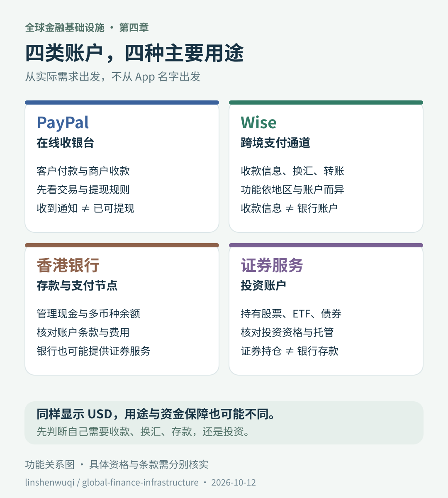
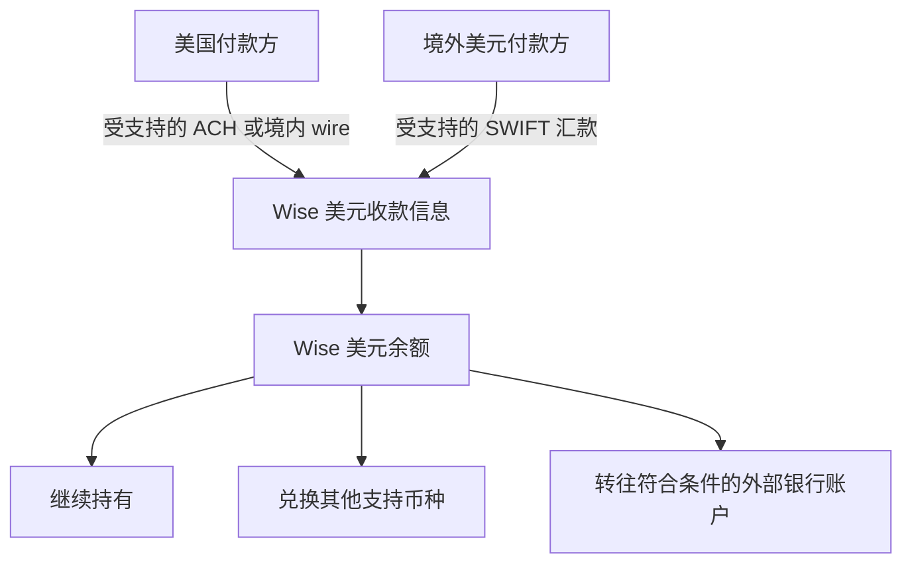
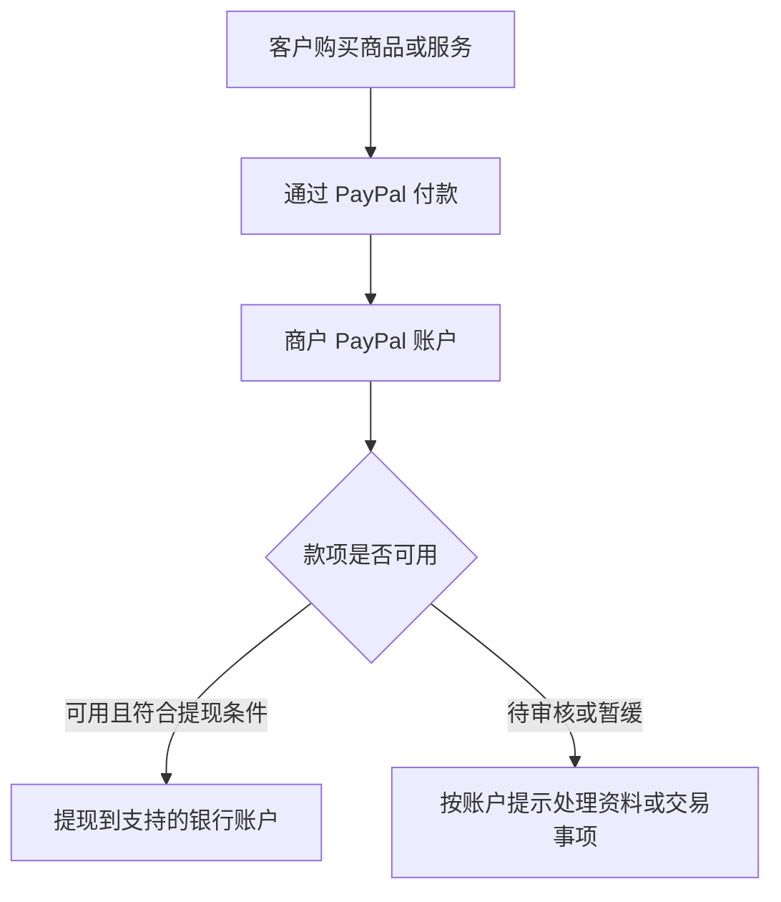
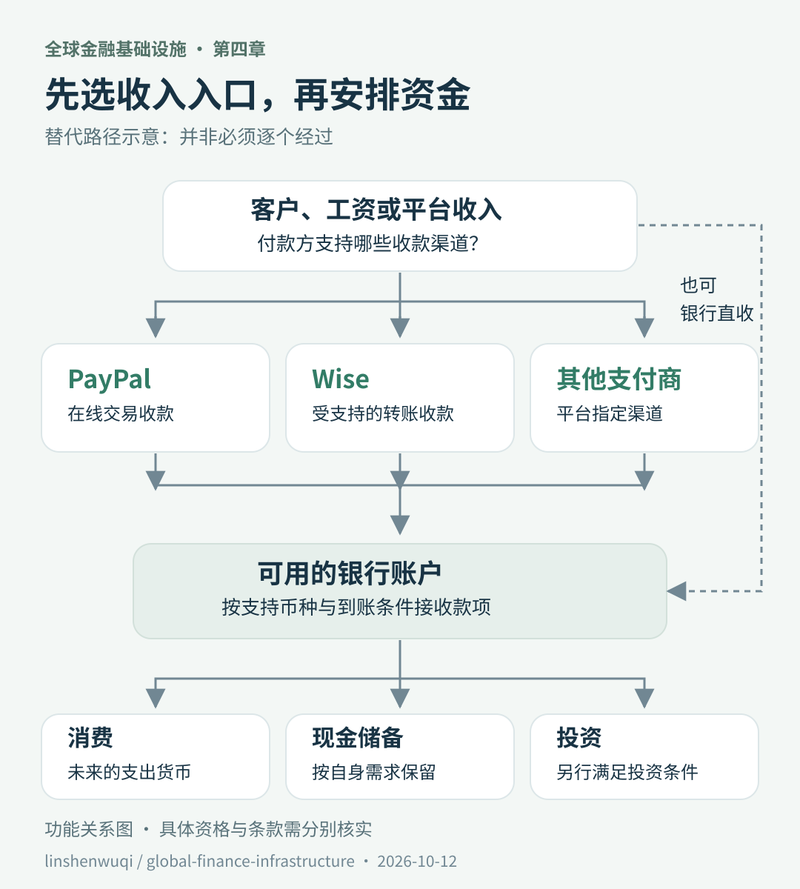
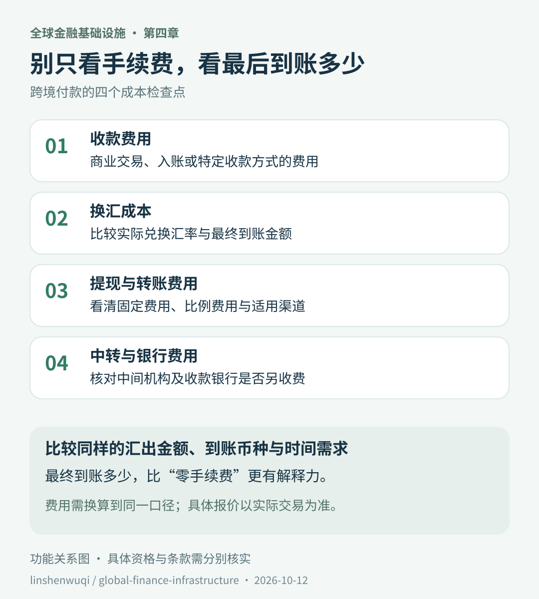

# 第四章｜Wise、PayPal 与香港银行：钱如何在全球金融体系中流动

*Chapter 4: Wise, PayPal and Hong Kong Banks — How Money Moves*

更新与资料核对日期：2026-10-12

Wise、PayPal、香港银行和券商，都可能显示美元余额。但屏幕上的“USD”相同，背后的用途、权利和资金进出规则却不同。

先用三句话抓住重点：

> **PayPal 更像在线收银台，帮助买卖双方完成付款。**

> **Wise 更像跨境支付通道，连接收款、换汇和转账。**

> **银行账户用于存款与支付，证券账户用于投资。**

这些是功能比喻。机构之间存在业务重叠，不能据此判断所有产品的法律身份、资金保障或开户资格。

## 一、先问用途，再选工具

海外客户要付款、自己要换汇、银行里要保留现金、准备买证券，是四件不同的事。选择工具时，先把需求说清楚。

| 工具 | 本章关注的主要用途 | 首先核对什么 |
|---|---|---|
| PayPal | 在线付款、商户收款 | 客户是否使用；商品或服务是否受支持；收款与提现规则 |
| Wise | 本地收款信息、换汇与跨境转账 | 居住地、账户类型、所需币种和收款功能 |
| 香港银行 | 存款、多币种管理、银行支付 | 账户资格、币种、入账条件、费用与存款保障 |
| 证券服务机构 | 股票、ETF、债券等投资 | 投资资格、市场范围、签约主体与托管安排 |

这不是账户推荐榜。银行也可能提供证券服务；支付平台也可能提供其他产品。具体使用哪项功能，就核对哪项产品的条款。

## 二、Wise：让付款方使用熟悉的收款方式

Wise 的一个重要功能是 **Local Account Details，本地收款信息**。

例如，符合条件的用户取得美元收款信息后，可以获得账号和 routing number。美国付款方可通过受支持的 ACH 或境内 wire 付款；境外美元付款也可能使用 SWIFT。到账后，款项记入 Wise 的美元余额。[Wise：美元收款方式](https://wise.com/help/articles/2827506/how-do-i-receive-money-with-my-usd-account-details)

这张图说明功能，不承诺每个用户都能开通所有路径。收款渠道、身份核验、付款来源及费用需要分别确认。

关键区别是：**收款信息让别人知道怎样付款，不等于你直接开立了传统美国银行账户。** Wise 在美元收款说明中也明确作出了这一区分。

### 注册、持有余额、收款和拿卡，是四项不同能力

不要从“能注册 Wise”推导出“能获得全部功能”。

| 能力 | 需要单独确认的问题 |
|---|---|
| 注册账户 | 当前居住地和身份能否申请？ |
| 持有余额 | 所在地区及个人／企业账户是否支持？ |
| 获取收款信息 | 目标币种是否开放，是否有额外核验？ |
| 申请卡片 | 当前地区是否支持该类卡？ |

例如，本次查阅的 Wise 余额资格页面列有中国大陆；香港则标注为仅企业账户可持有余额。美元收款信息另有地区和企业账户限制。**不同功能不能相互推导，新旧账户也可能不同。**[余额资格](https://wise.com/help/articles/2813542/where-do-i-need-to-live-to-hold-money-with-wise)、[美元收款信息资格](https://wise.com/help/articles/2810318/can-i-get-usd-account-details)

## 三、Wise 余额与银行存款，保护机制不同

Wise 的相关账户服务采用客户资金保障安排，例如将客户资金与运营资金分开保存；具体方式依签约主体和地区而异。不能因为界面显示余额，就把它套进香港银行的存款保障制度。[Wise：资金保护说明](https://wise.com/help/articles/2949821/how-wise-keeps-your-money-safe)

理解资金安全时，先问三个问题：

| 问题 | 为什么要问 |
|---|---|
| 我与谁签约？ | 品牌名不一定等于实际提供服务的法律主体 |
| 我的余额是什么性质？ | 银行存款、支付余额、证券持仓不是同一种权利 |
| 出现问题时适用什么机制？ | 存款保障、客户资金隔离、交易争议处理解决不同问题 |

银行存款保障及其范围已在[第三章](03-香港银行账户与港卡.md)说明。账户中的投资产品仍需另行判断。

## 四、PayPal：把在线付款接到商户收款

PayPal 的核心场景之一是在线交易。客户通过 PayPal 付款，商家通过自己的账户收款；商家关心的重点随之变成：款项是否可用、交易是否可能发生争议，以及怎样提现。

PayPal 官方列出的暂缓付款情形包括新卖家、交易模式变化、客户投诉或身份核验未完成。因此，**收到付款通知，不一定等于款项已经可以提现。**[PayPal：款项暂缓原因](https://www.paypal.com/c2/cshelp/article/why-is-my-payment-on-hold-or-unavailable-help126?locale.x=en_C2)

### 收到美元，不等于美元能原币提到任何银行

提现前，应把整个过程看完：

| 环节 | 需要确认的内容 |
|---|---|
| 收款 | 商业交易费用与账户支持的币种 |
| 余额 | 款项是否可用，有无审核或交易争议 |
| 提现 | 账户地区支持哪些银行和渠道 |
| 换汇 | 是否必须转换币种，采用什么汇率 |
| 到账 | 提现费用及银行可能收取的费用 |

PayPal 的商家费率页面提示，提现渠道因市场而异，币种转换可能另收费用。不能把另一地区账户的费率和功能直接套用到自己账户。[PayPal：商家费用与提现规则](https://www.paypal.com/c2/business/paypal-business-fees?locale.x=en_C2)

从资金管理角度，可以按实际需要保留处理退款和经营支出的余额，再安排资金去向。这里的重点是理解支付账户用途，而不是为所有商户规定统一的留存金额。

## 五、香港银行：可用的资金节点，但不是必经站

香港银行账户可以用于存款、换汇和支付；支持范围取决于账户产品。它可以接收符合要求的款项，也可能与投资服务相连。

但不能把所有人的收入都画成“PayPal → Wise → 香港银行”。有时客户直接向银行付款，有时平台只支持指定支付商；账户不匹配时，一条看似方便的路径可能根本不可用。

图中是替代路径，不是必须依次经过的步骤。**每条连线都需要付款方、收款方、账户条款和资金用途同时允许。**跨境款项进入某个账户，也不自动取得证券投资资格。

“钱怎么收到”和“收到后买什么”，应分开设计：

- **收入进入：**客户或平台支持什么渠道，钱能否到账并取出。
- **资金配置：**多少钱用于消费、保留现金，或在符合条件时投入资产。

收款工具解决了第一部分，不等于已经解决第二部分。

## 六、ACH、SEPA、FPS、SWIFT：不要只把它们当缩写

这些名字描述支付背后的不同体系。看懂它们，能帮助我们知道付款需要哪些资料，以及哪条渠道可能适用。

| 名称 | 如何理解 | 本章需要记住的区别 |
|---|---|---|
| ACH | 美国电子支付网络 | 常见于工资入账、账单扣款等，不等于所有付款即时到账 |
| SEPA | 单一欧元支付区及相关支付方案 | 围绕欧元支付，范围不只欧元区，也不等于所有欧洲货币 |
| FPS | 香港快速支付系统 | 支持港币与人民币，不因账户有美元余额就能转美元 |
| SWIFT | 金融机构之间的通信网络 | 传递支付等金融信息，实际资金转移由相关机构完成 |

来源：[Nacha：ACH](https://www.nacha.org/what-ach)、[欧洲支付委员会：SEPA](https://www.europeanpaymentscouncil.eu/about-sepa)、[香港金管局：FPS](https://www.hkma.gov.hk/eng/key-functions/international-financial-centre/financial-market-infrastructure/faster-payment-system-fps/)、[SWIFT：功能说明](https://www.swift.com/about-us/who-we-are)。

账号、routing number、IBAN 是收款资料；ACH、SEPA 等描述支付体系。资料长得像当地账户，也不能单凭外观判断服务的法律性质。

## 七、跨境付款要比较“最后到账多少”

“手续费为零”不等于总成本为零。“用了本地网络”也不能证明某个工具一定更便宜。

比较时，应固定汇出金额、到账币种和所需时间，并把费用换算到同一口径。可以直接问：**我付出相同金额，收款方最终得到多少？**

下面是自拟算例，与 Wise、PayPal 或任何银行的实际报价无关。假设汇出 1,000 美元，费用先从美元本金扣除，且没有其他费用：

| 假设方案 | 明示费用 | 汇率：每美元对应港币 | 最终到账 |
|---|---:|---:|---:|
| A | 5 美元 | 7.75 | (1,000 − 5) × 7.75 = 7,711.25 港元 |
| B | 0 美元 | 7.70 | 1,000 × 7.70 = 7,700.00 港元 |

B 标注零手续费，但本例中 A 最终多到账 11.25 港元。判断总成本时，汇率和明示费用需要一起看；现实中还可能有中转或收款银行费用。

## 八、用四个问题，画出自己的资金路径

与其收集账户，不如先完成一张简单的需求表：

| 问题 | 示例答案 |
|---|---|
| 钱从哪里来？ | 工资、客户或内容平台 |
| 付款方支持什么？ | 银行转账、指定支付商或在线付款 |
| 钱以什么货币到账？ | USD、EUR、HKD 等 |
| 之后主要用来做什么？ | 消费、现金储备或符合条件的投资 |

然后检查入口能否使用、余额能否取出、费用是否合理、资料能否持续提供。工具越多，资料维护和对账工作也越多；增加一个账户，应有明确用途。

## 本章要点

**PayPal 帮助完成在线付款，Wise 连接跨境收款与转账，银行提供存款和支付，证券服务机构提供投资功能。**

它们可以配合，也存在重叠。决定是否使用某项服务的，是具体需求和条款，而不是 App 中是否出现美元余额。

下一章将讨论：**跨境投资的资金路径与合规边界。**

---

[本章推文版与分享图](../传播/04-Wise、PayPal与香港银行-推文版.md)可用于简短分享；完整来源见[来源索引](../参考资料/来源索引.md)。

本章依据第四节已有成稿整理。示例不包含真实账户信息，功能与资格以实际签约主体和最新条款为准。
