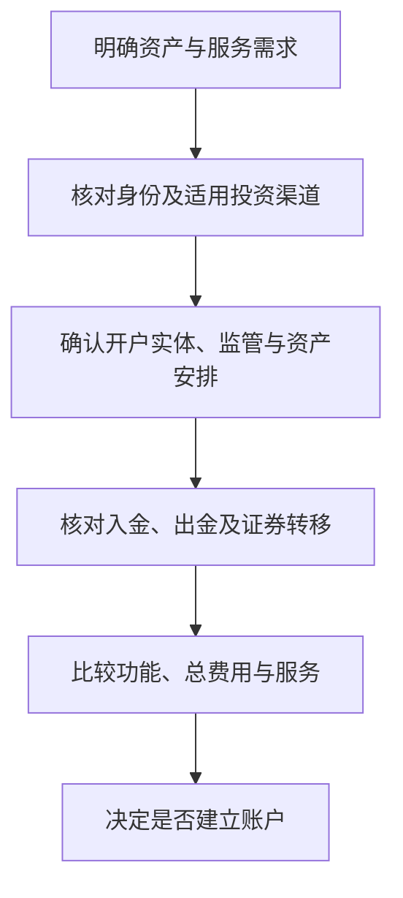

# 第六章｜美股券商怎么选：开户、账户安全与资金进出

*Chapter 6: Choosing a Broker for U.S. Stocks — Accounts, Safety and Transfers*

更新与资料核对日期：2026-10-12

准备投资美股时，普通人最先遇到的往往不是证券后台如何运作，而是几个现实问题：自己能开什么账户，资金放进去是否安全，能否购买想要的产品，以及将来怎样取回资金。

网上的券商比较经常从“零佣金”“开户奖励”开始。这些信息有参考价值，却不足以判断一个账户是否适合长期使用。更有解释力的顺序是：**先确认能否用真实身份开户，再看账户由谁提供、资产怎样保护，最后比较资金进出、费用和使用体验。**

本章以这些实际问题为主，介绍选择券商的方法。具体哪家机构当前接受申请、要求哪些材料，应在准备开户时重新核对。

## 一、券商究竟帮我们做什么？

券商提供证券交易及相关账户服务。投资者通过它下单，买卖账户允许交易的股票、ETF、债券等产品，并查看持仓和交易记录。

在国内，我们熟悉“银行卡连接证券账户”的结构。投资美股时，基本关系也类似：

银行存款与证券服务承担不同功能，即使它们显示在同一个 App 中，也需要分别理解。银行本身可能提供证券服务，券商也可能提供现金管理等配套功能。

因此，选择券商只是选择进入市场的服务工具。账户开好之后，买什么、买多少、承担什么风险，仍然是投资者自己的决定。

## 二、首先要问：我能否正常开户？

对于中国大陆投资者，开户资格往往比佣金更早成为限制条件。一家机构接受哪些居住地的客户，认可什么身份证明、地址资料和税务信息，都可能随业务政策改变。

所以，“以前有人成功开户”只能说明过去的一次申请，并不能证明今天适用于自己。网上教程也可能混用了个人账户、企业账户、不同地区客户或旧账户的条件。

准备开户时，应查看机构当前的官方要求；有不确定之处，可以向官方客服确认自己的实际情况。美国投资者教育网站的开户说明，也将身份、地址、税务及财务资料列为开户时需要考虑的信息。[Investor.gov：开立证券账户](https://www.investor.gov/introduction-investing/general-resources/news-alerts/alerts-bulletins/investor-bulletins-43)

能够开户，也不代表所有资金来源都可以用于投资。资金来源和适用投资渠道，仍应结合[第五章](05-中国大陆居民如何获得海外资产敞口.md)理解。

## 三、规模和历史有参考价值，但不能代替监管核实

长期使用账户，需要考虑机构能否持续提供服务，以及出现问题时能否联系、查询记录和办理账户转移。经营历史、业务规模、财务披露和客户服务，都可以作为比较因素。

不过，大品牌并不是零风险的保证，小机构也不能仅凭规模被认定为不安全。判断的起点应是实际服务机构是否受相应监管，以及它的业务资格是否与提供的服务相符。

美国机构可以通过 FINRA 的 [BrokerCheck](https://brokercheck.finra.org/) 查询相关注册和背景信息；香港机构可以查阅香港证监会的[持牌人及注册机构公众纪录册](https://www.sfc.hk/en/Regulatory-functions/Intermediaries/Licensing/Register-of-licensed-persons-and-registered-institutions)。

查询时，应使用公司完整名称核对，注意登记信息与官方联系方式。查到注册资料，是核实机构身份的一步，不是对投资收益或全部业务的保证。

## 四、美股券商为什么看起来有很多种？

常见机构可能侧重不同的服务：有的提供较广的证券和财富管理业务，有的强调多市场、多币种交易，有的以简单的手机 App 和中文服务吸引客户。

这些是业务特点，不是安全等级。普通投资者可以先从自己的需求缩小范围。

如果只需要长期持有少量股票或 ETF，复杂的交易界面和大量高级功能未必有用。如果以后需要交易不同市场、管理多种货币或转移证券，则要查看这些功能的支持范围。

**需要的功能能否稳定使用，比平台宣传了多少功能更重要。**

## 五、美国券商与香港券商，到底有什么区别？

这里先分清三个问题：自己与哪家公司签约，资产由谁保管，以及买卖的是哪个市场的证券。

一家香港机构可以提供美股交易服务，因此“能买美股”不等于“账户一定开在美国”。同一个国际品牌也可能由不同地区的公司提供服务，或涉及其他保管与清算安排。

例如，看到 IBKR 这样的品牌名时，还需要继续查看开户协议和账户文件中的公司全名。这个实际提供服务的法律主体，通常称为**账户法律实体（Account Entity）**。

对普通投资者而言，不必一开始研究所有后台机构，但至少应弄清：

- 与谁签约，哪些监管规则适用；
- 文件怎样说明客户资产的保管与保护；
- 出现争议时，应联系哪家机构。

不能仅根据 App 名称、网站语言或自己购买的股票，判断整个账户的监管与保护安排。

## 六、券商倒闭，股票是不是就没了？

客户资产与券商自身资产的区分，是证券账户安全的重要基础。以美国规则为例，客户保护规则要求承担相应业务的券商保护客户资金和证券，防止将客户资金用于自身经营。[SEC：券商客户保护规则说明](https://www.sec.gov/divisions/marketreg/bdguide.htm)

这意味着，券商经营失败，不等于客户持有的股票自动失去所有权。处理程序会涉及核实记录、返还或转移客户资产等事项。

但资产分开管理，也不意味着发生问题后立刻能取回全部资金。实际处理仍取决于资产是否完整、记录能否核对、账户安排和适用程序。

因此，除了查看机构说明，也应保存自己的月结单、交易确认和重要账户文件。它们可以帮助核对持仓与资金，不能只依赖手机屏幕显示的余额。

## 七、SIPC 保护的是什么？

美国券商账户常会提到 SIPC，即美国证券投资者保护公司。它主要处理成员券商发生财务问题、客户账户中的合资格证券或现金出现缺失的情形。

最重要的区别，是将资产保管问题与投资亏损分开：

| 情形 | 应怎样理解 |
|---|---|
| 股票价格下跌 | 投资风险，SIPC 不补偿市场亏损 |
| 券商出现财务问题，但客户资产完整 | 重点是依程序确认、返还或转移资产 |
| 成员券商出现问题且合资格客户资产缺失 | 可能涉及 SIPC 保护，须按具体规则处理 |

SIPC 的保护有条件和限额，不等同于银行存款保险，也不是对所有金融产品的保险。是否适用，应核对具体成员机构、账户及资产安排，不能把某个品牌一处的保护说明推广到所有关联账户。[SIPC：保护范围](https://www.sipc.org/for-investors/what-sipc-protects)

因此，“有 SIPC”是需要理解的保护机制，不能简化成“这个账户无论发生什么都安全”。

## 八、为什么开户会问税务居民、税号和地址？

金融机构需要确认客户身份及相关税务信息。因此，申请时可能要求税务居民声明、税号和居住地址，并按照要求核验资料。

CRS 是金融账户涉税信息自动交换的共同申报准则。参与地区按照规定识别和交换可报告账户信息。它不是每笔股票交易都实时向税务机关直播的系统。香港政府说明，香港按照 CRS 与伙伴地区开展年度金融账户信息交换。[香港政府：金融账户信息交换说明](https://www.info.gov.hk/gia/general/202603/25/P2026032500547.htm)

美国的信息交换安排与 CRS 不同。OECD 的交换资料将美国依据 FATCA 及相关政府间协议开展的安排另作说明；FATCA 主要涉及美国账户持有人及相关外国金融机构的申报义务。[OECD：自动交换资料](https://www.oecd.org/content/dam/oecd/en/topics/policy-issue-focus/aeoi/aeoi-exchanges.pdf)、[IRS：FATCA](https://www.irs.gov/businesses/corporations/foreign-account-tax-compliance-act-fatca)

因此，网上的“非 CRS 券商”标签不能回答全部税务问题。信息怎样交换，与本人依法应否申报纳税，是不同层面的问题。资金经过的银行，也可能适用与券商不同的信息申报规则。

## 九、地址证明应该怎样准备？

不同机构认可的证明材料可能不同，例如银行账单、公共事业账单或政府文件。申请人应按官方清单，提交能够反映真实情况的资料。

当一家机构要求自己并不具备的居住条件时，应先确认是否符合其服务范围，而不是把材料改成符合要求的样子。居住地址、通信地址和税务居民身份也不能混填。

账户使用期间，机构可能要求更新资料。真实、可持续提供的材料，有助于维持稳定的账户关系；不能只考虑第一次申请能否通过。

具体材料及有效期属于容易变化的开户信息，宜在实操部分注明核对日期，正文保留准备和核实的方法。

## 十、现金账户与保证金账户怎么理解？

开户时常见两个名称：**Cash Account（现金账户）**和 **Margin Account（保证金账户）**。

| 类型 | 基本功能 | 要理解的事项 |
|---|---|---|
| 现金账户 | 不向券商借款支付交易 | 仍需遵守资金到账、币种及结算规则 |
| 保证金账户 | 在允许范围内使用融资等功能 | 利息、保证金要求及被强制平仓的风险 |

现金账户可以用自有资金交易，适合希望先理解基本投资和账户规则的人。账户中显示有现金，也不意味着任何币种、任何时点都可以直接下单，要看可用资金和产品要求。

保证金账户允许借款，但开立这种账户不等于已经借钱。真正使用融资后，损失可能被放大；资金不足时，券商还可能出售持仓以满足要求。Investor.gov 的说明提醒，券商在某些情况下可以不事先征得客户同意出售证券，损失也可能超过最初投入。[Investor.gov：保证金账户](https://www.investor.gov/introduction-investing/general-resources/news-alerts/alerts-bulletins/investor-bulletins-29)

如果没有明确的融资需求，开户时不必仅因为功能更多就选择复杂账户。

## 十一、佣金之外，还要比较哪些费用？

零佣金只描述某类交易的一个费用项目。选择账户时，更有用的是按自己的使用方式估算总成本。

| 费用或服务 | 可以怎样核对 |
|---|---|
| 交易费用 | 目标市场及产品的佣金、最低收费和其他交易收费 |
| 换汇 | 是否需要主动兑换，采用什么汇率和费用 |
| 入金与出金 | 支持的币种、银行、渠道，以及次数或金额限制 |
| 账户服务 | 是否有维护、数据订阅或其他配套费用 |
| 证券转移 | 能否转往其他机构，支持哪些资产，怎样收费 |
| 客户服务 | 能否有效沟通，问题处理渠道是否清楚 |

这些项目应查看实际开户实体及适用账户的收费表。不能把某地区客户享有的优惠，直接套用到另一个地区的账户。

资金进出尤其值得提前确认。能够开户，却没有与自身情况相匹配的入金和出金安排，并不构成完整的投资方案。

## 十二、把八个问题按顺序问清楚

比较券商时，可以用以下八个问题形成一张记录表：

| 问题 | 要记录的答案 |
|---|---|
| 我的真实身份能否申请？ | 当前服务地区与客户准入条件 |
| 需要什么材料？ | 身份、地址、税务与其他核验要求 |
| 我与谁签约？ | 公司全名及相关账户文件 |
| 谁监管这项服务？ | 可核实的注册或牌照信息 |
| 客户资产如何保护？ | 保管安排、适用机制与主要限制 |
| 能买什么？ | 自己需要的市场、产品与交易权限 |
| 资金怎样进去、出来？ | 可用渠道、币种、条件与费用 |
| 长期使用成本如何？ | 交易、换汇、账户服务和转移成本 |

先确认身份、实体与资产安排，再比较资金进出和实际功能，最后衡量费用、界面和客服体验。这样更容易找到适合自己需求的工具。

开户奖励可以看，但不应代替上述问题。账户里的资产越多、预计使用时间越长，持续服务和退出安排就越重要。

## 十三、正文与开户实操，为什么要分开写？

判断账户法律实体、区分市场风险和保管风险、理解现金与保证金账户，这些方法相对稳定。具体接受哪些申请人、材料有效期多长、账户分配给哪个实体，则可能变化。

本书正文因此着重解释判断方法。具体开户教程应在实操部分按机构、账户类型和核对日期记录，使用前再查官方要求。

这也避免把某一时点的“最佳券商排行榜”，误读为长期适用于所有人的结论。

## 十四、券商放回整个资金体系中，才能判断是否需要

如果目标只是获得某类指数敞口，可以先结合第五章比较境内产品的可用性和实际成本。如果还需要特定海外证券、多市场服务或跨境账户管理，则需要进一步判断证券账户是否与自身条件相匹配。

海外收入、香港银行账户或交易软件，都不能单独证明投资渠道与资金用途已经满足要求。

真正完整的海外投资体系，应能解释钱从哪里来、通过什么账户投资、持仓如何记录，以及退出后如何使用资金。券商只是其中一个环节。

## 本章要点

选择美股券商，首先看自己能否用真实身份申请，以及实际与哪家公司建立账户关系。机构规模、品牌和优惠都有参考价值，但不能代替监管、资产保护和资金进出安排的核实。

券商经营失败与股票价格下跌，是两类风险；SIPC、CRS 和个人税务义务，也分别解决不同的问题。

把这些基本问题看清楚，再比较费用与使用体验，才更适合长期使用账户。

下一章将讨论：**中国居民投资美股的税务：W-8BEN、股息及其他所得。**

---

本章依据第六讲最后修订的通俗版成稿润色。具体机构的开户、账户分配和收费政策以当时官方资料为准。完整出处见[来源索引](../参考资料/来源索引.md)。
