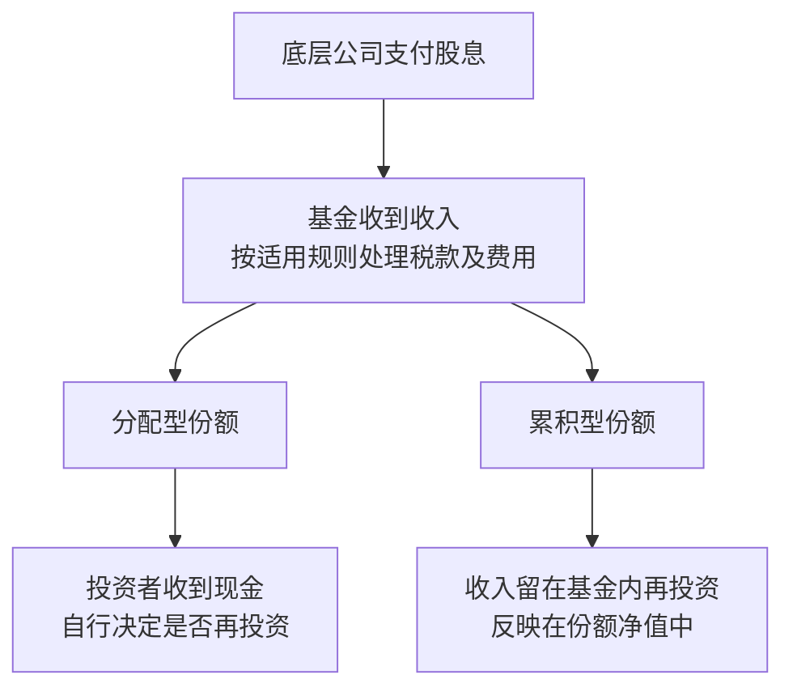

# 第九章｜知道想买什么之后，到底应该买哪个产品？

*Chapter 9: Choosing Products to Hold Global Assets*

更新与资料核对日期：2026-10-12

[第八章](08-普通人值得长期关注的全球优质资产.md)建立了全球资产地图。确定自己希望持有标普 500、纳斯达克 100、全球股票、美债或者黄金之后，接下来要解决的，是用什么产品实现。

同样跟踪标普 500，为什么有 VOO、IVV、SPY 和 CSPX？同样跟踪纳斯达克 100，QQQ 和 QQQM 有什么区别？为什么一些国际投资者选择美国注册的基金，另一些人选择爱尔兰注册的 UCITS 产品？

这些问题都需要先区分：**希望获得的资产暴露，与承载它的金融产品。** 标普 500 代表一种股票市场范围，具体基金则以自己的法律结构、费用和交易安排提供这种暴露。

本章讨论产品选择，下一章再讨论资金应如何分配。以下产品用于比较结构和判断方法，能否购买仍须结合第五、六章的投资渠道与账户条件。

## 一、同一个指数，为什么有很多产品？

VOO、IVV 和 SPY 都以跟踪标普 500 为目标，底层股票方向相近。在使用同一币种、同一期间、包含股息的总回报口径下，表现通常较接近；费用、跟踪情况和交易价格仍会造成差异。

普通长期持有者，主要比较持续成本与使用便利；交易频繁或需要期权的人，还会关心成交、价差和相关交易市场。SPY 历史较长并提供期权交易，但这不意味着每位长期投资者都需要这些功能。

| 产品示例 | 主要目标 | 官方列示年费率 | 比较时的重点 |
|---|---|---:|---|
| VOO | 标普 500 | 0.03% | 持有成本及账户适配 |
| IVV | 标普 500 | 0.03% | 持有成本及账户适配 |
| SPY | 标普 500 | 0.0945% | 交易需求、价差与期权功能 |
| CSPX | 标普 500 | 0.07% | 爱尔兰 UCITS 结构、累积型份额与交易市场 |

数据核对日期为 2026-10-12。表中为发行方列示的 Expense Ratio、Gross Expense Ratio 或 TER，口径按各自资料；不是单独的管理费，也不含投资者全部交易、换汇和税务成本。VOO 引用 2026-06-30 官方资料中的费率，其他项目按所链接页面列示；费率可能调整，交易前应重新核对。[Vanguard：VOO 资料](https://workplace.vanguard.com/assets/corp/fund_communications/pdf_publish/us-products/fact-sheet/F0968.pdf)、[iShares：IVV](https://www.ishares.com/us/products/239726/ishares-core-sp-500-etf)、[State Street：SPY](https://www.ssga.com/us/en/individual/etfs/state-street-spdr-sp-500-etf-trust-spy)、[iShares：CSPX](https://www.ishares.com/uk/individual/en/products/253743/CSSPX)

没有必要仅因几天或几个月的收益差异，在同类产品之间频繁切换。先确认差异来自哪里，再估算换仓本身的成本。

## 二、QQQ 和 QQQM，主要区别是什么？

QQQ 和 QQQM 都跟踪纳斯达克 100，主要提供相同的指数方向。Invesco 的资料将 QQQ 的交易流动性，与 QQQM 较低的长期持有成本作为比较重点。

| 产品 | 指数方向 | 官方列示年费率 |
|---|---|---:|
| QQQ | 纳斯达克 100 | 0.18% |
| QQQM | 纳斯达克 100 | 0.15% |

上述为 2026-10-12 核对的官方资料，不沿用旧教程中的 QQQ 0.20% 数字。[Invesco：QQQ 与 QQQM 比较](https://www.invesco.com/us/en/insights/building-versatile-portfolios-qqq-innovation-suite.html)

例如，假设全年持有金额固定为 10,000 美元，只估算上述费用，分别对应约 18 美元和 15 美元，差额为 3 美元。它说明费率差异的量级，不是实际账户收益计算。

因此，应先问自己需要长期持有工具，还是高频交易及相关功能，再比较总成本。更低费率有价值，却不能单独决定所有人的选择。

## 三、年费率值得关注，但要放在总成本中看

延续原稿的自拟算例：两只产品年费率分别为 0.03% 和 0.10%，假设资产金额全年不变。

| 持有金额 | 0.03% 对应年费用 | 0.10% 对应年费用 | 差额 |
|---|---:|---:|---:|
| 10,000 美元 | 3 美元 | 10 美元 | 7 美元 |
| 100,000 美元 | 30 美元 | 100 美元 | 70 美元 |

长期费用会积累，但换仓可能发生佣金、买卖价差、换汇和税务成本。如果一次调整付出较多成本，只为节省很小的年费差额，未必合算。

基金费用通常已影响净值与公布的基金回报。看已经扣除基金费用的历史回报时，不应再机械扣一次相同费率。比较时也要注意，价格涨幅不等于包含分红再投资的总回报。

## 四、基金注册地，为什么值得国际投资者关注？

跟踪相同指数的产品，可以采用不同地区的基金法律结构。VOO、IVV 等是美国产品；CSPX 的官方资料则列明，注册地为爱尔兰，并采用 UCITS 结构。

要分清三个地点：基金注册在哪里，通过哪个交易所买卖，以及底层资产属于哪些市场。爱尔兰基金可以主要投资美国股票，也可以用美元在伦敦交易。

这些安排会影响监管、基金收到股息后的处理，以及投资者自身的税务和继承分析。[第七章](07-中国居民投资美股的税务.md)讨论过美国所在地资产与遗产税，不能只凭券商或交易所所在地判断。

比较时，可以把税务理解成两层：底层资产向基金支付收入时怎样处理，基金份额投资者取得分配或卖出时又怎样处理。基金注册地值得关注，但不是一个适用于所有人的“自动免税”标签。

## 五、UCITS ETF 是什么结构？

UCITS 是欧洲的一套基金监管框架，不是一种资产类别。产品使用这个标签，不能说明它一定比其他基金更适合自己，也不能说明投资者统一适用同一种税率。[欧盟委员会：投资基金与 UCITS 框架](https://finance.ec.europa.eu/financial-markets/financial-markets-policy/investment-funds_en)

原稿中的几个例子如下：

| 产品代码示例 | 指数方向 | 该份额的收入处理 | 基金注册地 |
|---|---|---|---|
| CSPX | 标普 500 | 累积型 | 爱尔兰 |
| CNDX | 纳斯达克 100 | 累积型 | 爱尔兰 |
| VWRA | FTSE All-World 全球股票 | 累积型 | 爱尔兰 |

这里的代码指相应上市安排，并非全球唯一身份。同一份额可能在不同交易所有不同代码或交易币种。下单前应核对完整名称、交易所、币种与 ISIN，而不是只看几个字母。[iShares：CSPX](https://www.ishares.com/uk/individual/en/products/253743/CSSPX)、[iShares：CNDX](https://www.ishares.com/uk/individual/en/products/253741/CNDX)、[Vanguard：FTSE All-World 累积型](https://www.vanguard.co.uk/professional/product/etf/equity/9679/ftse-all-world-ucits-etf-usd-accumulating)

## 六、分配型与累积型，有什么区别？

**Distributing（分配型）**会按产品安排向投资者支付现金。**Accumulating（累积型）**则将相关收入留在基金内部再投资。



累积型可以减少手动再投资，但“没收到现金”不代表整个过程没有税款，也不能直接推导出投资者没有申报义务。基金层面和个人层面的处理，仍须分开判断。

比较两种份额的表现，也要把已支付的现金收入计入，否则容易把累积型的净值增长与分配型的除息价格直接比较。

## 七、想一次覆盖全球股票，可以看什么？

VT 与 VWRA 都是原稿列出的全球股票产品，但它们并不是同一个指数的两个版本。

| 产品 | 跟踪基准 | 主要股票规模范围 | 收入处理 |
|---|---|---|---|
| VT | FTSE Global All Cap | 大盘、中盘与小盘 | 分配型 |
| VWRA | FTSE All-World | 大盘与中盘 | 累积型 |

两者都覆盖发达和新兴市场，区别还包括基金结构、股票范围、费用和上市安排。VT 的资料为 2026-06-30；VWRA 的范围和结构按官方页面核对。[Vanguard：VT 资料](https://workplace.vanguard.com/assets/corp/fund_communications/pdf_publish/us-products/fact-sheet/F3141.pdf)、[Vanguard：FTSE All-World 累积型](https://www.vanguard.co.uk/professional/product/etf/equity/9679/ftse-all-world-ucits-etf-usd-accumulating)

它们体现的是让多个市场共同参与组合的思路，不需要自己逐一预测国家赢家。但全球覆盖并不意味着每个国家平均分配，也不消除全球股票共同下跌的风险。

## 八、再买日本或欧洲，意味着什么？

如果全球基金已经包含日本和欧洲，再买对应地区产品，主要是在提高该地区的组合比重。

例如，假设全球基金内日本权重为 5%，组合中有 80% 全球基金、20% 日本基金，那么日本的整体权重约为：

```text
80% × 5% + 20% × 100% = 24%
```

这是自拟算例，不是任何基金的实际当前权重。它说明“全球基金加日本基金”，是在表达额外偏好。

国家、行业与因子基金，都可以按这个方法合并查看底层覆盖。它们是否需要加入，应由组合目标决定，而不是为了收集更多市场。

## 九、美债产品的重要区别，是期限与利率敏感度

美国国债具有较高信用质量，但不同期限的美债产品，价格表现可能差别很大。

| 原稿产品示例 | 主要国债期限范围 | 主要理解角度 |
|---|---|---|
| SGOV | 0—3 个月 | 短期美元资金管理，利率敏感度较低 |
| IEF | 剩余期限 7—10 年 | 中期国债配置，价格会受到利率变化影响 |
| TLT | 剩余期限超过 20 年 | 长久期国债配置，对长期利率更敏感 |

范围按发行方资料核对。产品持仓会更新，“7—10 年”或“20 年以上”描述的是所投资债券的期限，并不是投资者买入基金后等待这些年就自动到期。[iShares：SGOV](https://www.ishares.com/us/products/314116/ishares-0-3-month-treasury-bond-etf)、[iShares：IEF](https://www.ishares.com/us/products/239456/ishares-710-year-treasury-bond-etf)、[iShares：TLT](https://www.ishares.com/us/products/239454/ishares-20-year-treasury-bond-etf)

SGOV 可以被理解为短期美元资金的“停车场”之一，但它仍是证券产品，涉及交易、结算、费用和汇率，并不是银行存款，也不等于货币市场基金。

长期美债则不能当作高利率版本的存款。市场利率上升时，其价格可能明显下跌；利率下降时，也可能上涨。债券信用质量高，与基金价格稳定是两个问题。

## 十、为什么不能只比较债券收益率？

债券产品页面可能同时列出 SEC 收益率、过去分配收益率和历史总回报。它们回答不同问题，不能混用，更不能把其中一个数字当成未来一年保证到手的收益。

投资者除了问“现在产生多少收入”，还需要问“价格会怎样受利率变化影响”。基金公布的有效久期，可以帮助理解利率敏感度，但它也会变化。

比较总回报时，应同时计入价格变化和收入。即使收到利息，卖出时仍可能亏损；债券基金也没有普通单只债券那样统一的本金到期日。[Investor.gov：债券基金风险](https://www.investor.gov/introduction-investing/investing-basics/glossary/bond-funds-and-income-funds)

## 十一、黄金可以通过哪些证券产品持有？

原稿列出的 IAU、GLDM，都提供与所持黄金价格相关的暴露。通过证券账户买卖，可以减少自行采购、保管和回收金条的操作。

但它们采用黄金信托结构，不能把所有股票 ETF 的监管与税务结论原样套用。发行方也说明，这些信托不是按美国《1940 年投资公司法》注册的投资公司。[iShares：IAU](https://www.ishares.com/us/products/239561/ishares-gold-trust-fund)、[State Street：GLDM](https://www.ssga.com/us/en/individual/etfs/spdr-gold-minishares-gldm)

证券份额与自己持有实物金条，使用方式不同；普通小额持有人也不应假定能直接提取金条。需要看保管、赎回和费用条款。

此外，黄金价格产品与金矿公司股票产品提供的暴露不同。后者还涉及企业经营、成本和管理风险，不能仅凭名称都有“黄金”就当成同类工具。

## 十二、可以按照六步选择产品

| 判断顺序 | 要回答的问题 |
|---|---|
| 底层资产 | 跟踪什么基准，包含哪些市场和公司规模，是否使用杠杆？ |
| 法律结构 | 注册在哪里，属于基金、信托还是其他证券结构？ |
| 收入处理 | 分配型还是累积型，是哪个份额类别？ |
| 总成本 | 年费率、价差、交易与换汇费怎样共同影响持有？ |
| 运作与流动性 | 运作历史、规模、跟踪表现和实际可成交情况如何？ |
| 账户与税务适配 | 自己能否通过适用渠道购买，持有和卖出如何处理税务？ |

资产、结构和账户条件应一起确认。税务问题也应在购买前判断，而不是等下单后才看。


## 十三、每股价格高，不代表底层资产更贵

一只基金每股 800 美元，另一只每股 100 美元，不能据此判断第一只的底层资产贵八倍。

假设两种份额都对应 80,000 美元资产，分别切成 100 份和 800 份，就得到 800 美元和 100 美元的单位净值。单份价格主要与划分方式有关；真正的估值，要看底层资产与买入价格。

交易时还要看市价相对净值的折溢价。支持碎股的账户可以降低单份价格带来的门槛，但功能与规则应按券商要求核对。

## 十四、普通人不需要把所有产品都买齐

认识这些代码，是为了比较实现同一目标的工具。拥有全球股票基金后，是否还需要美国、国家或行业基金，应结合已有覆盖判断；选择现金管理、债券或黄金产品，也要先知道它承担什么任务。

本章不决定股票、债券和黄金各占多少，那是组合设计的问题。产品越多，记录、核对和维护可能越复杂；每一种新增产品都应有可解释的用途。

## 本章要点

先确定希望持有的资产，再比较产品。相同指数可以有不同工具，全球股票产品也未必覆盖同样的公司范围。

基金注册地、收入处理、费用、流动性以及账户和税务条件，都影响实际使用。短期与长期美债也承担不同风险，不能仅凭利息数字选择。

下一章将回答：[普通人的全球资产组合，到底应该怎么搭？](10-普通人的全球资产组合.md) 从钱的用途出发，决定核心、稳定资产与主动观点的比例，并学习再平衡。

---

本章依据第九讲公开版成稿润色。费率为注明日期的官方资料快照；费用、区域权重和份额价格算例均为自拟，忽略未列出的税费、价格变化与现金流。产品代码用于说明，不构成通用购买清单。完整出处见[来源索引](../参考资料/来源索引.md)。
