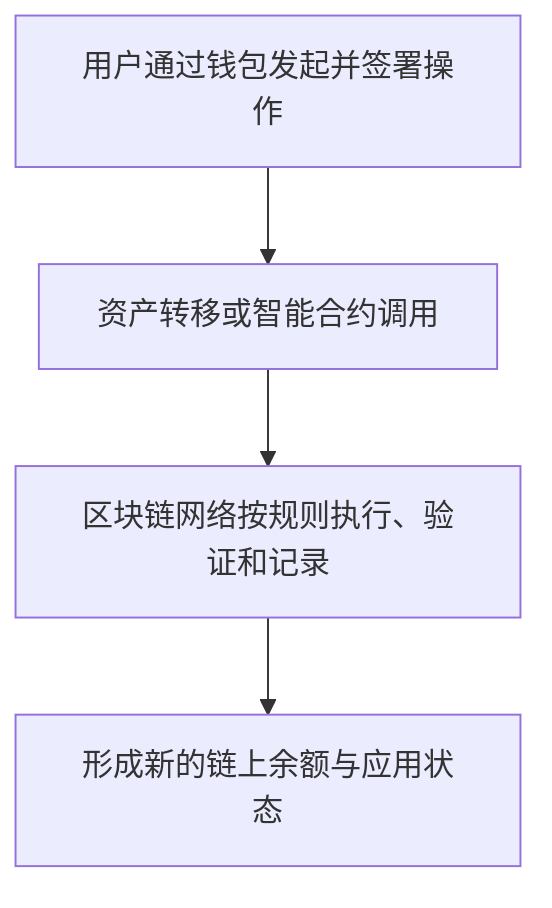

# 第十二章｜区块链到底是什么？Ethereum、TRON 又是什么？

*Chapter 12: Understanding Blockchain, Ethereum and TRON*

更新与资料核对日期：2026-10-13

[上一章](11-比特币到底是什么.md)介绍了比特币：它把密码学、公开账本和共识规则组合起来，在没有单一记账管理者的情况下完成数字价值转移。

沿着这个思路，可以进一步追问：如果一个网络能够共同记录“谁拥有多少资产”，能否也共同执行交易规则、借贷程序和其他应用？

Ethereum（以太坊）、TRON（波场）等支持智能合约的公链，正是理解这个问题的入口。本章先把网络、原生资产和应用分清，再解释为什么同样叫 USDT，转账时还要选择网络。

## 一、Bitcoin 和 Ethereum 的核心区别

日常交流中，人们经常用“比特币”和“以太坊”同时指代网络和资产。更清楚的说法是：Bitcoin 是网络，BTC 是其原生资产；Ethereum 是网络，ETH 是其原生资产。

比特币主要围绕数字货币的发行、转移和安全运行展开。“数字黄金”是对其稀缺性与价值储存用途的类比，不代表它与黄金具有相同风险。

以太坊则把可编程能力放在核心位置：网络不仅记录资产，还能执行部署在链上的程序。因此，可以先用下面的类比建立理解：

| 网络 | 入门类比 | 主要理解方向 |
|---|---|---|
| Bitcoin | 数字黄金网络 | 发行规则、价值转移与储存 |
| Ethereum | 开放式计算平台 | 共享状态、智能合约与应用 |

类比只是入口。比特币也有脚本功能，以太坊也能转移和储存资产，两者并非完全互斥。

## 二、为什么需要 Ethereum？

互联网最初让信息传递变得容易，后来又承载了电商、社交和支付平台。在这些服务中，用户通常需要信任运营公司维护数据库、执行规则和管理权限。

以太坊探索的是另一种安排：把一部分程序和状态放到公开网络，由参与验证的节点按照共同规则检查执行结果。

例如，一个应用可以让交易规则由链上程序执行，让用户查看资产如何移动，而不是完全依赖平台给出的内部账单。这种方式有新的用途，也有成本和边界，并不适合替代所有互联网服务。

## 三、什么是智能合约？

智能合约（Smart Contract）是部署在区块链上的程序。“智能”不指人工智能，而是指程序能够按照预先写好的规则执行操作。

最简单的理解是：

```text
收到符合条件的调用
        ↓
检查程序中的条件
        ↓
执行规定的操作，更新链上记录
```

以航班延误赔付为例，可以把“延误达到约定时间后支付赔款”写成程序。但区块链不会自己查询机场：它需要外部数据服务把航班信息带到链上。这类连接链外信息的服务称为**预言机（Oracle）**，它提供的数据也需要被信任和核验。[Ethereum：智能合约](https://ethereum.org/developers/docs/smart-contracts/)、[预言机](https://ethereum.org/developers/docs/oracles/)

合约执行还需要交易触发、足够的费用，以及可用于赔付的资金。代码正确执行，也不能单独证明外部数据正确或相关安排具有法律效力。

因此，智能合约可以理解为“按代码执行的规则”，不宜把它想成能独立处理一切现实争议的合同。

## 四、Ethereum 为什么被称为“世界计算机”？

以太坊可以运行智能合约，所以人们用“世界计算机”形容它。这强调的是共享执行规则和状态，而不是说它比普通云服务器计算得更快。

传统应用通常由公司的服务器运行核心程序；区块链应用可以把部分核心逻辑交给智能合约，让网络验证资产与状态的变化。

这类应用常被称为 **DApp（Decentralized Application，去中心化应用）**，包括交易、借贷、数字收藏品、游戏等。

但一个 DApp 的网页、数据接口或管理权限仍可能由某个团队控制。“链上程序公开”与“整个服务完全去中心化”，需要分别判断。

## 五、ETH 是什么？

Ether（ETH，以太币）是以太坊的原生资产，主要有以下几种作用。

### 1. 支付网络手续费

将交易写入以太坊、执行改变链上状态的合约操作，需要支付费用。**Gas 是计算资源的计量单位，Gas Fee 是相应的费用**，以太坊主网的协议费用用 ETH 支付；单纯读取公开数据通常不需要发送付费交易。[Ethereum：Gas 与费用](https://ethereum.org/developers/docs/gas/)

可以类比使用计算服务要支付资源费用。具体费用取决于操作复杂度和当时网络价格，不能把某次转账报价当成永久标准。

### 2. 维护网络安全

以太坊目前采用**权益证明（Proof of Stake，PoS）**。验证者质押 ETH，参与区块与共识验证，并承担相应奖惩。它已于 2022 年从工作量证明转向权益证明。[Ethereum：PoS](https://ethereum.org/developers/docs/consensus-mechanisms/pos/)

质押涉及运行、罚没以及服务商等不同风险，不能直接类比银行存款。

### 3. 作为生态中的基础资产

ETH 也可以用于链上交易、抵押等应用。但应用中的代币不都叫 ETH：USDT 等代币可以运行在以太坊上，资产本身仍由各自的发行与管理安排决定。

记住三个层面即可：**Ethereum 是网络，ETH 是原生资产，链上应用还可以使用其他代币。**

## 六、为什么出现大量公链？

公链可以先理解为依据公开规则运行、通常允许公众参与使用或验证的区块链网络。不同网络的参与门槛和验证机制并不相同。

随着应用增加，以太坊主网会面临容量、费用和使用体验的限制。TRON、Solana、BNB Chain 等网络采用不同设计，尝试满足各类应用需要。

以太坊也通过 **Layer 2（二层网络）**等方案扩展容量，把部分执行工作移到主网之外，再以特定机制与主网连接。[Ethereum：扩容](https://ethereum.org/developers/docs/scaling/)

这可以类比不同操作系统与计算平台的并存。不过，各条链有独立账本和安全安排；速度、成本、验证者结构及应用兼容性，需要一起看。多链并存也不意味着资产能在它们之间直接互换。

## 七、TRON（波场）到底是什么？

TRON 中文通常称为波场，是一条支持数字资产与智能合约的公链。讨论它时，应把三件事分开：

- **TRON**：区块链网络；
- **TRX**：网络的原生资产；
- **运行在 TRON 上的代币与应用**：例如采用 TRC20 标准的 USDT。

网络、推动其发展的机构和个人、某一个钱包 App，是不同层面的事物。认识 TRON 的用途，不能只看人物新闻或 TRX 的价格。

## 八、TRON 和 Ethereum 有什么区别？

两者都可以运行智能合约，但网络安全与资源计费安排不同。

| 比较项 | Ethereum | TRON |
|---|---|---|
| 原生资产 | ETH | TRX |
| 共识机制 | 权益证明（PoS） | 委托权益证明（DPoS） |
| 主要出块安排 | 由验证者按协议参与 | 由投票选出的 27 名超级代表参与出块 |
| 资源费用 | Gas 计量，主网协议费用以 ETH 支付 | 交易消耗带宽，合约执行还消耗能量 |
| 本章关注的应用 | 智能合约与链上金融应用 | 智能合约与稳定币转移 |

TRON 的**委托权益证明（Delegated Proof of Stake，DPoS）**，可以先理解为持币者通过投票选择出块代表。截至本章核对日，官方文档列出的活跃超级代表为 27 名。这与所有人直接参与出块是不同的结构。[TRON：共识与 DPoS](https://cn.developers.tron.network/docs/concensus)

TRON 的**带宽（Bandwidth）**用于计量交易数据，**能量（Energy）**用于计量智能合约执行。资源不足时，网络可以通过消耗 TRX 支付相应费用。因此，“TRON 转账永远免费”或“永远比以太坊便宜”都不准确；平台提现费还可能另行收取。[TRON：资源模型](https://developers.tron.network/docs/resource-model)

## 九、为什么很多人会通过 USDT 接触 TRON？

对于普通读者，TRON 一个容易理解的用途，是承载稳定币转移。

USDT 由 Tether 发行，不是 TRON 自己发行的“美元”，也不只存在于一条链上。Tether 官方列出的支持网络包括 Ethereum、TRON、Solana 等；各网络版本有各自的代币标识与账本。[Tether：支持的协议与代币信息](https://tether.to/en/supported-protocols/)

因此，看见“USDT-TRC20”，需要读出两层信息：资产名称是 USDT，运行环境是 TRON 上采用 TRC20 标准的代币。

这说明了 TRON 与稳定币的关系。至于一次转账的实际成本、平台是否支持、服务是否适用于自己，还要另外核实。

## 十、ERC20、TRC20 是什么？

它们是**代币标准**，定义余额、转账、授权等程序接口，帮助钱包和应用以共同方式与代币交互。[ERC-20 标准](https://eips.ethereum.org/EIPS/eip-20)、[TRON：TRC20](https://developers.tron.network/docs/trc20)

| 常见标记 | 资产 | 所指环境 |
|---|---|---|
| USDT（Ethereum／ERC20） | USDT | Ethereum 上的相应代币合约 |
| USDT（TRON／TRC20） | USDT | TRON 上的相应代币合约 |

ERC20 本身不等于 Ethereum 这条链，其他兼容网络也可能使用类似标准。平台界面有时把标准名称当作网络简称，实际仍须确认具体网络。

不同链上的同名代币，不是一份余额的不同显示方式。它们分别记在各自账本中；币名相同，也不能证明某个合约就是官方发行的资产。

## 十一、为什么选错网络可能无法到账？

资产名称正确，只解决了一个问题。接收方还需要支持相应网络和代币。

例如，发送的是 TRON 上的 USDT，而收款平台只接受 Ethereum 上的 USDT，就不能期待它按原定流程入账。能否找回，取决于地址控制权、平台处理能力和具体操作，不能预先保证。

即使某些兼容网络显示相同形式的地址，也不代表收款平台支持这些网络。

理解链上转移，至少需要同时确认：**资产、网络、地址，以及接收方支持的代币合约与入账规则**。跨链桥接或平台换链属于额外过程，还会引入新的成本与风险。

## 十二、孙宇晨和 TRON 的关系

孙宇晨（Justin Sun）是 TRON 的创始人及重要推动者，TRON 官方历史资料记录了 2017 年相关基金会的成立。[TRON：项目与人物介绍](https://tron.network/about/?lng=eng)

对本书的读者，更有用的问题是：网络怎样运行，谁参与验证，应用的资产由谁发行，用户需要信任哪些环节。

创始人的知名度、网络使用量和原生资产的投资回报，并不能直接相互替代。理解人物与项目的关系之后，仍要回到技术、服务和风险本身。

## 十三、怎样把区块链放回金融基础设施地图？

前几章分别讨论银行账户、支付工具、券商和投资产品。在 Crypto 中，也可以把“底层网络”与“上面的资产和应用”分开看：



钱包是用户管理密钥、查看资产和发起操作的入口；公链提供账本与执行环境；智能合约定义程序规则；资产则可能是原生资产，也可能由其他发行方管理。

这个分层方法能减少混淆：一条链能够运行，并不能单独证明上面的代币可靠；一个钱包方便，也不能单独证明其中的应用安全。

## 十四、为什么普通人需要理解公链？

因为一些支付与金融产品正在使用这类基础设施。即使不持有 ETH 或 TRX，理解网络与资产的关系，也有助于辨认服务的实际结构。

稳定币尝试把与法币挂钩的资产放到链上流转，但链上代币不自动等于银行美元存款。其发行、储备、赎回与价格风险，下一章会继续讨论。

**RWA（Real World Assets，现实世界资产）代币化**则尝试用链上凭证表达国债、基金或其他资产相关的权利。真正拥有何种权利，仍要看发行文件、托管安排与适用法律，不能只凭“上链”二字判断。

这些变化值得理解，但不能预设它们一定会取代银行或传统证券体系。

## 十五、区块链目前仍然存在的问题

| 问题 | 普通读者需要理解的影响 |
|---|---|
| 性能与费用 | 网络容量有限，费用与确认体验可能变化 |
| 使用门槛 | 密钥、网络选择和授权操作需要准确理解 |
| 程序与外部依赖 | 合约漏洞、预言机、跨链服务或管理权限可能出问题 |
| 服务与欺诈 | 网页、平台或托管人存在额外风险 |
| 监管与法律 | 技术可运行，不代表相关服务在各地都可使用 |

代码公开不代表没有漏洞，交易记录可查也不能阻止诈骗。去中心化程度需要具体分析，不能只看项目使用了什么名称。

延续上一章的法律边界，中国大陆现行银发〔2026〕42 号通知对虚拟货币相关业务及服务作出限制，也规定了现实世界资产代币化相关活动的监管要求。本章介绍网络机制，具体业务与产品仍须满足适用法律。[中国人民银行等八部门：2026 年通知](https://www.pbc.gov.cn/tiaofasi/144941/3581332/2026020619591971323/index.html)

## 十六、Bitcoin、Ethereum、TRON 如何一起理解？

| 网络 | 原生资产 | 本章的理解重点 |
|---|---|---|
| Bitcoin | BTC | 数字货币规则、工作量证明与价值转移 |
| Ethereum | ETH | 可编程应用、权益证明与 Gas 费用 |
| TRON | TRX | 智能合约、委托权益证明与资源计费 |

三者有不同侧重，也存在用途重叠。多链生态不是一张简单的“新技术淘汰旧技术”排行榜；更快的出块、更低的一次费用或更多的应用，都不能单独决定安全性与投资价值。

## 本章要点

区块链不仅可以记录资产转移，也可以承载程序规则。Ethereum 和 TRON 都支持智能合约，但共识与计费安排不同。

网络、原生资产、代币标准和应用，是理解 Crypto 时需要分清的四个层面。Ethereum 与 ETH、TRON 与 TRX、USDT 与承载它的网络，分别属于不同角色。

智能合约能够按代码执行，却仍依赖正确的数据、触发交易及具体权限安排。链上记录也不能自动解决现实中的法律与信任问题。

下一章将讨论：[**稳定币：为什么 USDT 可能比比特币更接近普通人的现实应用？**](13-稳定币与USDT、USDC.md) 在理解网络之后，进一步看 USDT、USDC 与美元的关系，以及储备、赎回、脱锚和发行方风险，并与前文的银行账户及跨境支付概念衔接。

---

本章依据第十二讲已整理的 GitHub 版成稿润色，保留原稿从智能合约、公链到稳定币的理解顺序。网络机制与代币标准按官方资料核对；图表用于解释结构，不构成价格预测、费用报价或服务推荐。完整出处见[来源索引](../参考资料/来源索引.md)。
