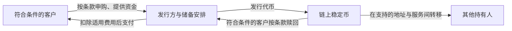

# 第十三章｜稳定币：为什么 USDT 可能比比特币更接近普通人的现实应用？

*Chapter 13: Stablecoins, USDT and Their Practical Role*

更新与资料核对日期：2026-10-13

[第十一章](11-比特币到底是什么.md)讨论了比特币的出现与价值判断，[第十二章](12-区块链、以太坊与波场.md)介绍了区块链、智能合约以及 Ethereum、TRON 等公链。

沿着这条线索，接下来需要理解稳定币：如果资产可以在区块链上转移，能否让它以美元等现实货币为参照，减少计价时的价格波动？

对于部分接触链上交易与支付的用户，USDT、USDC 比 BTC 更接近日常使用。它们尝试连接传统货币与链上应用，但理解这种连接，需要同时看价格目标、储备、赎回和实际使用条件。

## 一、什么是稳定币？

稳定币（Stablecoin）是一类试图维持相对稳定价格的数字资产。本章重点讨论与美元挂钩的 USDT 和 USDC，它们的设计目标是：

```text
1 USDT ≈ 1 USD
1 USDC ≈ 1 USD
```

这里的“≈”很重要：它表示价格目标，不能理解为任何时刻、任何平台都保证按一美元成交。

BTC 的美元价格由市场决定，可能大幅变化。美元稳定币则尝试让持有人在链上以接近美元的尺度计价。两者承担的角色不同。

稳定币也并非全部挂钩美元，维持价格的机制也不完全相同。本章不把 USDT、USDC 的储备模式当作所有稳定币的通用结构。

## 二、为什么 Crypto 需要稳定币？

假设一笔服务报价为 1,000 美元，如果直接约定用某个数量的 BTC 支付，从报价到交付期间，美元价值可能明显变化。商家、买家和借贷应用都需要处理这种波动。

美元稳定币提供了另一种安排：用接近美元的单位报价，同时让代币在区块链上转移。它可以用于交易计价、资产交换和部分链上金融应用。

因此，稳定币的主要用途通常不在于追求自身价格上涨，而在于提供较易理解的计价与转移工具。价格稳定目标，也需要具体机制和市场信任来支撑。

## 三、“数字美元”这个说法应该怎样理解？

日常讨论常把美元稳定币称为“数字美元”。这个类比强调的是：与美元挂钩的价值，可以用代币形式在区块链上流转。

但 USDT、USDC 都不是美联储发行的美元现金，也不是用户直接持有的央行数字货币。它们依赖私人发行方及相应储备、合同和服务安排。

可以把两种记录方式分开看：

| 持有形式 | 余额记录在哪里 | 还需要理解什么 |
|---|---|---|
| 银行美元存款 | 银行账簿 | 银行责任、账户条件与适用保障 |
| 美元稳定币 | 相应网络的代币账本；托管平台另有内部记录 | 发行方、储备、赎回及托管安排 |

两者都可能以美元计价，但持有人拥有的权利和承担的风险不同。

## 四、USDT 是什么？

USDT 通常称为泰达币，是 Tether 发行的美元挂钩代币，官方也使用 USD₮ 标记。

Tether 的公开说明称，流通中的代币由等值储备支持。其条款列出的储备包括现金、现金等价物及其他资产，可能包含贷款应收款等，因此不能理解为每枚代币都对应一张单独封存的美元钞票。[Tether：透明度说明](https://tether.to/en/transparency/)、[代币条款](https://tether.to/en/legal/)

理解 USDT 时，需要同时看三件事：**储备是否足够、资产是否具有流动性，以及持有人怎样实现兑换。**

对于符合条件的客户，发行方提供按规定申购和赎回的安排；市场上的其他参与者也可能通过交易买卖代币。发行方兑换与市场成交，是两种不同过程。



这是机制示意，不表示所有钱包持有人都能直接向发行方兑换。Tether 的直接申购、赎回要求客户核验，并有最低金额及费用等条件。[Tether：条款](https://tether.to/en/legal/)、[费用表](https://tether.to/en/fees/)

储备与兑换机制有助于支持价格目标，但仍不能保证市场价格永不偏离。

## 五、USDT 和美元有什么区别？

“以美元计价”不等于“就是银行里的美元”。

| 比较项 | 银行美元存款 | USDT |
|---|---|---|
| 持有关系 | 对银行的存款权利 | 发行方与代币条款下的相关权利 |
| 转移方式 | 银行与支付网络 | 支持该代币的区块链或平台内部系统 |
| 兑换条件 | 账户及银行服务条件 | 发行方资格、服务条款或市场买卖条件 |
| 保护安排 | 视银行、地区与存款类型而定 | 不因挂钩美元而获得银行存款保障 |
| 风险重点 | 银行、账户及支付安排 | 储备、赎回、代币、网络与托管安排 |

Tether 条款明确，代币不是法定货币，也不适用 FDIC、SIPC 或类似保护。[Tether：代币条款](https://tether.to/en/legal/)

因此，持有 1,000 USDT 与在银行持有 1,000 美元存款，不能仅凭屏幕上相近的金额就视为同一种资产。

## 六、为什么 USDT 可以运行在不同区块链？

USDT 可以由发行方在多个网络上发行。Tether 官方资料列出了 Ethereum、TRON、Solana 等网络及相应代币信息。[Tether：支持的协议](https://tether.to/en/supported-protocols/)

同样以美元挂钩，并不意味着这些版本共用一份钱包余额。Ethereum 上的 USDT 记在 Ethereum 的代币账本中，TRON 上的 USDT 记在 TRON 的代币账本中。

还要区分发行方直接支持的版本，以及第三方桥接、包装或托管形成的版本。判断时应看具体网络、代币合约和发行说明，不能只看“USDT”这个名称。

这也意味着，不同链上的代币不能仅凭名字相同就直接互转；跨链处理属于额外过程，会引入新的服务与风险。

## 七、为什么很多人会接触 TRC20 USDT？

TRON 上的 USDT 是稳定币转移的一种常见形式。在支持它的平台中，“使用 USDT-TRC20”通常意味着：通过 TRON 网络转移相应 USDT 代币。

这里需要分别看网络成本和平台收费。TRON 的交易消耗带宽，智能合约执行还消耗能量；资源不足时可能消耗 TRX 支付费用。平台提现也可能另收费用。[TRON：资源模型](https://developers.tron.network/docs/resource-model)

因此，不能把某次低费用体验当成永久报价，也不能仅凭“TRC20”判断总成本。确认速度还受到网络状态及收款平台入账规则影响。

## 八、ERC20、TRC20 到底是什么？

按照上一章的区分，ERC20、TRC20 是代币标准，用于约定余额、转账、授权等接口。平台有时把它们作为网络简称显示，实际仍需确认具体网络。

| 常见标记 | 通常所指 | 不应混淆的对象 |
|---|---|---|
| USDT（Ethereum／ERC20） | Ethereum 上的相应 USDT 合约 | USDT 与 ETH |
| USDT（TRON／TRC20） | TRON 上的相应 USDT 合约 | USDT 与 TRX |

ETH、TRX 是相应网络的原生资产；USDT 是运行在网络上的代币。代币金额和网络手续费，也不是同一笔余额。

ERC20 标准还可用于其他兼容网络，不能单靠标准名称推断实际转账环境。有关标准的解释见[第十二章](12-区块链、以太坊与波场.md)。

## 九、为什么选错网络可能无法到账？

发送和接收双方需要支持同一种资产、相应网络及具体代币。

例如，发送的是 TRON 上的 USDT，而收款平台只接受 Ethereum 上的 USDT，就不能期待平台按原定流程入账。即使某些兼容网络显示相同形式的地址，也不表示平台支持这些网络。

错误操作能否处理，取决于地址控制权、平台能力和具体情况；额外处理可能产生费用，也可能无法追回。

这说明：理解资产名称之后，还需要理解它在哪条链上，以及收款服务接受什么。

## 十、为什么稳定币对普通人特别重要？

从本书的整体主题看，稳定币值得关注，是因为它让“资产叫什么”和“通过什么网络移动”进一步分开。

传统跨境汇款通常依赖银行和支付机构。在支持稳定币的业务安排中，价值转移的一部分可以通过链上代币完成，再由相应机构提供兑换、托管或商家服务。

但**代币已经到达一个地址，不等于银行现金已经到账**。进入银行账户、兑换当地货币或用于消费，仍可能需要服务机构、身份核验和具体业务条件。

因此，稳定币增加了一种基础设施安排，也增加了发行方、代币和网络等新的判断环节。

## 十一、为什么一些海外互联网从业者关注稳定币？

自由职业者、数字内容创作者和部分 Web3 从业者关注稳定币，通常是因为业务跨越地区，且希望更直接地连接链上应用。

| 关注点 | 需要同时理解的条件 |
|---|---|
| 网络通常全天候运行 | 服务平台、银行兑换和审核未必全天候完成 |
| 地址间转移较直接 | 确认时间、费用及代币限制仍然存在 |
| 便于程序与应用连接 | 合约权限、托管与系统安全需要核实 |
| 可以跨地区使用技术接口 | 实际业务仍受地区规则与服务资格限制 |

拥有钱包，只说明拥有一个技术入口，不能单独证明付款、收款和兑换服务适用于自己。链上转账也不会自动消除收入的税务、资金来源或业务合规要求。

## 十二、稳定币和港卡有什么关系？

[第三章](03-香港银行账户与港卡.md)已经说明，“港卡”的核心是背后的香港银行账户。账户提供存款、本地与国际转账等服务；具体功能还取决于银行产品。

稳定币则是另一类资产与转移安排。两者可以同时出现在某些金融服务体系中，但不能预设任意银行账户都能直接兑换或接收稳定币。

| 工具 | 本书中的主要角色 | 需要确认的事项 |
|---|---|---|
| 香港银行账户 | 银行存款与传统支付接口 | 账户功能、资金用途及银行条款 |
| 稳定币 | 美元挂钩代币与链上应用接口 | 发行、网络、兑换及适用法律 |

它们可能长期共存。判断具体用途时，需要回到[第四章](04-跨境收款与支付.md)的原则：账户功能、支付网络、资产性质和服务条件应分别理解。

## 十三、稳定币安全吗？

“稳定”描述的是价格目标，安全性则涉及多个环节。

| 风险来源 | 可能产生的影响 |
|---|---|
| 发行方与储备 | 储备质量、流动性或运营问题影响兑换与信任 |
| 市场脱锚 | 成交价格偏离目标，持有人实际卖出金额减少 |
| 权限与法律 | 冻结、限制转移或限制兑换 |
| 钱包与网络 | 密钥丢失、错误转账、恶意授权或合约问题 |
| 托管及第三方服务 | 平台故障、资产管理或跨链安排出现损失 |

以一个自拟算例说明脱锚影响：持有 1,000 枚美元稳定币，若实际只能按每枚 0.97 美元卖出，所得为 970 美元，较一美元目标少 30 美元。这个例子不代表历史事件，也没有假设价格一定恢复。

发行方还保留相应的限制或冻结权限。Tether 条款规定了冻结及服务终止情形；Circle 条款说明其可按相关政策阻止特定地址的链上转移。自己控制密钥，并不代表稳定币完全没有发行方控制。[Tether：条款](https://tether.to/en/legal/)、[Circle：USDC 条款](https://www.circle.com/legal/usdc-terms)

对中国大陆读者，现行银发〔2026〕42 号通知明确虚拟货币的法律地位，并对相关业务及服务作出限制。网络可以运行，不能据此推导某项业务可以开展。[中国人民银行等八部门：2026 年通知](https://www.pbc.gov.cn/tiaofasi/144941/3581332/2026020619591971323/index.html)

## 十四、USDT 和 USDC 有什么区别？

USDC 是 Circle 体系发行的美元挂钩稳定币。比较 USDT 与 USDC，更有用的方法是查看储备、披露、兑换和适用实体，而不是仅凭“更合规”或“更安全”的标签判断。

| 比较项 | USDT | USDC |
|---|---|---|
| 发行体系 | Tether | Circle |
| 价格目标 | 与美元挂钩 | 与美元挂钩 |
| 储备说明 | 条款列出现金、现金等价物及其他资产 | Circle 披露现金与现金等价资产，包含短期国债等安排 |
| 直接赎回 | 符合 Tether 核验及其他条件的客户 | 符合资格并注册相应 Circle Mint 账户的客户 |
| 比较资料 | 透明度说明、储备报告与代币条款 | 透明度说明、储备鉴证与 USDC 条款 |

Circle 公开资料介绍了 USDC 储备及月度第三方鉴证安排。披露可以帮助理解产品，但报告对应特定时点与范围，不能视为对未来安全性的保证。[Circle：透明度与储备](https://www.circle.com/transparency)

Circle 条款对直接赎回资格设有条件，也明确 USDC 不享有相应银行存款保险保护。[Circle：USDC 条款](https://www.circle.com/legal/usdc-terms)

市场规模与流动性会随时间变化，本章不把实时排名写成永久结论。两种代币的使用条件，也不能仅凭发行方名称推断。

## 十五、稳定币为什么可能影响未来金融？

稳定币把传统货币的计价需求，与可以调用程序的转移网络连接起来。企业支付、数字产品结算和链上资产交易，都可能探索这种结构。

这种变化的价值，在于某些流程可以更方便地与软件结合。但发行、储备、法币兑换、法律责任和用户保护仍需相应机构与制度承担。

因此，讨论未来发展时，既要看网络能力，也要看这些配套安排是否成熟。技术创新与实际普及，并不是同一个结论。

## 十六、稳定币与 RWA 有什么关系？

RWA（Real World Assets，现实世界资产）代币化，尝试用代币或相关凭证表达现实资产的权利，例如国债或基金权益。

在部分链上产品中，稳定币可以充当计价与结算工具。可以用一个功能关系图理解：

```text
区块链网络：记录转移并执行程序
       ↓
稳定币：提供法币挂钩的计价与结算工具
       ↓
资产代币或应用：表达具体产品与规则
```

稳定币与国债代币仍是不同产品。储备中包含国债，不等于稳定币持有人直接拥有对应国债，也不意味着其自动获得国债利息。

至于 RWA 代币实际代表什么权利、谁保管资产以及怎样退出，需要查看具体法律文件和产品条款。

## 十七、放回全球资产配置框架，应该怎样理解稳定币？

前面的银行、券商与基金章节，帮助读者理解传统金融体系。稳定币章节则补上另一种资产转移与应用接口。

按照[第十章](10-普通人的全球资产组合.md)的思路，资金用途应先于工具选择。即使一种代币以美元为目标，也不能直接把它等同于生活备用金、银行存款或无风险现金。

还要分清“持有稳定币”和“把稳定币投入收益产品”。收益若来自借贷、流动性服务或平台安排，便增加了相应风险，不能把它当作稳定币本身天然产生的存款利息。

理解稳定币，是为了更准确地看清金融工具之间的关系，而不意味着需要配置或使用它。

## 本章要点

比特币、区块链网络和稳定币，分别提供不同的资产特征与基础设施能力。美元稳定币尝试把与美元挂钩的计价方式带到链上，但其价格、权利与银行美元存款并不相同。

USDT、USDC 的理解重点，是储备、发行与赎回安排，以及具体网络和服务条件。链上记录、市场成交与银行入账，需要分别看待。

稳定币可能连接传统金融与链上应用，同时也保留发行方、服务机构、技术和法律等方面的风险。

下一章将讨论：[**Crypto 世界的钱在哪里？交易所、钱包与私钥**](14-交易所、钱包与私钥.md) 在理解资产与网络之后，继续区分交易平台的内部余额、自己管理密钥和托管服务，理解“Not your keys, not your coins”这句话的含义与边界。

---

本章依据用户提供的第十三章成稿润色，保留原有十八节理解路径。储备、赎回与网络信息按官方资料核对，图表用于解释概念；脱锚金额为自拟算例，忽略费用，不是行情记录或价格预测。完整出处见[来源索引](../参考资料/来源索引.md)。
