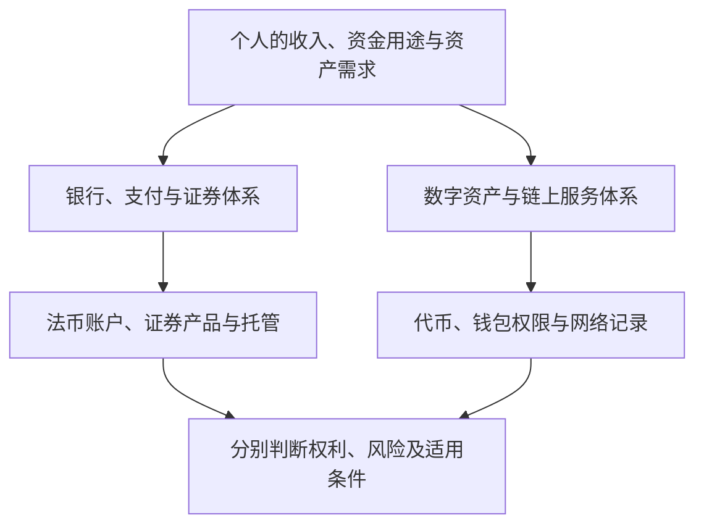

# 第十五章｜普通人如何理解和进入 Crypto 世界？

*Chapter 15: Understanding Crypto Participation and Its Financial Connections*

更新与资料核对日期：2026-10-13

前四章分别介绍了比特币、公链、稳定币，以及交易所、钱包与私钥。接下来，把这些概念放进同一张地图：传统货币怎样与数字资产发生连接，平台交易与链上转移又分别发生了什么？

本章沿着原稿的普通读者视角，解释入金、现货、合约、P2P 和充提币。理解这些流程，有助于辨认服务与风险；学习并不要求实际参与交易。

对中国大陆读者，现行银发〔2026〕42 号通知明确虚拟货币的法律地位，并严格限制相关业务及服务。以下图表解释金融与技术关系，不是向所有读者提供可用的开户或资金路线。[中国人民银行等八部门：2026 年通知](https://www.pbc.gov.cn/tiaofasi/144941/3581332/2026020619591971323/index.html)

## 一、传统金融与 Crypto 金融有什么区别？

传统证券投资中，银行账户承担支付与存款功能，证券账户用于管理交易与持仓，登记、托管和结算体系处理相关资产记录。

Crypto 服务也包含支付、交易、托管与记录等环节，但它们可能由不同机构、软件和网络承担。

| 功能 | 传统证券体系中的常见安排 | Crypto 中的相关安排 |
|---|---|---|
| 资金转移 | 银行及支付机构 | 法币支付服务、平台与链上转移 |
| 买卖资产 | 券商与交易市场 | 中心化平台或链上交易应用 |
| 保管与控制 | 证券托管及账户规则 | 平台托管、密钥或合约权限 |
| 交易记录 | 机构账簿与登记结算系统 | 平台内部账簿与区块链记录 |

这是功能比较，不表示法律地位和保护安排相同。登录密码与私钥，也不能作为相互替代的对应项：前者通常控制平台访问，后者用于生成链上授权签名。

Crypto 与传统金融之间仍有联系，尤其在法币付款、储备托管和资金兑换等环节。

## 二、参与流程涉及哪些基础设施？

可以先识别四类对象，而不把它们想成必须依次购买或开通的工具。

**法币支付与兑换服务**负责处理传统货币，例如银行或平台支持的支付渠道。是否支持某种付款方式，取决于地区、客户资格和业务条款。

**交易平台**提供资产交换等服务。Coinbase、Binance、Kraken、OKX 等是读者可能看到的品牌，但同一品牌也可能有不同实体和产品，不能凭名称判断具体服务适用于自己。

**钱包**帮助用户查看记录、管理控制权限和签署操作。托管与自托管的区别见[第十四章](14-交易所、钱包与私钥.md)。

**区块链网络**按协议验证和记录交易。Bitcoin、Ethereum、TRON 的资产与运行规则不同。

在中心化平台中，注册与身份核验通常属于账户流程。**KYC（Know Your Customer，了解你的客户）**强调核验客户身份；材料和审查条件依具体服务而定。例如，Coinbase 说明其会为法律、合规及防诈骗目的核验身份，未完成时账户功能可能受限。[Coinbase：身份核验说明](https://help.coinbase.com/en-gb/coinbase/getting-started/getting-started-with-coinbase/id-doc-verification)

通过核验，不代表资产安全得到保证，也不能据此推导所有产品和付款渠道都已获准使用。

## 三、什么是“入金”与“出金”？

在本章中，入金指通过允许的渠道，把法定货币转入相应账户或交易服务；出金则指把账户中的法币余额转出至支持的收款渠道。

```text
法币入金：银行或支付渠道 → 服务中的法币余额
法币出金：服务中的法币余额 → 支持的银行或支付渠道
```

实际界面可能使用 Deposit、Withdraw、Buy 等不同名称，有的平台还提供直接购买方式。理解时应先确认：移动的是法币，还是数字资产？

资金已转出、平台已收到、资金可用于交易、余额可再转出，也可能是不同状态。费用、付款人身份、资金来源和处理时间，需要查看具体规则。

## 四、什么是法币？

Fiat 在这里通常指法定货币，例如人民币、美元、港币和欧元。

“Fiat → Crypto”表示用传统货币换取数字资产。这是一次资产交换，之后持有的资产性质会发生变化。

比如“美元 → USDT → BTC”可以描述某种交易安排，但不是所有购买 BTC 都必须先换 USDT。若服务支持相应法币交易对，也可能直接交换。稳定币的兑换条件和风险见[第十三章](13-稳定币与USDT、USDC.md)。

同样地，把 Crypto 卖成平台上的美元余额，与美元最终进入银行账户，是两个环节。

## 五、什么是现货交易？

现货交易（Spot Trading）以买卖资产本身为目标，区别于建立与资产价格相关的衍生品合约头寸。

假设买入 0.01 BTC，成交后账户记录相应资产数量。但若资产留在中心化平台，通常仍由平台或托管方管理链上密钥；账户余额不能直接等同于用户独立控制的链上资产。

| 情况 | 需要理解的对象 |
|---|---|
| 现货买入并留在平台 | 相应资产余额、客户权利与托管安排 |
| 转到自托管地址 | 链上记录及用户的签名控制条件 |
| 买入相关衍生品 | 合约头寸、结算规则与风险敞口 |

即使不使用融资，现货也有价格、平台和操作风险；“现货”这个标签本身不提供本金保障。[CFTC：虚拟货币交易风险](https://www.cftc.gov/LearnAndProtect/AdvisoriesAndArticles/understand_risks_of_virtual_currency.html)

## 六、什么是合约交易？

Crypto 平台所称的“合约”常包括期货、永续合约等衍生品。它们让交易者获得与某种资产价格相关的敞口，但不一定交付相应代币。

合约与杠杆也不是同一个概念。杠杆表示以相对较少的自有资金承担较大的价格敞口，合约则有自己的保证金、结算和强制平仓规则。

可以用一个自拟简化算例理解：

| 条件 | 金额 |
|---|---:|
| 初始保证金 | 1,000 美元 |
| 10 倍敞口下的名义仓位 | 10,000 美元 |
| 价格向有利方向变化 5% 的简化盈亏 | ＋500 美元 |
| 价格向不利方向变化 5% 的简化盈亏 | −500 美元 |

同样的价格变化，对初始保证金的影响为 50%。实际还涉及维持保证金、手续费、资金费率和标记价格等，可能在理论亏损达到全部保证金之前就被强制平仓。

这些金额不是某个平台的真实报价或爆仓预测。不同产品的亏损责任也不同，不能预设亏损一定止于最初投入。[CFTC：杠杆与合约风险](https://www.cftc.gov/LearnAndProtect/AdvisoriesAndArticles/understand_risks_of_virtual_currency.html)

先理解合约条款与风险，才能判断自己看到的究竟是资产持仓，还是价格头寸。

## 七、什么是 P2P？

P2P 是 Peer-to-Peer，即点对点。在平台交易语境中，常指用户之间进行资产交换，平台可能提供报价展示、撮合、代币托管或争议处理等服务。

它与比特币网络本身的点对点通信，是不同层面的概念。也不能因为叫“点对点”，就认为整个交易没有机构参与。

P2P 还把对手方付款和资金来源问题带入流程。例如，伪造付款凭证、撤销付款、冒用第三方账户或把交易引到平台之外，都可能造成损失。平台自身的风险资料也提示了相关诈骗情形。[Binance：P2P 诈骗风险](https://www.binance.com/en/blog/p2p/6416111153825153913)、[第三方付款与中间人诈骗](https://www.binance.com/en/support/faq/detail/03a0b16b35344e72b308aea70888311c)

平台显示“已付款”与实际资金状态需要区分。即使某次款项已经到账，也不能由此证明资金来源可靠或交易符合适用法律。

因此，本章把 P2P 作为一种交易安排来解释，不把它视为绕过银行、身份核验或监管要求的通道。

## 八、什么是充币和提币？

充币、提币描述的是数字资产转移与平台账户记账，和法币入金、出金不同。

| 名称 | 通常表示 | 需要区分的环节 |
|---|---|---|
| 充币（Deposit） | 数字资产到达平台支持的充值地址 | 链上确认与平台内部入账 |
| 提币（Withdraw） | 平台按申请向指定地址发出数字资产 | 平台审核、发出交易与网络确认 |
| 法币入金／出金 | 通过支付渠道移入或移出传统货币 | 支付、账户余额及银行到账 |

例如，自托管地址中的 USDT 转入平台，涉及网络交易和平台确认；平台余额中的 USDT 转出，则由平台按相应规则发出资产。

不同平台还可能提供内部转账。要理解一次操作发生了什么，应查看其实际记录，不能仅根据按钮名称判断。

## 九、为什么 Crypto 转账需要确认网络？

同样叫 USDT，可能位于不同网络的代币合约中。资产名称相同，不表示发送和接收环境相同。

```text
资产与代币合约
       ↓
具体区块链网络
       ↓
接收地址及附加信息（如服务要求）
       ↓
接收服务的支持与入账规则
```

ERC20、TRC20 是代币标准，界面有时把它们作为网络简称。实际仍需要确认 Ethereum、TRON 或其他具体网络。

即使地址形式相同，也不能推断平台接受该网络的资产。有关标准、地址与控制条件的说明，见[第十二章](12-区块链、以太坊与波场.md)和[第十四章](14-交易所、钱包与私钥.md)。

## 十、为什么第一次转账要小额测试？

在允许开展相关业务的场景中，小额测试有助于验证当时的地址、网络及实际入账过程，减少第一次就转移较大金额的操作风险。

测试还应满足最低入账金额和费用规则。区块浏览器显示确认，与收款服务记入余额，可能并不同步。

小额测试的作用有边界：它不证明对方诚信、服务持续安全，也不保证后续信息未被替换。后续操作仍需重新核对，签名时也应理解实际授权内容。[Ethereum：安全与防诈骗](https://ethereum.org/security/)

## 十一、普通人容易在哪些地方出错？

| 常见错误 | 容易忽略的问题 |
|---|---|
| 看见别人赚钱就买入 | 资产逻辑、价格风险及自己的资金用途 |
| 尚未理解资产就使用杠杆 | 保证金、强平和实际亏损责任 |
| 相信“稳赚”“内部机会” | 对手方身份、利益冲突及诈骗 |
| 把助记词交给客服或陌生人 | 恢复资料意味着资产控制权限 |
| 只核对币名 | 网络、合约、地址和入账规则 |
| 把余额截图当作资产保证 | 托管、提现及账户权利的实际安排 |

这类错误有些来自对资产的不理解，有些来自对服务流程的不理解。安全学习应与金融认知一起进行，而不是等到大额交易之后再补课。

## 十二、普通人的 Crypto 学习路线

原稿把学习分为认知、观察、安全和实践四个部分。可以按以下方式逐步推进：

**建立认知。** 先理解 BTC、ETH、稳定币、钱包与网络各自承担什么角色，能用自己的话说明资产与控制关系。

**观察市场。** 关注价格、宏观环境、产品结构和监管变化。若阅读 ETF 资金流等数据，要核对日期、覆盖产品和统计口径，不能把单个指标直接当作涨跌预测。

**学习安全。** 理解密钥、恢复资料、授权和诈骗识别。在任何实际操作之前，这部分都需要先完成。

**按条件判断是否实践。** 学习不以买入资产为考核标准。若未来在适用法律允许、服务资格符合的环境中接触数字资产，应先理解费用、保管和退出条件，再考虑有限范围的验证。

理解一项技术，与实际投入资金，是可以分别完成的决定。

## 十三、Crypto 与全球资产配置有什么关系？

本书前面的银行、券商和基金章节，介绍了传统全球金融体系；Crypto 部分补充了新的资产类型、转移网络和程序化金融安排。

可以把两类系统放在一张功能图上：



这张图解释功能关系，不表示人民币可以依照任意路径汇出并购买境外资产。资金来源和用途的区分，见[第五章](05-中国大陆居民如何获得海外资产敞口.md)。

两类系统也并非完全分离。例如，稳定币储备可能依赖银行与传统资产，部分证券产品提供 Crypto 价格敞口，RWA 产品又涉及现实资产的托管与权利文件。

这些连接的具体形式不同，不能仅凭“上链”或“数字美元”就判断拥有同一种权利。

## 十四、普通投资者应该怎样定位 Crypto？

首先，它是一个值得理解的金融与技术主题。理解发行、网络、支付和控制机制，有助于辨认全球金融基础设施的变化。

其次，部分 Crypto 资产可能作为投资者研究的另类资产。但能否持有、是否适合以及能承受多大风险，需要回到[第十章](10-普通人的全球资产组合.md)的资金用途与风险能力框架，不能把“小比例”当成所有人通用的建议。

最后，数字资产可能被用于某些互联网业务和链上应用。实际用途需要具体服务、支付方接受程度及法律条件来支持，不能由技术存在直接推导业务可开展。

把认知、投资和工具用途分开，可以减少“为了学习而必须买入”或“为了使用而忽略风险”的混淆。

## 本章要点

理解 Crypto 参与流程，需要区分三类动作：法币通过支付渠道移动，资产在平台中交易，数字资产在链上转移。它们有不同的记录、费用和责任安排。

现货、合约与 P2P 也承担不同角色。资产余额不等于独立控制的链上密钥，合约头寸不等于持有代币，平台提供撮合也不能消除付款及对手方风险。

知识学习、服务资格与资金投入应分别判断。理解资产、保护恢复资料、核对网络和读懂授权，是前面几章共同建立的基础。

下一章将讨论：**Crypto 投资与未来金融：BTC、ETH、稳定币应该怎么看？** 作为这一部分的收束，将比较不同资产的价值依据、代币风险及其与个人组合的关系，再回到本书的全球资产体系主题。

---

本章依据用户本次提供的第十五章成稿润色，保留原有十五节理解路径。图表为概念整理，不是实时开户名单或可用资金路线；杠杆金额为自拟简化算例，忽略费用与具体保证金规则，不是收益或爆仓预测。完整出处见[来源索引](../参考资料/来源索引.md)。
