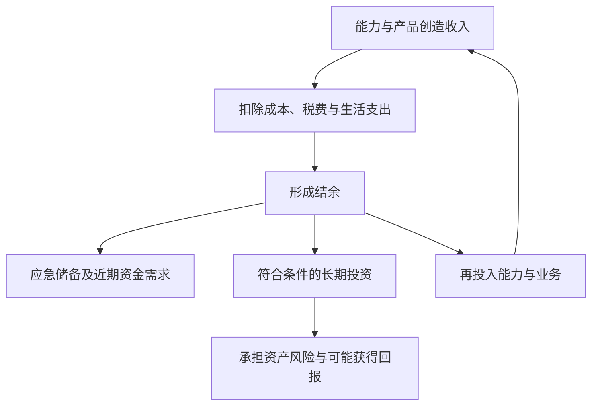

# 第十七章｜全球收入：为什么“赚美元”可能比投资美元更重要？

*Chapter 17: Global Income — Why Earning Dollars May Matter More Than Investing Them*

更新与资料核对日期：2026-10-13

第一篇介绍了银行、支付、证券工具与资产配置，回答普通人如何理解全球金融市场；第二篇介绍了 Crypto 与数字金融体系，讨论新的资产、网络与控制机制。

从本章开始，进入**第三篇｜全球收入与个人能力**。视角从“已有资金怎样配置”，转向另一个现实问题：本金还不多时，怎样提高持续创造收入的能力？

投资主要讨论已有资金如何承担风险、获得回报；收入则决定能够创造多少现金流，以及有多少结余可以逐步成为本金。对于人生早期、积累尚少的人，提高收入与结余能力，可能比追求更高投资收益率更有影响。

这里的“赚美元”，延续[第二章](02-赚美元、持有美元与美元资产.md)的用法：既指可能以美元结算的收入，也指让自己的劳动、服务与产品连接更广阔市场。收入币种与客户所在地仍需分别判断。

> 全球收入的核心，是让自己的能力为更多客户创造价值，并获得相应报酬。

## 一、财富增长不仅依靠投资

谈到财富增长，人们容易先想到股票、基金、房产、黄金或 Bitcoin。这些讨论大多从已有本金出发，但收入、支出和负债同样影响财富积累。

可以用一个自拟简化例子比较不同量级：

| 情况 | 假设变化 | 对应金额 |
|---|---|---:|
| 拥有 100 万元本金 | 一年获得 10% 回报 | 10 万元 |
| 拥有 10 万元本金 | 一年获得 10% 回报 | 1 万元 |
| 提高劳动或经营收入 | 年收入增加 10 万元 | 尚需扣除新增成本、税费与支出 |

10% 只是算术假设，不是预期收益或稳定年化回报。投资可能亏损，提高收入也需要时间、投入与市场需求。

这个例子说明：本金较小时，同样的收益率对应的金额有限；收入增加若能转化为结余，就能扩大未来本金。

```text
收入增加
   ↓
扣除成本、税费与生活支出
   ↓
形成新增结余
   ↓
逐步积累可投资本金
```

因此，要比较的是可持续的财富积累，而不是把“多赚十万元”与“投资赚十万元”看成成本、风险完全相同的结果。

人生早期值得投入的资产之一，是自己解决问题并创造收入的能力。它与金融投资可以相互配合。

## 二、什么是“赚美元”？

“赚美元”不意味着必须去美国工作。软件开发者服务海外企业，设计师承接跨境项目，创作者触达不同地区受众，开发者销售数字产品，都可能产生跨境收入。

不过，全球市场不是统一的高工资市场。收入仍取决于需求、交付质量、沟通、信誉和竞争，不会只因客户使用美元付款就自动提高。

可以区分三个问题：

| 问题 | 判断内容 |
|---|---|
| 客户在哪里？ | 谁有需求，谁愿意购买？ |
| 报酬怎样计价？ | 合同使用美元、人民币还是其他币种？ |
| 最终怎样收到和使用？ | 平台扣费、收款渠道、兑换及实际可用余额 |

海外客户也可能支付人民币，国内客户也可能采购面向全球的产品。决定业务价值的是提供了什么，结算货币只是交易安排的一部分。

互联网降低了部分沟通和交付的地理成本，但没有消除平台资格、收款条件和业务限制。关于跨境收款的功能关系，见[第四章](04-跨境收款与支付.md)。

## 三、什么是地理套利？

地理套利（Geographical Arbitrage）通常指利用不同地区的收入机会与生活成本差异，改善收入能够覆盖的支出和结余。

原稿用“收入全球化，成本本地化”概括这种关系。作为理解框架，它提醒读者：客户市场与生活所在地不一定相同。

但不能简单假设美国客户总支付高价格、中国生活成本总较低。同一国家内的城市、行业和家庭情况也差异很大，远程岗位还可能按所在地定薪。

真正需要计算的是：

```text
实际结余
= 实收收入折算为支出币种后的金额
− 业务成本
− 税费
− 生活支出
```

例如，假设每月收到 2,000 美元，分别用两种假设汇率作比较：

| 条件 | 情景 A | 情景 B |
|---|---:|---:|
| 每美元折合人民币 | 7 元 | 6.5 元 |
| 收入折算 | 14,000 元 | 13,000 元 |
| 假设业务、税费与生活支出合计 | 9,000 元 | 9,000 元 |
| 剩余金额 | 5,000 元 | 4,000 元 |

这是自拟敏感性例子，不是实时汇率、税额计算或典型收入；为便于比较，将支出固定。它说明即使美元收入不变，以人民币衡量的结余也会受到汇率影响。

如果新增营销、软件、沟通和售后成本超过收入增量，地理差异也未必带来更多财富。

## 四、为什么互联网带来了新的全球收入机会？

过去，许多职业需要在客户或雇主所在地完成。数字交付让部分工作可以远程完成，例如软件、设计文件、数据分析报告和在线课程。

内容平台、开源社区、作品集和数字产品渠道，可以承担不同角色：展示能力、建立信任、发现需求、连接客户或完成交易。


图表说明业务功能，不保证所有平台、支付方式或地区组合都可用。直接接触客户与通过平台接单，也有不同的合同、费用和争议处理安排。

互联网扩大了潜在客户范围，也扩大了竞争范围。能被客户发现、能清楚解释价值、能按时交付，与掌握技术本身一样影响结果。

全球连接能力，因而不仅是语言能力，还包括理解需求、表达方案、管理预期与长期维护信誉。

## 五、为什么美元收入受到关注？

美元在国际贸易、支付和金融交易中有广泛用途。美联储的 2025 年研究回顾了这些作用，但使用的数据有时间滞后，本章不把它当作 2026 年实时市场统计。[美联储：美元的国际角色，2025 年版](https://www.federalreserve.gov/econres/notes/feds-notes/the-international-role-of-the-u-s-dollar-2025-edition-20250718.html)

对个人而言，可以从三个角度理解美元收入的吸引力。

**客户需求。** 美国及其他国际市场中可能存在愿意为专业服务与产品付款的客户。能否取得较高报酬，取决于具体需求与竞争，而不是货币名称。

**计价与结算。** 一些跨境合同、软件服务和平台采用美元计价。但界面显示美元价格、客户支付美元、创作者收到美元，是不同环节；平台可能按账户地区或付款设置使用其他币种。

**资产安排。** 美元结余可以与未来美元支出或相关资产目标配合，但收入不会自动转化为可投资资金，更不会自动产生复利。应先判断资金用途、期限和适用渠道，再选择是否保留或兑换。

对中国大陆读者，真实跨境业务收入的收款、结汇与境外投资用途，需要分别核实。外汇局说明了个人结售汇年度便利化额度及额度外真实业务办理条件，也明确个人购汇不得用于境外证券投资等尚未开放的资本项目；不能由“有美元收入”推导任意路径都可用于投资。[外汇局：个人外汇说明](https://www.safe.gov.cn/tianjin/2025/0714/2833.html)、[个人购汇要求](https://www.safe.gov.cn/tianjin/2018/0628/920.html)

美元收入的价值，需要和实际生活安排结合。赚取其他币种、服务本地客户，同样可能形成优秀的收入模式。

## 六、普通人的全球收入机会有哪些？

这一章先建立地图，后续章节再展开具体平台与业务。可以沿用原稿的四类划分。

| 类型 | 可能的载体 | 客户为什么付款？ | 需要持续投入什么？ |
|---|---|---|---|
| 内容创作者 | 视频、X、Newsletter、Podcast | 内容、会员权益、广告触达或商业合作 | 选题、原创内容、受众与信誉 |
| 数字产品 | 电子书、课程、模板、软件、授权数据 | 节省时间、学习知识或完成工作 | 开发、营销、更新与售后 |
| 技能服务 | 编程、AI 自动化、分析、设计、咨询 | 获得具体交付成果 | 专业能力、沟通与项目管理 |
| 互联网创业 | SaaS、AI 工具、跨境在线服务 | 持续解决问题 | 产品、获客、运营与责任承担 |

这四类可以组合。例如，设计师通过内容展示作品，再承接服务；开发者从重复客户需求中形成软件产品。收入来源也未必局限于平台直接奖励。

数字产品具有重复销售的可能，但“一次生产，多次销售”不等于永久免维护。版权与授权、退款、渠道费用、客服和版本更新，都会影响净收益。

平台规则尤其需要核对。YouTube 的合作伙伴计划包含地区、频道政策、审核与收款账户等条件，发布视频或达到某个数据门槛，并不自动得到收益。[YouTube：合作伙伴计划与资格](https://support.google.com/youtube/answer/72851)

截至本章核对日，X 官方说明旧 Creator Revenue Sharing 计划已于 2026 年 9 月 7 日结束，并介绍转向新的 Original Content Rewards 计划。旧教程中的收入规则不能直接套用到新计划；具体资格与付款安排应重新核对。[X：创作者计划变更说明](https://help.x.com/en/using-x/creator-revenue-sharing)

因此，国内读者需要把业务模式、平台资格与实际收款安排逐项判断，不能把平台名单当作直接可用的收入入口。

## 七、AI 为什么可能扩大个人的全球收入机会？

AI 可以辅助文字草稿、代码、分析、翻译和客户沟通，减少部分重复劳动与制作成本。它也可能让个人更容易做出第一个样品，用于验证客户需求。

相关研究支持的是具体场景下的效率变化，而非人人都能靠 AI 创业成功。例如，NBER 的《Generative AI at Work》研究了客服场景，发现辅助工具对不同经验水平员工的影响并不相同；这种结果不能直接换算成个人创业收入。[NBER：Generative AI at Work，2023 年修订版](https://www.nber.org/papers/w31161)

可以从工作环节理解工具的作用：

| 工作环节 | AI 可以辅助的部分 | 仍需由人承担的判断 |
|---|---|---|
| 需求研究 | 整理资料、归纳问题、形成假设 | 核实来源，确认客户是否愿意付款 |
| 制作交付 | 草稿、原型、代码与分析 | 正确性、质量、授权与客户适用性 |
| 沟通运营 | 翻译、回复草稿、任务整理 | 承诺、隐私、关系与争议处理 |

“一人公司”可以理解为个人借助软件、自动化和外部服务承担更多环节。它不是“没有成本与责任的公司”，也不保证一个人能完成所有专业工作。

当工具人人可用时，竞争也可能加剧。长期差异仍来自需求理解、行业知识、可靠交付和信任，而不只是生成内容的速度。

> AI 可以提高部分工作的效率；客户购买的是有用的结果，而不是使用过 AI 这个事实。

## 八、投资美元和赚美元有什么区别？

投资美元资产与赚取美元收入，分别处理资金回报与收入来源。还要与单纯持有美元现金区分，详见[第二章](02-赚美元、持有美元与美元资产.md)。

| 行为 | 主要投入 | 需要判断的问题 |
|---|---|---|
| 创造收入 | 时间、技能、产品与业务资源 | 谁付款，如何持续交付并形成净收入？ |
| 持有货币 | 已有资金 | 用哪种币种应付未来支出？ |
| 投资资产 | 可承担相应风险的本金 | 持有什么权利，面临哪些风险与成本？ |

二者可以相互配合，但中间需要经过结余、储备与用途判断。



这是概念循环，不是确保财富增长的公式。业务再投入可能失败，金融资产也可能亏损。

税务同样不能只按币种判断。中国个人所得税法区分居民与非居民个人的纳税范围；境外所得政策进一步规定所得来源与抵免等问题。海外客户付款或美元到账，并不自动说明该项收入属于税法上的境外所得。[国家税务总局：个人所得税法](https://www.chinatax.gov.cn/n810219/n810744/n3752930/n3752974/c3970366/content.html)、[财政部、税务总局：境外所得政策](https://12366.chinatax.gov.cn/bzds/081/081-5-7.html)

合同、实际服务内容、平台账单与收款记录，有助于说明收入与业务关系。具体处理仍需按身份、所得性质和业务事实核实。

## 九、普通人的长期财富系统

原稿提出三个部分：主业收入、全球收入能力、全球资产投资。它们可以对应不同任务。

**主业收入**支持日常现金流，也提供专业经验与客户需求的积累。但主业同样可能变化，需要结合应急储备与负债安排。

**全球收入能力**拓展客户与业务机会。它可以是主业本身，也可以是允许开展的独立服务或产品，不一定要额外经营一份副业。

**长期资产配置**管理已经积累的资金，让不同资产承担与目标匹配的任务。金融投资不能代替收入来源，收入增长也不能代替风险管理。

三者不必按统一顺序完成。专业能力、语言与沟通、需求理解和交付记录，可以成为共同基础。

对于起步者，一个可用的学习方向是：找到自己能够解决的具体问题，完成一个可信的作品，了解潜在客户，再验证能否持续交付和收款。

这个过程不保证快速致富，但能把“想赚美元”的目标，转化为可以观察和改进的业务能力。

## 十、本章总结

传统的“学习 → 就业 → 工资 → 储蓄投资”仍然有效。互联网和 AI 为部分工作增加了另一种可能：能力可以连接不同地区的客户，产品可以通过数字渠道交付。

新路径可以概括为：

```text
提升个人能力
   ↓
连接有真实需求的市场
   ↓
可靠交付并取得收入
   ↓
形成结余与资金储备
   ↓
按目标发展业务与配置资产
```

“赚美元”的意义，是扩大能力能够服务的市场。它不能由币种名称来保证高收入，也不能只用收入截图衡量成功。

对于本金尚少的人，持续创造收入并保留结余，可能比提高几个百分点的投资收益率更有影响。长期财富体系，则需要收入能力、支出管理与投资判断共同支持。

下一章将讨论：**第十八章｜X、YouTube、数字产品与海外创作者收入**。将进一步比较创作者平台、数字产品和收入渠道，核对 X 现行计划、YouTube 的收入机制、地区与收款资格，以及 AI 辅助工作的实际边界。

## 本章要点

收入决定本金从哪里来，投资管理已积累的资金。增加营业收入、提高净收入和扩大可投资结余，是三个需要分别计算的问题。

全球市场扩大机会，也扩大竞争；地理成本差异与 AI 工具，都需要通过需求、交付和实际结余来检验。

结算币种、平台资格、资金用途与税务身份不能相互替代。全球收入能力的基础，仍是有价值的成果与可持续的客户关系。

[上一章：Crypto 投资与未来金融](16-Crypto投资与未来金融.md) · [返回全书目录](../目录.md)

---

本章依据用户本次提供的第十七章成稿润色，保留十节顺序，按已发布目录统一为第三篇开篇。收入、本金与汇率金额均为自拟简化算例，不是收益预测、税务计算或典型收入；图表描述功能关系，不代表所有读者可使用的平台与收款路线。AI 工作流程与个人财富系统为编辑分析，研究资料仅支持其实际覆盖场景。平台计划按核对日说明，后续变化需重新确认。完整出处见[来源索引](../参考资料/来源索引.md)。
