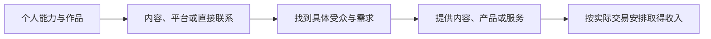
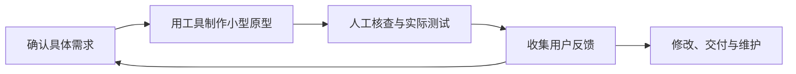

# 第十八章｜X、YouTube、数字产品与海外创作者收入

*Chapter 18: X, YouTube, Digital Products and Global Creator Income*

更新与资料核对日期：2026-10-13

上一章讨论了全球收入：本金的积累不仅取决于投资回报，也取决于个人能否持续提供有价值的劳动、服务或产品。

这一章进一步观察几个具体载体：X 上的内容与客户连接、YouTube 视频、数字产品，以及 AI 辅助制作。重点是理解谁在付款、为什么付款、收入怎样产生，再判断这种模式是否适合自己的能力和条件。

平台收入规则会变化，本文按核对日期说明。平台名单是业务研究的入口，不能直接当作适用于所有地区的开户、变现或收款路线。

> 内容帮助人们认识你，可靠的成果建立信任，具体的交易安排才形成收入。

## 一、互联网正在改变个人赚钱方式

“学习、就业、领取工资、储蓄投资”仍然是重要的财富积累路径。城市、行业、企业和经济环境，会影响这种路径中的机会与收入。

互联网为部分工作增加了新的连接方式。软件、设计文件、课程、视频与报告可以数字化交付，个人有机会通过作品展示和远程沟通，服务不同地区的客户。



例如，程序员交付工具，设计师完成项目，作者出售原创指南，视频创作者提供内容。这些模式的共同点是能够跨地域展示或交付成果，但客户不会因为创作者使用了某个平台就自动付款。

平台扩大了传播范围，也带来了新的竞争、费用和规则。理解机会时，需要把“能够被看到”与“能够形成业务”分开。

## 二、什么是创作者经济？

创作者经济（Creator Economy）通常指个人或小团队围绕内容、知识、受众关系和产品开展商业活动。

个人创作和独立经营并非互联网时代才出现。新的变化在于，制作、发行、沟通和交易中的部分环节，更容易由小规模团队完成。

一个视频创作者可能同时负责选题、制作、用户交流和产品销售。与其把自己只看成“上传内容的人”，不如理解自己在经营一组相互关联的工作。

| 收入安排 | 主要付款方 | 对方购买的价值 |
|---|---|---|
| 平台奖励或广告相关收益 | 平台按计划结算，资金机制依计划而定 | 符合规则的内容、受众触达等 |
| 付费订阅、会员 | 订阅者或支持者 | 持续内容、权益与交流 |
| 品牌合作 | 企业或品牌 | 推广、内容制作或特定合作交付 |
| 产品与服务销售 | 最终客户 | 工具、知识或具体问题的解决方案 |

同一位创作者可能组合多种模式。也有很多账号只有内容影响力，尚未形成稳定收入。创作者经济描述一种经营方式，并不代表收入水平。

## 三、为什么关注海外平台？

国内外平台都可能提供机会。选择海外平台的理由，应是目标客户或受众在那里，而不是预设海外流量一定更值钱。

**受众范围。** 不同语言、地区和行业的用户可能关注不同问题。专业经验能否被理解，需要选题、表达与案例来连接。

**商业条件。** 广告需求、产品价格、竞争和客户购买意愿都可能不同。同样的观看量，未必对应相同的广告展示或购买行为。

**交易安排。** 报价币种、平台统计币种和最终收款币种可能不同，不能把“海外平台”直接等同于“美元到账”。关于收款功能，见[第四章](04-跨境收款与支付.md)。

研究一个平台时，可以先判断：希望触达谁，对方有什么需求，平台帮助完成哪个环节，以及自己能否满足实际服务与付款条件。

## 四、X 的创作者收益模式

原稿中的“创作者广告分成”需要按现行资料更新。X 官方说明，旧 Creator Revenue Sharing 计划在 2026 年 8 月 7 日停止新申请，并于 9 月 7 日结束。[X：旧计划变更说明](https://help.x.com/en/using-x/creator-revenue-sharing)

### 1. 原创内容奖励

截至核对日，新计划为 Original Content Rewards。其规则关注原创内容产生的合资格曝光，包括 Premium 用户在首页信息流中的特定曝光；公开显示的总浏览量不能直接视为奖励计费量。

申请还涉及地区、账户状态、年龄、订阅、受众及曝光要求，并需审核。达到数据条件不保证获准加入。具体定义和门槛应查阅当时官方页面，不沿用旧广告分成教程。[X：Original Content Rewards](https://help.x.com/en/using-x/original-content-rewards)

### 2. 订阅收入

X 的创作者订阅是另一种安排：符合条件的创作者提供额外内容或权益，订阅者按月付费。收入与订阅人数、价格及适用费用有关，不等同于平台曝光奖励。[X：创作者订阅](https://help.x.com/en/using-x/subscriptions-creator)

付费订阅也意味着持续交付。决定提供深度文章、交流或其他权益之前，需要估算维护时间和能够稳定兑现的内容。

### 3. 商业合作与产品服务

账号还可以用于展示专业能力、连接品牌或寻找客户。例如，发布原创数据分析案例后，可能获得报告制作或工具开发的业务机会。

这类收入来自具体合同或交易，不是 X 根据粉丝量自动发放。合作需要明确交付、费用、权利与商业关系披露，实际要求依平台及业务环境而定。

## 五、X 创作者收入到底有多少？

没有可靠的“多少粉丝对应多少美元”的通用公式。个别大账号的收入截图，也不足以说明普通参与者的典型收入。

研究收入时，至少要区分三种数：

| 数字 | 能说明什么 | 不能直接说明什么 |
|---|---|---|
| 粉丝、浏览与互动 | 传播或受众参与情况 | 合资格曝光、付费意愿与利润 |
| 平台奖励或订阅收入 | 某项收入来源的表现 | 全部业务收入与最终到账 |
| 扣除成本后的结果 | 业务投入与产出的关系 | 下一期收入能够维持 |

举一个自拟订阅例子：假设有 100 位付费读者，每人每月支付 5 美元，月度账面订阅金额为 500 美元。它还没有扣除适用的平台和支付费用、退款、税费及制作成本，也不能保证下月全部续订。

这个例子用于理解“人数 × 价格”，不是 X 的实际报价、可选价位或收入预测。

受众与产品的匹配程度，通常比单看粉丝总数更能帮助分析业务。专业内容也不自动高价；真正需要验证的是具体客户是否愿意为具体成果付款。

## 六、国内读者如何研究 X 上的全球收入机会？

先区分国籍、实际所在地、平台参与资格与付款资格。它们不是同一个问题。拥有账号或海外收款工具，不自动满足创作者计划的条件。

截至核对日，X 的 Original Content Rewards 可用地区名单未列中国大陆。其奖励申请与付款还有各自要求，应按真实情况核实，不能仅修改地区资料就推定具备资格。[X：现行计划与地区范围](https://help.x.com/en/using-x/original-content-rewards)

在符合适用法律与服务条款的业务环境中，仍可以从内容与能力的关系研究可能方向：

| 方向 | 可以展示的原创成果 | 需要积累的能力 |
|---|---|---|
| AI 与自动化 | 有输入、过程、结果及局限的案例 | 实际验证与工作流程设计 |
| 中国市场观察 | 一手观察、公开资料对照与来源说明 | 研究、表达与跨文化解释 |
| 专业知识 | 编程、设计、数据分析等作品 | 专业能力与可靠交付 |
| 知识产品 | 自有方法、模板、工具或授权资料 | 产品设计、权利管理与售后 |

这些是选题假设，不是经过市场验证的赚钱名单。更具体的起点，是选择自己能持续提供证据和原创成果的领域，再观察是否出现真实咨询、试用或购买需求。

## 七、YouTube：视频内容与多种收入安排

YouTube 适合用视频展示过程、讲解问题和积累可反复观看的内容。它的形式与 X 不同，但同样需要同时经营内容质量、受众关系和收入安排。

| 收入方式 | 基本关系 |
|---|---|
| 广告与 YouTube Premium 相关收入 | 根据适用模块与内容表现结算 |
| 频道会员 | 观众为会员权益付费 |
| Super Chat、Super Stickers、Super Thanks | 按功能规则提供付费互动或支持 |
| 品牌合作 | 与品牌约定具体合作内容 |
| 产品和服务 | 通过内容帮助客户了解并购买成果 |

平台内变现通常需要加入 YouTube 合作伙伴计划（YPP），并符合相应功能的条件。官方要求涉及地区、频道政策、审核及 AdSense for YouTube 等；达到观看或订阅门槛后仍需审核。[YouTube：YPP 资格](https://support.google.com/youtube/answer/72851)

截至核对日，YPP 可用地区名单未列中国大陆，香港与台湾则分别列出。读者应核对真实居住地区及账户情况；可以观看或发布内容，不等于可以直接加入 YPP。[YouTube：可用地区](https://support.google.com/youtube/answer/7101720)

品牌合作收入与平台广告收益还应分别记录。YouTube 要求创作者对符合条件的付费推广进行平台披露，商业关系也不能因内容采用教程或评测形式而被隐藏。[YouTube：品牌内容披露](https://support.google.com/youtube/answer/154235)

## 八、YouTube 收入如何产生？

理解收入，首先区分播放、广告展示和平台收益统计。

**CPM**通常描述广告主为每千次广告展示支付的金额，不能直接当作创作者每千次视频播放的收入。

**RPM**从创作者角度衡量每千次观看对应的平台统计收入，已扣除 YouTube 分成，可能包含广告之外的多种收入。普通视频与 Shorts 的观看分母口径也不同；Shorts 使用 engaged views（有效观看）口径。比较数据时应先核对类型、期间与收入范围。[YouTube：收入分析指标](https://support.google.com/youtube/answer/9314357)

以下用一个自拟普通视频例子说明 RPM 的量级关系：

| 同一统计口径下的观看量 | 假设 RPM | 对应统计收入 |
|---:|---:|---:|
| 100,000 次 | 1 美元 | 100 美元 |
| 100,000 次 | 4 美元 | 400 美元 |

计算为“观看量 ÷ 1,000 × RPM”。数字不是平台报价或行业平均水平，也不预测下一期收入；实际仍应以相同口径的后台数据为准。

广告收益受广告供需、观众地区、时段、格式与可变现情况影响，并非每次播放都有广告。因此，不能仅凭“金融类”“娱乐类”标签，给所有频道套用固定单价。

不同模块的分成基数也不同。按核对日官方说明，观看页广告分成为相应净收入的 55%，Shorts 为分配给创作者金额的 45%，会员等粉丝付费功能按相应净收入的 70% 计算；这些比例不能相互替换，也不是全部播放金额的固定提成。[YouTube：合作伙伴收益说明](https://support.google.com/youtube/answer/72902)

最后，后台预估收益、结算收益与银行到账是不同阶段。平台收入也尚未扣除创作者自己的制作成本与适用税费。

## 九、国内创作者可以研究哪些视频方向？

选题应从能够证明的经验出发。以下方向保留原稿思路，但需要通过实际受众反馈验证。

**知识类内容。** 编程、数据分析与金融概念，可以通过案例帮助观众理解问题。清楚交代假设、来源和适用范围，比只重复结论更有价值。

**工具类内容。** 软件与 AI 工具教程可以展示实际操作、结果与失败情况。功能会变化，应注明版本或演示时间。

**中国视角内容。** 生活、产业与商业观察可以补充海外观众不熟悉的背景；应区分个人见闻、公开数据与推测。

**行业分析。** 可以用公开资料比较技术、产品与商业模式。专业分析要求证据与方法，不能只靠热门话题名称获得可信度。

原创并不意味着所有素材都必须自己拍摄，但需要能够说明自己的贡献和素材使用依据。YouTube 的重复使用内容政策与版权规则是不同判断：即使取得素材许可，缺少实质贡献的频道也可能不符合变现要求。[YouTube：频道变现政策](https://support.google.com/youtube/answer/1311392)

## 十、数字产品：把成果变成可重复交付的商品

数字产品可以重复销售，单位复制成本可能较低。但获客、客服、退款和更新并不会因此消失。

| 产品类型 | 可以交付什么 | 买家需要看懂什么 |
|---|---|---|
| 原创电子书与指南 | 有步骤、案例与解释的知识成果 | 适合谁，解决什么问题 |
| 模板 | 表格、文档、设计或工作流程模板 | 使用环境、示例与可修改范围 |
| 软件工具 | 小程序、插件、自动化工具 | 功能、依赖、费用与支持期限 |
| 授权资料产品 | 自有或获授权的研究、数据与素材 | 来源、更新日期和使用许可 |

国内外数字产品业务的差别，不只是人民币与美元。语言、客户需求、购买习惯、支付、税费和售后都可能不同。

“资料合集”也需要明确权利来源。公开可下载不代表可商业再销售；复制、翻译和改编等使用可能涉及权利人的授权。应核对具体许可及适用例外，不能把重新整理或更换语言当作自动取得销售权。[WIPO：版权与作品使用](https://www.wipo.int/en/web/copyright/faq-copyright)

用一个自拟销售例子理解净结果：假设产品售价 20 美元，售出 50 份，销售金额为 1,000 美元；若退款 40 美元、平台和支付费用 100 美元、推广与工具成本 260 美元，则剩余 600 美元，尚未扣除适用税费及个人劳动成本。

这些数值不是某个平台的费率，也不是销售预测。它说明重复销售是否值得做，需要看完整成本，而不能只计算“价格 × 份数”。

## 十一、AI 为什么可能扩大数字产品机会？

AI 可以辅助提纲、草稿、示例代码、界面文案、翻译和测试思路，让个人更快做出可验证的初版。能否节约时间，取决于任务、工具和使用者的判断能力。

一个电子书项目仍需要作者核对事实、组织解释、处理素材与编辑质量；一个软件项目仍需要验证功能、数据处理、安全与维护。工具参与制作，不会替创作者承担交付责任。



在视频领域，还需分别理解原创性与 AI 披露。YouTube 对批量、重复或缺乏实质价值的内容有变现限制；使用 AI 本身不能代替原创贡献。[YouTube：频道变现政策](https://support.google.com/youtube/answer/1311392)

对于逼真且经过 AI 生成或实质修改的内容，YouTube 还规定了披露要求；普通提纲、字幕等辅助工作与这类内容的要求不同，需按实际用途判断。[YouTube：生成式 AI 内容披露](https://support.google.com/youtube/answer/14328491)

“一人公司”可以理解为借助工具承担更多业务环节的小型经营方式。它仍需要客户、收入、质量与责任安排，不能只靠提高生成速度成立。

## 十二、普通人应该如何选择方向？

不必先设定百万粉丝目标。可以先寻找一个自己能持续解决、客户能够理解的问题，并选择便于展示成果的形式。

一个可供尝试的过程是：

1. **明确对象与问题。** 例如，帮助某类使用者减少重复整理表格的时间。
2. **完成一个可信样品。** 展示输入、过程、输出，以及适用条件。
3. **选择一个主要渠道。** 根据受众的使用习惯和自己的资格判断。
4. **观察真实反馈。** 看使用、咨询、付费或复购，而不只看点赞。
5. **计算投入与结果。** 把制作、沟通、维护时间与现金成本一起记录。

例如，程序员可以先公开一个自动化案例，了解重复需求，再考虑工具或服务；有研究能力的作者可以先发布带出处的方法讲解，再评估读者是否需要更完整的原创资料。

金融主题还需要区分知识教育与具体推荐、收费咨询等业务，不能仅以“个人分享”代替对实际服务性质与资格的判断。

这是一套验证思路，不是固定时间内必然变现的路线。若持续投入没有带来使用价值或需求证据，应允许调整选题和交付方式。

## 十三、AI 时代的个人竞争力是什么？

工具让部分制作更容易，也让同类内容和产品更容易出现。个人竞争力因而需要落在几个可观察的方面：

| 能力 | 可以观察的表现 |
|---|---|
| 理解问题 | 能准确说出客户在何处遇到困难 |
| 学习与验证 | 能核对新信息，发现并修正错误 |
| 使用工具 | 能把工具放进稳定的工作流程 |
| 表达与交付 | 能让用户理解并实际使用成果 |
| 维护信任 | 说明限制、兑现承诺、持续改进 |

语言、专业经验、原创案例和服务记录，可以逐步积累。它们不保证形成长期优势，但比单纯占有信息或追逐一个新工具，更能帮助检验实际能力。

互联网与 AI 扩大了个人参与某些全球业务的可能性，能否形成持续收入，仍需由需求与交付来证明。

## 十四、本章总结

X、YouTube 与数字产品承担不同功能：传播和交流、视频内容与受众经营，以及具体成果的交易。它们可以相互配合，也有不同的资格、费用与规则。

可以把收入路径概括为：

```text
提升能力与形成原创成果
   ↓
找到适合的受众和渠道
   ↓
建立信任并验证需求
   ↓
通过适用的业务安排取得收入
   ↓
扣除成本与税费，形成可管理的结余
```

创作者收入不是流量的必然结果。平台计划、订阅、品牌合作和产品销售，需要分别理解；持续创造有用成果，才是这些安排能够发展的基础。

下一章：[**第十九章｜海外收入如何进入个人金融体系？**](19-海外收入与个人金融体系.md) 将围绕收款、结算、记录与资金用途，比较兑换为生活支出币种、保留资金用于符合条件的消费，以及在适用条件下进行投资等安排，衔接本书前面的账户、外汇、税务与资产配置章节。

## 本章要点

平台奖励、付费订阅、商业合作与产品服务是不同收入来源。总浏览量不等于奖励计费量，广告主支出不等于创作者净收入，销售金额也不等于利润。

原创价值、实际使用效果与持续交付，比未经核实的粉丝或收益案例更值得研究。AI 可以辅助制作，仍需要人工验证、权利依据与适用的内容披露。

先核对真实地区和服务资格，再判断收入模式与收款条件。将业务结余接入个人金融体系，是下一章的问题。

[上一章：全球收入与赚美元](17-全球收入与赚美元.md) · [返回全书目录](../目录.md)

---

本章依据用户本次提供的第十八章完整成稿润色，保留十四节顺序。平台规则按 2026-10-13 官方资料核对，门槛、分成、地区及付款安排可能变化。订阅、RPM 与数字产品金额为自拟教学算例，不是实际平台报价、典型收入或收益预测；业务路线和选题方向为编辑分析，不构成平台可用性或收入保证。完整出处见[来源索引](../参考资料/来源索引.md)。
