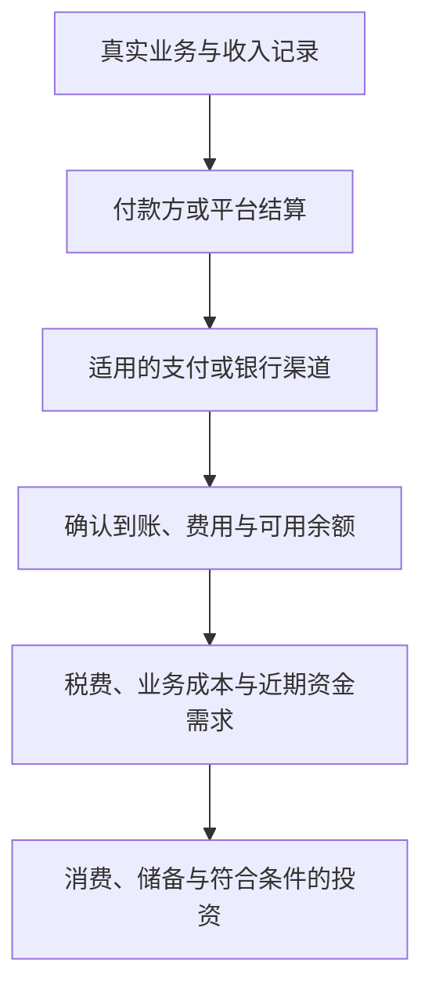

# 第十九章｜海外收入如何进入个人金融体系？

*Chapter 19: Bringing Global Income into a Personal Financial System*

更新与资料核对日期：2026-10-13

前两章把视角从配置资产转向创造收入：个人怎样连接全球客户，又怎样通过内容、产品与服务形成业务？接下来，还需要回答一个问题：收入产生之后，如何收到、记录和安排这些钱？

收入、账户余额与可投资结余是不同的状态。平台显示收益，不表示已经完成结算；资金到账，也不表示全部可以自由用于长期投资。

本章沿用原稿的三种用途：兑换为人民币用于国内生活，按条件研究长期投资，以及保留资金用于海外消费。先确认收入事实、收款条件与资金用途，再选择适合自己的安排。

> 个人金融体系连接的是收入、记录、责任和资金目标，而不只是更多账户。

## 一、从全球收入到个人财富体系

国内工资常通过银行账户进入消费、储蓄和投资安排。收入来自境外客户或平台时，则可能多出平台结算、支付服务、银行入账与币种转换等环节。

并非所有海外收入都以美元付款，也并非都必须先进入海外账户。具体路径由合同、平台支持、账户资格和业务性质共同决定。



这是一张功能图，不是保证可用的资金路线。跨境收入可以与人民币工资共同纳入财务计划，但币种增加本身不会提高财富水平。

管理时，可以连续回答四个问题：钱因何而来，现在由谁保管，是否存在退款或其他责任，以及未来准备在何时用于什么事情。

## 二、海外收入的三种主要用途

三种用途可以组合。选择时应先看生活支出、负债、业务现金流和时间安排，而不是把所有资金交给同一个账户或投资产品。

### 路径一：兑换为人民币，用于国内消费与储备

若近期主要以人民币支付生活费用，把相应部分转为支出币种，可以减少这部分资金的汇率不确定性。是否需要先提现、是否直接兑换，以及最终由哪个账户接收，须看渠道规则。

```text
确认结算与可用余额
   ↓
核对收款、兑换和转账条件
   ↓
核对实际费用、汇率与到账金额
   ↓
安排人民币支出与储备
```

PayPal 的商家费用资料分别列示交易、提现和币种转换等项目；业务与地区不同，适用费用也可能不同。比较渠道时，应看实际到手金额，不能只比较一个标出的手续费。[PayPal：商家费用](https://www.paypal.com/c2/business/paypal-business-fees?locale.x=en_C2)

举一个自拟换汇例子：假设已可结算的金额为 1,000 美元，扣除假设渠道费用 30 美元，剩余 970 美元；按假设汇率每美元 7 元兑换，对应 6,790 元人民币。若另有退款、税费或业务支出，个人可用结余还要继续减少。

这些金额不是任何平台的真实费率或实时汇率，也不是税额计算。它说明“账面美元金额”与“能够用于生活的钱”之间，可能经过多个扣减环节。

**保存来源资料。** 合同、订单、结算单、退款记录与付款凭证，可以帮助解释业务、金额和账户流水。平台经由支付机构打款时，银行流水中的付款名称也可能与平台品牌不同，应保留能够连接两者的资料。

**区分收汇与结汇。** 收汇是接收外汇，结汇是按规则兑换为人民币，两者不能与税务额度混为一谈。《经常项目外汇业务指引（2020 年版）》规定个人结售汇年度便利化额度，并说明境内个人凭相应来源材料办理不占用额度的经常项目结汇。便利化额度不是免税额度，也不等于真实收入收款的统一上限；实际办理仍需按业务事实审查。[外汇局：经常项目外汇业务指引，个人结售汇部分](https://www.safe.gov.cn/safe/file/file/20200831/f0127756271c43ef9b3908d5d157bd91.pdf)

个人经营性与非经营性收支、账户类别和材料要求也应分别判断。不能因为以个人身份创作或接单，就默认全部款项适用同一种处理方式。[外汇局：个人外汇管理办法](https://www.safe.gov.cn/safe/2022/0818/21330.html)

**按实际性质处理税务。** 收到美元、从海外账户转入国内、办理结汇，分别是资金动作，不能单独决定纳税结果。税务问题在第三节进一步说明。

### 路径二：形成结余后，按条件研究长期投资

收入可以增加本金，但只有扣除责任、支出和储备之后的资金，才适合进一步判断投资期限与风险。长期消费需求、负债和应急资金也属于财富体系的重要部分。

原稿中的“美元收入 → 海外券商 → ETF”可以帮助理解经济关系，却不能当作对所有读者通用的合法路线。对中国大陆读者，资金来源、境外存放、转移与投资用途需要分别核实。

《外汇管理条例》说明外汇收入调回或存放境外，以及境外证券投资等事项的相关管理要求。某笔收入真实、已存境外，或能够通过券商入金审核，不足以单独证明投资用途符合全部适用规定。[外汇局：外汇管理条例，第九及十七条等](https://www.safe.gov.cn/safe/2008/0806/5321.html)

同样，个人购汇用途限制不能因拥有其他账户而消失。外汇局明确不得将个人购汇用于境外证券投资等尚未开放资本项目；收入与用途的区别见[第五章](05-中国大陆居民如何获得海外资产敞口.md)。[外汇局：个人购汇要求](https://www.safe.gov.cn/tianjin/2018/0628/920.html)

在适用条件已经明确时，可以用三类资金角色管理：

| 角色 | 主要任务 | 判断重点 |
|---|---|---|
| 收入与业务资金 | 收款、退款、支付业务成本 | 资金事实、服务条件与责任 |
| 现金管理与储备 | 税费预留、生活支出、应急需求 | 期限、币种、可用性与保障 |
| 长期投资资金 | 对应长期目标承担资产风险 | 投资资格、风险、费用与退出 |

这不要求必须开设三套账户；清楚的记账和用途划分也能帮助管理。账户越多，核对、维护和信息更新成本也可能越高。

假设每年留下 5,000 美元结余，连续三年累计留存本金为 15,000 美元，这是不计投资收益、汇率和费用的算术例子。若投入资产，最终价值可能高于或低于本金，不能把持续投入等同于稳定复利。

投资税务还需要另行判断。W-8BEN 用于相关外国身份、实益所有人及适用协定待遇说明，按要求提供给付款方或金融机构；填写表格本身不代替其他国家或地区的申报义务，也不授予投资资格。[IRS：W-8BEN 说明](https://www.irs.gov/instructions/iw8ben)

股息、资本利得和美国资产遗产税等框架见[第七章](07-中国居民投资美股的税务.md)，组合与风险能力见[第十章](10-普通人的全球资产组合.md)。Crypto 也不是普通的美元余额管理工具；相关资产与服务须单独理解，国内现行规定见[第十六章](16-Crypto投资与未来金融.md)。

### 路径三：保留相应币种，用于香港或海外消费

若未来确有海外旅行、软件订阅、云服务或课程支出，可以研究保留相应币种。前提仍是账户、资金存放与消费安排符合实际条件。

香港消费常以港元计价，其他服务也可能使用美元、欧元或当地货币。“在海外消费”不等于“从美元余额直接扣款”，持有国际卡也不保证任何地区或商户都接受付款。

| 环节 | 需要看清什么 |
|---|---|
| 商户报价 | 原始计价币种、税费与续费条件 |
| 卡片扣款 | 扣哪个余额，是否兑换或产生费用 |
| 账户结算 | 入账金额、币种与交易记录 |
| 退款 | 退回渠道、到账时间与可能的汇率差异 |

以汇丰香港的多币种借记卡为例，官方说明部分支持币种可从对应存款扣款，其他币种按规则兑换结算。这用于说明“具体卡片规则决定扣款”，不是账户或卡片推荐。[汇丰香港：多币种借记卡说明](https://www.hsbc.com.hk/debit-cards/products/mastercard-debit-card/)

借记卡使用余额，信用卡通常涉及账单和还款安排，两者也需要区分。只有收入、余额与支出币种等条件相匹配时，保留外币才可能减少部分转换环节；不能预设必然免换汇或成本更低。

## 三、海外收入体系中的合规与记录

长期资金管理需要真实业务、准确资料和完整记录。银行受理、平台准入、税务申报和资金用途，各自有不同要求，一项审核通过不能代替其他判断。

### 1. 账户所在地与税务责任分开判断

香港或其他海外账户主要承担存款、支付或多币种管理等功能。账户所在地不能单独决定个人的税务居民身份，也不能把收入排除在适用的纳税范围之外。

中国个人所得税法规定居民与非居民个人的纳税范围。收入具体属于工资薪金、劳务报酬、稿酬、特许权使用费或经营所得等，须结合实际业务判断，不能仅按“平台收入”这个名称分类。[国家税务总局：个人所得税法](https://www.chinatax.gov.cn/n810219/n810744/n3752930/n3752974/c3970366/content.html)

税法上的境外所得也有具体认定规则。例如，境外提供劳务与境外组织支付并负担稿酬，对应不同的来源判断条件。海外客户付款、以美元计价或保留在境外，都不能单独证明属于境外所得。[财政部、税务总局：境外所得政策](https://12366.chinatax.gov.cn/bzds/081/081-5-7.html)

若实际涉及境外征税、申报与税额抵免，应根据身份、所得来源、所得类别和相应证明处理。平台预扣或提交某张表格，也不能预设已经完成全部税务责任。

### 2. 正确认识 CRS 与账户信息交换

CRS（Common Reporting Standard，共同申报准则）是金融账户信息自动交换的标准框架。具体交换取决于当地实施规则、机构、账户和税务居民身份，不能仅凭账户使用美元就判断。

香港税务局的 AEOI 说明指出，相关机构识别申报对象、收集账户资料并按安排报送和交换；资料可能包括身份、账户余额以及相应利息、股息和资产出售总额。[香港税务局：金融账户信息交换问答](https://www.ird.gov.hk/eng/faq/dta_aeoi.htm)

资产出售总额不等于投资净利润，账户余额也不等于应税所得。因此，信息交换、个人申报和实际税额计算，需要分别理解。

账户要求税务居民自我证明时，应按真实情况填写并在变化后更新。不同地区还有其他信息申报安排，不能把 CRS 当作所有账户都以完全相同方式处理的系统。

### 3. 建立能够核对的资金记录

不必等到收入很大才开始记录。可以按月把业务、结算、到账和用途连接起来：

| 记录层面 | 可以保留的资料 | 主要用途 |
|---|---|---|
| 业务事实 | 合同、订单、交付与退款记录 | 说明款项因何产生 |
| 收入结算 | 平台账单、费用、预扣与结算周期 | 区分收入和扣减项目 |
| 资金到账 | 支付凭证、银行流水、交易编号 | 连接付款与实际入账 |
| 币种转换 | 金额、汇率、费用与日期 | 解释到账差额 |
| 后续用途 | 消费、转账、投资和税务记录 | 核对资金安排与余额 |

这些资料不是统一的银行受理清单；机构可能要求其他材料。自己的记录也应安全保管，提交时使用机构认可的渠道。

同一笔钱从支付服务转入银行、再转到本人其他账户，属于资金移动，不能在内部账目里重复算作新增收入。预估收入、已结算收入、待提现余额和实际到账，同样要分别标记。

《外汇管理条例》要求经常项目收支有真实合法的交易基础，并涉及交易资料审查。与其猜测“什么金额不会被询问”，更有用的是准确说明业务与资金关系。[外汇局：外汇管理条例](https://www.safe.gov.cn/safe/2008/0806/5321.html)

## 四、普通人的全球金融基础设施

全球收入不要求每个人购买同样的账户或服务。可以先识别功能，再研究已有工具能否满足需求。

| 系统 | 要解决的问题 | 需要关注什么 |
|---|---|---|
| 收入与业务 | 钱怎样创造 | 需求、合同、交付与净收入 |
| 收款与结算 | 钱怎样收到 | 付款支持、身份、费用与到账 |
| 银行与现金管理 | 钱怎样存放 | 账户性质、保障、期限与币种 |
| 投资 | 结余怎样匹配长期目标 | 资格、权利、风险与税务 |
| 消费与支付 | 钱怎样使用 | 支付条件、扣款币种与费用 |
| 记录与申报 | 怎样解释整体安排 | 业务事实、余额核对及适用义务 |

PayPal、Wise 和银行可能承担其中不同环节。Wise 的官方资料也分别规定余额服务的地区与账户条件；能够注册、能够持有余额与能够取得某种收款信息，不应直接视为相同资格。[Wise：持有余额的资格](https://wise.com/help/articles/2813542/where-do-i-need-to-live-to-hold-money-with-wise)

支付服务余额与银行存款的法律性质和保护安排，还应回到[第四章](04-跨境收款与支付.md)区分。第三方代收、客户退款与业务支出，也会影响看似已经到账的资金能否长期留存。

工具选择应跟随需求：先确认必要功能，比较费用与责任，再决定是否增加账户。能够清楚记录和使用已有工具，也是完整体系的一部分。

## 五、结合普通读者的现实安排

建立全球收入可以从主业经验、学习和小范围业务验证逐步开始。副业需要考虑自身时间、合同责任与服务资格，不宜只根据某次平台收益就推断能够替代主业。

```text
积累专业能力与作品
   ↓
验证需求和真实业务
   ↓
确认收入、收款与记录安排
   ↓
核对成本、税务与近期支出
   ↓
形成储备和可长期安排的结余
```

用第二节的 6,790 元到账金额作一个自拟用途例子：

| 假设用途 | 金额 |
|---|---:|
| 税费及退款等责任的暂时预留 | 2,000 元 |
| 近期生活支出 | 3,000 元 |
| 业务工具与维护 | 500 元 |
| 尚待安排的结余 | 1,290 元 |
| 合计 | 6,790 元 |

这些金额不是税额、推荐比例或典型支出。预留金额需要在责任明确后调整；剩余部分也不自动成为投资预算，还要考虑已有储备、负债和未来支出。

一个软件工程师可能同时拥有工资与服务收入，一位创作者可能同时有平台结算和产品销售。形成多元收入之后，仍需检查是否依赖同一个客户、平台或行业，避免把收入名称增加误认为风险已经分散。

收款波动较大时，生活安排应结合实际可持续现金流，而不是最好月份的金额。个人体系的价值，是让收入变化时仍能知道哪些资金可以用、哪些需要保留。

## 六、本章总结

全球收入进入个人金融体系，要经过业务、结算、到账、记录和用途判断。兑换人民币、保留外币消费与长期投资，是不同选择，也有不同条件。

长期财富增长既需要创造收入，也需要支出管理、储备与风险判断。购买资产只是可能的一部分，消费、偿债和业务再投入也可以服务于明确的生活目标。


“赚全球的钱、管理全球的钱”，最终落在可持续收入、清楚记录与合适用途上。账户和币种可以增加选择，个人目标与责任决定如何使用这些选择。

## 第三篇收束｜全球收入与个人能力

至此，第三篇完成了三章路径：

1. [第十七章：全球收入与创造收入的能力](17-全球收入与赚美元.md)。
2. [第十八章：创作者平台、数字产品与业务模式](18-海外创作者与数字产品收入.md)。
3. [第十九章：收入如何进入个人金融体系](19-海外收入与个人金融体系.md)。

这一篇把前面的账户、工具和资产知识，与劳动和经营收入连接起来。从理解世界金融体系，到判断资产，再到创造收入，个人能力与金融管理形成了同一张地图。

**第三篇完。**

## 下一阶段｜第四篇：实操手册（计划）

后续实操手册拟记录账户、支付、平台与申报等具体流程，包括香港账户与卡片、跨境收款、证券账户、W-8BEN、创作者结算，以及数字资产的控制与安全学习。

这些主题并非面向所有读者的统一操作路线。每份手册应先明确适用地区、身份、业务用途和服务条件，再给出核对日期、官方入口与验证方法；无法确认或不适用的情形需要清楚标注。

正文建立认知，实操手册记录在具体条件下可验证的流程。手册尚未形成正文，不能把本章预告视为已经发布的指南。

## 本章要点

海外付款、外币收入、境外存放与税法上的境外所得，不能相互替代。真实收入与后续资金用途，也需要分别核实。

先核对结算和责任，再决定消费、储备或投资。平台余额、银行到账、币种转换和本人账户间转账，需要通过记录串联，避免重复计算收入。

清楚的业务事实、准确的身份资料与持续记账，能够支持长期的个人金融管理。

[上一章：海外创作者与数字产品收入](18-海外创作者与数字产品收入.md) · [返回全书目录](../目录.md)

---

本章依据用户本次提供的第十九章完整成稿润色，保留六节主体与三种用途，并按已发布目录统一为第三篇收束、第四篇实操计划。资金图表为功能关系，不是通用资金路线；换汇、累计留存与用途金额为自拟教学算例，不是实时汇率、费用、税额或推荐比例。政策与服务按核对日期查阅，具体处理仍须按真实身份、业务、账户和资金用途核实。完整出处见[来源索引](../参考资料/来源索引.md)。
