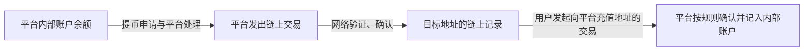
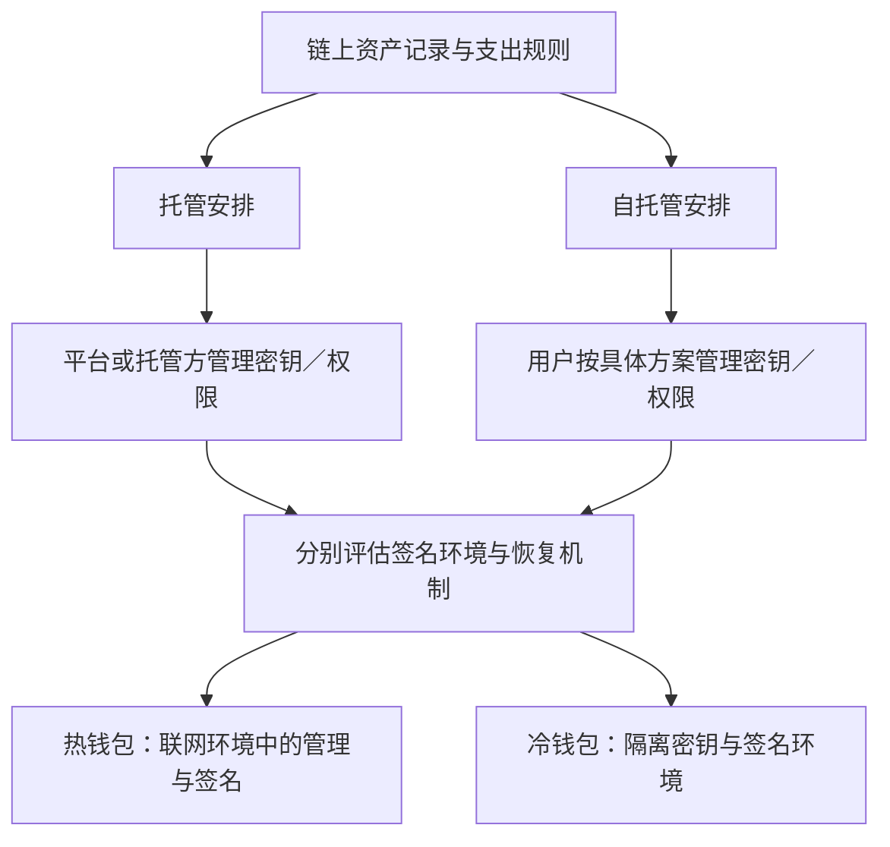

# 第十四章｜Crypto 世界的钱在哪里？交易所、钱包与私钥

*Chapter 14: Exchanges, Wallets and Private Keys*

更新与资料核对日期：2026-10-13

前面三章介绍了比特币、公链与稳定币：BTC 是一种具有特定发行规则的数字资产，Ethereum、TRON 提供网络与程序运行环境，USDT、USDC 则尝试把美元挂钩的计价方式带到链上。

接下来，需要回答一个更实际的问题：交易所里显示的余额是什么，钱包到底管理什么，以及谁能够决定资产怎样转移？

本章不展开复杂密码学，先围绕一个核心问题建立理解：**Crypto 资产究竟由谁控制？**

## 一、先看懂交易平台、钱包与区块链

普通用户接触 Crypto 时，经常遇到三个概念：

| 对象 | 主要作用 | 需要分清的关系 |
|---|---|---|
| 中心化交易平台 | 提供交易、账户与托管等服务 | 平台内部余额与链上记录不同 |
| 钱包 | 查看记录、管理密钥或权限、发起操作 | 钱包界面本身不装着代币 |
| 区块链 | 按规则验证和记录交易与状态 | 链上控制权不等同于所有法律权利 |

交易平台也会使用钱包管理资产，用户还可以直接使用自托管钱包。因此，这三者并不是所有人都必须依次经过的步骤，而是不同的功能层面。

## 二、Binance、Coinbase、OKX 到底是什么？

这类品牌提供中心化 Crypto 交易平台等服务，通常被称为 **CEX（Centralized Exchange，中心化交易所）**。

从界面体验看，用户注册账户、验证身份、登录并买卖资产，类似在证券平台管理账户。但这种类比只说明使用方式，不能据此推断它们具有与银行、证券公司相同的法律地位或客户保护。

同一个品牌还可能提供独立钱包、托管等不同产品。判断资产怎样保管，应该看具体服务和账户条款，不能只看 App 名称。本章提到品牌是为了识别概念，具体服务资格需要另外核实。

## 三、交易所显示的 BTC 和 USDT 是什么？

假设某个平台页面显示：

```text
BTC：0.1
USDT：5,000
```

在常见的平台托管模式下，用户看到的是平台内部账本记录的余额。平台或其托管人控制相应链上资产的密钥，并按账户与服务安排履行义务。

一次平台内买卖，不一定对应一次专门为该用户发出的链上交易；平台也可能把多个客户的资产放在共同管理的钱包中。

因此，页面余额、专属充值地址与用户独立控制的链上钱包，是不同概念。实际客户权利、资产隔离及提现安排，需要看相应条款。

## 四、交易所的主要便利是什么？

平台通常让用户通过账号、密码和多因素认证管理账户。忘记登录密码时，可能通过身份核验或客服流程恢复访问。

这种方式减少了直接管理链上密钥的负担，但也增加了对平台运营、信息安全和托管安排的依赖。恢复登录访问，不等于任何情况下都能取回资产。

## 五、如果交易所出问题怎么办？

平台若发生攻击、停业、破产或暂停提现，页面显示余额并不能保证用户立即取出资产。客户资产如何处理，取决于实际托管、法律及处置安排。[Investor.gov：Crypto 资产托管基础](https://www.investor.gov/introduction-investing/general-resources/news-alerts/alerts-bulletins/investor-bulletins/crypto-asset-custody-basics-retail-investors-investor-bulletin-0)

这也是“**Not your keys, not your coins**”这句话所提醒的问题：不控制相关密钥，就需要依赖托管方执行资产转移。

它强调的是技术控制与托管依赖，不能理解为用户没有合同权利，也不能直接推出所有人都应采用同一种保管方式。

## 六、钱包到底是什么？

Crypto 资产的交易与状态记录在相应区块链上。钱包主要提供查看记录、构造交易、管理密钥或签署操作的功能。

以普通自托管钱包为例，可以把它理解成“管理钥匙与操作账本的工具”。资产并不是作为一个文件装在手机里，换一部手机也不意味着链上的记录消失。[Ethereum：钱包](https://ethereum.org/wallets/)

有些钱包只用于观察地址，不能签署支出操作；有些则连接硬件设备，由设备完成签名。因此，能够显示余额，不一定意味着能够支出。

## 七、怎样用“保险柜”理解钱包？

可以先用一个简化类比：

```text
区块链记录 ≈ 可公开核验的资产与交易账簿
地址       ≈ 账簿上的收款标识
私钥       ≈ 产生有效授权签名的秘密钥匙
钱包       ≈ 管理钥匙、查看记录和发起操作的工具
```

原稿中的“透明保险柜”有助于理解公开记录与秘密钥匙的区别，但链上并不存在真正装钱的柜子。

不同网络的记账方法也不同：比特币通过未花费交易输出等规则表达可支出的资产，以太坊账户和代币合约又有各自记录方式。普通读者先理解控制关系即可，不必把所有链都想成相同的账户数据库。

## 八、钱包地址是什么？

地址可以先理解为链上的收款标识。Ethereum 地址常以 `0x` 开头，其他网络有自己的格式；仅凭格式相似，不能证明支持同一种资产和网络。

通常可以把收款地址交给付款方，单独知道地址不能像掌握私钥那样签署交易。但公开地址可能让他人关联余额、交易和身份，因此“可以提供收款地址”不等于“没有隐私影响”。

地址、公钥与私钥也不是三个可互换的名称。它们有技术上的关联，作用却不同。[Ethereum：账户](https://ethereum.org/developers/docs/accounts/)

## 九、什么是私钥？

私钥（Private Key）是用于生成数字签名的秘密数据。对于普通单密钥账户，有效签名是授权相应操作的重要条件。

```text
地址：用于识别收款位置
私钥：用于签署被网络认可的操作
```

“掌握私钥就能控制资产”是有适用条件的简化理解。多签账户、智能合约账户或代币发行方权限，可能增加其他限制。例如，[上一章](13-USDT、USDC与稳定币.md)说明了稳定币发行方的冻结安排。

## 十、私钥为什么不能当作普通登录密码？

平台登录密码通常可以通过服务商的核验流程修改。普通链上账户的私钥则不是由某个客服保存并重置的密码。

一旦私钥泄露，攻击者可能签署资产转移；已经确认的链上交易通常没有银行式的撤回机制。即使没有泄露密钥，用户自己签下恶意操作，也可能造成损失。

私钥不应交给客服或陌生人，也不应随意通过聊天、截图或无保护的网络存储传递。正规支持人员可以解释恢复流程，但不需要取得用户的秘密密钥。[Ethereum：安全与防诈骗](https://ethereum.org/security/)

## 十一、助记词是什么？

很多传统钱包使用 **Seed Phrase／Recovery Phrase**，通常称为助记词或恢复短语。常见形式是 12 个或 24 个单词，但并不是所有钱包都采用同一机制。

以 BIP39 方案为例，助记词用于生成种子，再结合后续规则产生钱包密钥；该标准还定义了其他词数，以及可选的额外口令（passphrase）。因此，不能把任意一串单词当成有效备份。[BIP39 标准](https://github.com/bitcoin/bips/blob/master/bip-0039.mediawiki)

本书不展示可用于实际钱包的恢复短语。需要记住的是：用于恢复控制权的秘密资料，应当按其安全等级管理。

## 十二、助记词为什么像“总钥匙”？

在常见的确定性钱包中，一份恢复资料可以生成许多密钥，钱包再用这些密钥管理不同地址。

```text
助记词 ＋ 额外口令（如有）
            ↓
          种子
            ↓
       按规则派生密钥
            ↓
       相应地址与控制权限
```

但恢复还可能需要正确的派生规则和钱包支持。单独导入的私钥、多签配置或某些账户资料，也不一定包含在这份助记词中。

因此，“总钥匙”适用于由它生成的那部分密钥，不能保证任意钱包的全部内容都会自动恢复。额外口令也不同于 App 的解锁密码；若使用了它，恢复时通常同样需要正确口令。

## 十三、丢失助记词为什么可能失去资产？

如果手机损坏、原有密钥不可访问，同时又没有有效备份或其他恢复机制，用户可能永久失去签署支出操作的能力。链上记录仍在，但无法满足支出条件。

另一方面，仅仅丢失纸上助记词，并不代表立即失去资产：若原设备仍能签署，或有其他有效恢复安排，情况就不同。

关键问题是：**所有可用的控制和恢复途径，是否都已失去？** 对普通自托管账户，网络没有一个可以凭身份证重置私钥的总管理员。[Ethereum：支持与恢复问答](https://ethereum.org/community/support/faq)

## 十四、钱包现在一定有助记词吗？

不一定。钱包还可以采用多方计算（MPC）、智能合约账户、社交恢复或多签等安排。

这些名称也不是同义词。多签强调多个授权者共同满足条件，社交恢复依赖指定恢复规则，账户抽象则允许通过程序定义更灵活的验证与账户功能。[ERC-4337：账户抽象](https://eips.ethereum.org/EIPS/eip-4337)

普通读者不必先记住全部技术细节，可以先问：谁能授权转移，谁能改变规则，设备丢失如何恢复，以及服务商停止运营会有什么影响。

“不展示助记词”本身，不能证明钱包一定是托管或自托管，也不能证明更加安全。

## 十五、托管和自托管有什么区别？

| 比较项 | 托管模式 | 自托管模式 |
|---|---|---|
| 密钥或控制权限 | 由平台／托管方管理 | 用户依照具体方案管理 |
| 日常使用 | 通常以账户登录为入口 | 通常需要理解签名、备份和网络 |
| 恢复方式 | 依赖服务商核验与规则 | 依赖预先建立的备份或恢复机制 |
| 主要依赖 | 托管方运营与履约 | 自己的管理及所用软硬件、合约 |
| 转移限制 | 平台条款与审核等限制 | 网络、合约、代币权限等限制 |

自托管减少了一部分平台依赖，也增加了密钥保管与操作责任。它并不会消除代币发行方、应用、软件或网络风险。

选择保管方式，需要比较实际方案及个人能力，而不是单靠“自己的钱包”或“正规平台”这类称呼判断。

## 十六、新手自己保管私钥为什么也可能危险？

如果把助记词截图上传、下载假钱包，或给陌生应用签署不理解的授权，即使资产放在自托管钱包，也可能发生损失。

风险不仅来自秘密泄露。用户可能亲自授权某个合约支出代币，或签下一份可以被对方利用的消息。

因此，安全管理包含两个问题：**秘密是否保管好，以及签署的内容是否理解。** 获得自主控制权之后，这两项责任也随之增加。

## 十七、什么是热钱包？

热钱包（Hot Wallet）通常指在联网环境中管理和使用密钥的钱包，例如部分手机或浏览器软件钱包。

它便于日常操作，但联网设备、浏览器扩展和下载来源都可能增加攻击面。钱包有登录或解锁密码，并不意味着密钥和签名操作天然安全。

热钱包描述的是密钥与签名环境，不是账户由谁托管。平台也可以使用热钱包管理部分资产。

## 十八、什么是冷钱包？

冷钱包（Cold Wallet）强调把密钥或签名过程与日常联网环境隔离。硬件钱包是常见方案之一。

硬件设备可以接收待签名交易、在设备内签名，再把签名结果交给联网软件广播。设计良好的方案让秘密密钥留在设备中，联网计算机不必直接取得它。[Bitcoin 开发者指南：硬件与签名钱包](https://developer.bitcoin.org/devguide/wallets.html)

但隔离密钥不等于自动识别恶意交易。用户仍需要确认设备显示的操作；若主动签署危险授权，硬件设备也可能照样执行。设备、备份和供应链同样需要可靠管理。

## 十九、普通人需要买冷钱包吗？

没有适用于所有人的金额门槛。需要考虑资产规模、使用频率、操作能力，以及能否建立可靠的备份和恢复安排。

长期保存与频繁交互，可以采用不同方案。但设备更贵、步骤更多，并不自动带来更好的实际安全性。

还要记住两个独立维度：

| 维度 | 区分的问题 |
|---|---|
| 托管／自托管 | 谁管理控制权限 |
| 热／冷钱包 | 密钥与签名过程怎样隔离 |

托管机构也可能用冷钱包，自托管用户也可能用热钱包。这两组名称不能排成一条固定的安全等级线。

## 二十、交易所和钱包之间怎样移动资产？

在支持的业务场景中，**Withdraw（提币）**一般指平台从其管理的地址发出资产，目标是用户指定的链上地址。

反向的 **Deposit（充币）**一般指资产到达平台支持的充值地址，再由平台依据确认及入账规则记到用户账户。



这张图只解释记录关系。平台还可能提供内部转账等不同方式；链上确认与平台入账是两个环节。充币、提币也不等同于法币入金或银行卡提现。

## 二十一、为什么一定要确认网络？

延续[第十三章](13-USDT、USDC与稳定币.md)的例子，同样叫 USDT，可能位于 Ethereum、TRON 或其他网络中。

确认币名之后，还需要确认具体网络、接收地址、代币合约及平台支持规则。若接收服务要求 Memo／Tag 等附加信息，也需要按其说明处理。

标准名称、地址格式或曾经成功过的一次转账，都不能单独证明本次路径正确。网络或代币不匹配，可能无法入账，找回也不能预先保证。

## 二十二、为什么大额转账前要做小额测试？

在允许开展相关业务的场景中，小额测试可以帮助确认具体地址、网络和入账过程，减少第一次就转移较大金额带来的操作风险。

但测试需要符合最低入账金额和费用规则。只看到交易在区块浏览器上确认，还应分别核实接收端是否按预期入账。

测试成功只能验证当时的路径，不证明对方诚信、平台持续安全或后续交易一定相同。后续操作仍须重新核对信息，不能把测试当成万能保证。

## 二十三、危险为什么不只来自底层网络？

对于用户，有不少损失途径并不需要攻破比特币或以太坊的底层密码学，例如假钱包、冒充客服、钓鱼网站、剪贴板地址替换或恶意授权。

只核对地址首尾少量字符，可能漏掉伪装地址；只看到“签名不收费”，也不能判断签名无风险。某些消息签名或授权可以使对方取得后续操作能力。

这说明，网络能够按规则执行，并不能确保用户选择的规则、软件和接收方可信。[Ethereum：安全与防诈骗](https://ethereum.org/security/)

## 二十四、普通人应建立哪些安全底线？

| 场景 | 基本原则 |
|---|---|
| 收款地址 | 可以按需提供，同时理解公开账本的隐私影响 |
| 私钥与助记词 | 不交给任何人，不以随意截图或无保护上传代替备份 |
| 账号安全 | 使用可靠的认证方式，核实服务入口 |
| 钱包下载 | 核实来源，不安装聊天链接提供的陌生程序 |
| 交易与授权 | 理解资产、接收方、金额及权限；看不懂就不签 |
| 地址核验 | 使用可信来源核对完整地址，警惕剪贴板替换 |
| 网络选择 | 核对接收方实际支持的网络、代币与附加信息 |
| 首次较大转移 | 先验证小额路径及实际入账，后续仍重新核对 |
| 恢复安排 | 了解设备丢失、备份损坏及服务停止时的处理条件 |
| 所谓客服索要秘密 | 不提供私钥或助记词 |

安全的核心不仅是保密，还包括理解授权、独立核对信息和建立可用的恢复机制。

## 二十五、中国大陆读者还需要理解监管边界

现行银发〔2026〕42 号通知明确，比特币、以太币、泰达币等不具有与法定货币等同的法律地位；境内开展相关兑换、交易服务等虚拟货币业务活动受到严格禁止，境外主体不得非法向境内主体提供相关服务。[中国人民银行等八部门：2026 年通知](https://www.pbc.gov.cn/tiaofasi/144941/3581332/2026020619591971323/index.html)

本章介绍交易平台、钱包与转移机制，帮助读者理解全球数字金融基础设施及其风险。技术上可以签署或发送，不代表某项业务在本人所在地或服务所在地可以开展。

实际服务资格、资金用途及法律责任，需要依照适用规则判断。

## 二十六、用一张图看懂控制与恢复关系



这张图说明两个选择维度，而不是固定的购买或转移步骤。实际方案还可能使用多签、分布式计算或智能合约恢复，需要查看具体控制条件。

对于传统助记词钱包，恢复资料帮助生成密钥，密钥用于满足支出规则。对于其他方案，则应按其实际机制理解，而不是机械套用“一份助记词控制一切”。

## 本章要点

链上资产记录、平台内部余额和钱包界面，是不同层面的事物。理解保管方式，首先要看谁能够授权转移，以及用户依据什么条件恢复访问。

托管方式依赖服务商管理和履约；自托管则让用户承担更多密钥、签名和备份责任。热钱包与冷钱包描述的是签名环境，不能直接替代托管关系的判断。

私钥和恢复资料需要保密，交易与授权也需要被理解。硬件设备、小额测试或公开可验证的网络，都无法替用户判断所有风险。

下一章将讨论：[**普通人如何理解和进入 Crypto 世界？**](15-理解Crypto的参与流程.md) 从服务流程的角度解释注册与身份核验、现货交易、入金与出金、P2P 及充币提币等概念，继续区分技术流程、实际服务条件和主要风险。

---

本章依据用户提供的第十四章成稿润色，保留原有二十六节理解路径及总结。图表解释控制、记录和恢复关系，不代表实际账户、可用交易路线或平台推荐。密钥与恢复机制依具体钱包设计而定；完整出处见[来源索引](../参考资料/来源索引.md)。
