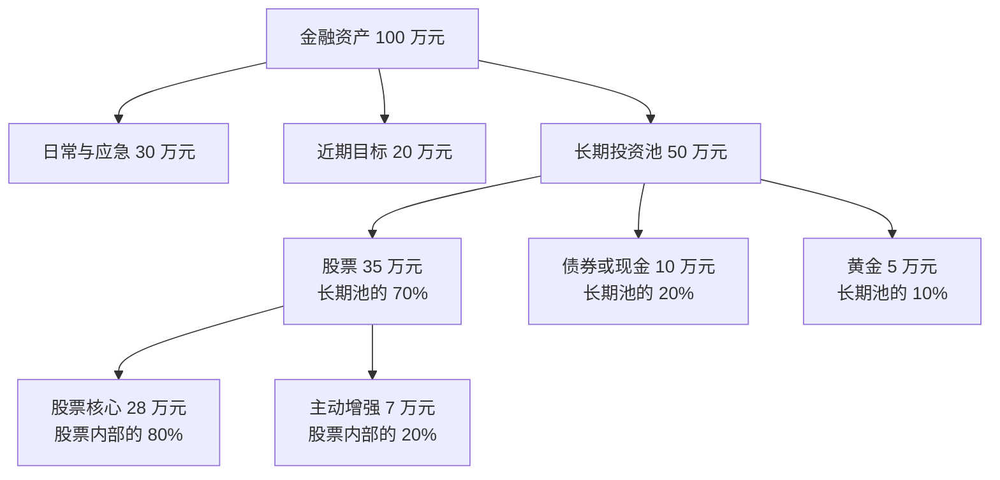
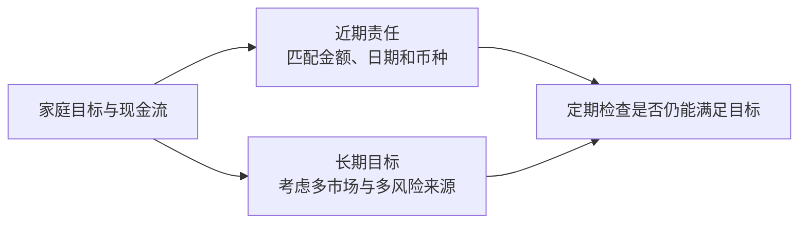

# 第十章｜普通人的全球资产组合，到底应该怎么搭？

*Chapter 10: Building and Maintaining a Global Asset Portfolio*

更新与资料核对日期：2026-10-12

[第九章](09-VOO、QQQ、美债与美元资产工具.md)讨论怎样选择持有资产的产品。本章进一步回答：钱应该怎样分配，才能与自己的生活计划、风险能力和长期目标相匹配？

知道标普 500、全球股票、美债和黄金之后，下一步并不是继续寻找更多品种。一个成熟的组合，也不是把所有“好资产”各买一点。

它首先需要回答：这笔钱什么时候使用，自己实际能承受多少亏损，哪些资产负责长期增长，哪些资金负责近期生活，以及多少仓位用于表达主动判断。

本章保留原稿的用途分类、核心—卫星和再平衡框架。全部金额、比例及市场变化例子均为教学算例，忽略税费、汇率、现金流等未列因素，不是推荐比例或历史回测。

## 一、先按照用途，而不是收益率分配资金

资产配置的第一步，不是决定股票占 60% 还是 70%，而是区分钱的用途。

一年后必须用于住房或教育的钱，与二十年不用的养老资金，不应该采用相同策略。投资期限越短、支出越不能推迟，越需要注意本金波动和取用条件。[Investor.gov：资产配置与投资期限](https://www.investor.gov/introduction-investing/getting-started/asset-allocation)

原稿提出四类用途，可以这样整理：

| 资金用途 | 主要任务 | 首先考虑 |
|---|---|---|
| 日常与应急 | 应付生活、失业或突发支出 | 能否及时使用，是否保持足够流动性 |
| 近期确定目标 | 支付未来几年明确的大额支出 | 金额、日期和币种是否匹配 |
| 长期投资 | 为较远的目标积累资产 | 能否承受波动并持续持有 |
| 主动观点与兴趣投资 | 表达对某个方向的有限判断 | 总损失预算及对生活计划的影响 |

最后一类资金同样需要长期承担风险。为避免重复计算，本章将它视为长期投资资金内部划出的预算，不再额外加一个百分比。

## 二、日常与应急资金，首先解决取用问题

这部分资金用于生活费、医疗、临时失业或家庭突发事件。目标是需要时拿得出来，而不是追求最高收益。

需要保留多少，应结合基本开支、收入稳定性、保险和家庭责任估算。原课堂的“几个月生活费”是思考起点，不是所有家庭统一适用的金额。

可以优先比较与支出币种匹配、取用方便的现金和低波动安排。但“低风险产品”仍要查看具体保障、赎回和到账条件；货币基金、短债基金与银行存款不能直接当成一回事。[Investor.gov：应急资金与短期目标](https://www.investor.gov/introduction-investing)

## 三、未来几年要使用的钱，不属于长期股票本金

买房、装修、婚礼、买车或教育支出，往往有明确时间。

如果两年后必须使用一笔钱，就不能默认市场下跌后可以再等五年。支出日期不会等待资产恢复。

因此，除了控制价格波动，还要考虑资金到期、赎回和到账时间。目标本来以人民币支付，就应重视人民币金额是否足够，而不能只看外币余额。

**近期确定需要使用的钱，不应该承担自己无法等待恢复的风险。**

## 四、长期资金可以承受波动，但时间不能保证盈利

较长投资期限，通常给投资者更多时间应对市场周期。在其他条件相同时，它可以支持不同于短期支出资金的风险选择。

但长期持有并不保证一定盈利，也不能保证在某个日期恢复。年轻只是可能拥有较长时间，不代表每个年轻人都适合高股票比例。

收入、负债、家庭责任和未来支出，同样决定实际风险能力。只有把这些因素放在一起，才能判断哪些钱真正可以长期投资。

## 五、心理上敢亏，与现实中能亏，要分开判断

**Risk Tolerance（心理风险承受度）**，是亏损出现时自己的感受与行为。**Risk Capacity（实际风险承受能力）**，则是财务状况允许承受多少损失、等待多久。

一个人可能认为自己能接受下跌 50%，但如果明年必须使用大部分资金，现实中的等待能力仍然有限。

判断时，最好把比例换成金额。例如，“能承受 20% 下跌”，对 10 万元和 100 万元的账户分别意味着 2 万元和 20 万元，心理感受可能完全不同。

敢承担风险，不等于生活安排有能力承担风险。两者冲突时，应重视实际财务约束。

## 六、股票、稳定资产、黄金和主动投资，分别做什么？

| 组合部分 | 常见任务 | 需要记住的边界 |
|---|---|---|
| 广泛股票资产 | 参与企业长期增长 | 盈利与估值变化都可能造成大幅亏损 |
| 现金及适当债券 | 提供流动性，争取降低组合波动 | 长债、低信用债券或外币债券未必稳定 |
| 黄金 | 提供不同于企业权益的价格表现 | 也会波动，并不在每次危机中上涨 |
| 主动观点仓 | 表达区域、行业或其他判断 | 与核心可能重叠，应控制总风险预算 |

不同资产承担不同任务。上一章已经说明债券产品差异，因此本章的“稳定资产”不能笼统理解为任何债券。

股票与债券可能同时下跌，黄金也可能下跌。分散能够改变组合风险结构，却不能保证亏损时必然有另一项资产补回来。[Investor.gov：债券基金风险](https://www.investor.gov/introduction-investing/investing-basics/glossary/bond-funds-and-income-funds)

## 七、股票比例没有统一答案

原稿中的三组比例，可以放在同一张表里比较。这里的分母是**已经单独留出应急和近期支出后的长期投资池**。

| 示意组合 | 股票 | 债券／现金 | 黄金 | 假设只有股票下跌 30%，其他不变时的组合变化 |
|---|---:|---:|---:|---:|
| 偏进取 | 80% | 15% | 5% | −24% |
| 相对均衡 | 60% | 30% | 10% | −18% |
| 偏稳健 | 40% | 50% | 10% | −12% |

最后一列按“股票权重 × 股票变化”计算，只展示一个简化情景。真实市场中其他资产也会变化，这不是最大可能亏损，更不能证明某一组合安全。

例如，100 万元长期池中的 −24%，对应 24 万元。把数字换成自己能理解的生活影响，比只给自己贴“进取型”或“稳健型”标签更有用。

## 八、股票内部，可以先区分核心与增强

核心仓承担广泛股票配置的基础任务。它应是一种即使不知道未来哪个国家、行业领先，仍愿意按计划持有的资产范围。

增强仓则表达对成长股、某个地区、质量因子或其他方向的额外偏好。它不是必须存在：不希望作主动判断，也可以保持更简单的股票结构。

第八章讨论的持仓重叠仍然适用。核心与增强名称不同，不代表底层公司不同，要合并看地区、行业和头部公司的风险。

## 九、核心—卫星结构，关键是明确分母

原稿以股票内部 80% 核心、20% 主动增强说明 **Core-Satellite（核心—卫星）**。这是一种控制观点范围的方法，不是标准比例。

假设股票占长期池的 70%，股票内部再按 80% 和 20% 划分：

```text
核心占长期池：70% × 80% = 56%
增强占长期池：70% × 20% = 14%
股票以外部分占长期池：30%
```

股票内部的“20%”，不等于整个家庭财富的 20%。当还存在应急和近期目标资金时，它占全部金融资产的比例会进一步不同。

以 100 万元金融资产为自拟例子，可以把层次画清楚：



图中每层都应按自己的分母理解。主动增强已包含在 35 万元股票中；不能再把它额外加到总资产上。

## 十、主题投资，需要明确损失预算

人工智能、半导体、新能源、资源或 Crypto 等方向，可能具有投资机会，也可能有较大的集中风险。

可以问：如果这个仓位下跌 50%，会损失多少钱，是否影响住房、生活或长期目标？

假设单一主题占组合 5%，它下跌 50%，其他资产不变，对组合的影响是 −2.5%。如果占 30%，同样情景的影响变为 −15%。

这两个自拟例子只用于比较仓位大小。某些主动投资可能损失超过 50%，甚至全部本金；多个看似不同的主题也可能同时下跌。核心与卫星的划分有助于管理，但不能自动防止重大亏损。

## 十一、房产也属于家庭资产配置

不能只看证券账户。住宅可能是家庭最大的资产，但自住房不能简单当成随时可以出售、用于再平衡的现金。

一个自拟资产负债表如下：

| 项目 | 金额 |
|---|---:|
| 住宅估值 | 300 万元 |
| 金融资产 | 100 万元 |
| 总资产 | 400 万元 |
| 房贷余额 | 100 万元 |
| 净资产 | 300 万元 |

住宅占总资产 75%，同时还有房贷支出责任。即使证券账户分散，也需要理解家庭对本地房地产和现金流的整体依赖。

估值、负债和流动性应分别记录。养老金权益也值得考虑，但不能把未来领取金额直接当成今天可以投资的资金。

## 十二、工作收入，也是隐性的风险来源

收入稳定的人，与收入高度依赖行业周期的创业者，即使金融资产相同，也可能有不同的配置需求。

如果收入和所持股票同时依赖某个行业，一轮低迷可能既影响工资，也影响投资余额。因此，职业收入应与投资风险一起看。

未来工资可以帮助理解家庭现金流能力，却不等于无风险资产。它也存在失业、健康、行业和收入变化风险，不能据此机械推导高股票比例。

## 十三、适度全球分散，可以从家庭整体看

不少家庭的工资、住房、社保和退休安排主要与本地经济及本币有关。金融投资中增加不同市场和货币来源，可以让财富不完全依赖同一种经济环境。

但“海外产品”不一定天然分散。它可能仍高度集中于一个行业，或与职业收入共同受全球周期影响。

先查看整个家庭已有的风险，再判断还需要增加什么，比单独看一个证券账户更完整。资金渠道与用途仍需衔接[第五章](../第一篇｜先看懂全球金融地图/05-中国大陆居民如何获得海外资产敞口.md)，资产配置本身不会自动解决跨境条件。

## 十四、全球配置，也要匹配本地生活责任

如果日常消费和大额支出主要以人民币计价，把所有金融资产变成外币，同样可能产生汇率错配。

可以把两项任务分开：近期生活责任重视对应币种与取用条件，长期资产再按适用渠道逐步分散。



目标是让资产与责任相匹配，而不是单纯追求海外资产比例越来越高。

## 十五、相对稳定的资产，可以支持再平衡

当股票下跌，而其他资金仍有相对稳定的价值时，组合可能具备调整空间。现金和适当债券可以成为再平衡的资金来源之一。

但这并不意味着一跌就必须加仓。应急资金和近期目标资金仍有自己的用途，不能因为市场下跌，就拿它们填补长期仓位。

如果原来被当成“稳定”的长债也在下跌，或自己出现收入变化，则需要先重新判断实际条件。再平衡应服从组合目标，而不是强迫自己逆势买入。

## 十六、再平衡：把比例拉回原定结构

**Rebalancing（再平衡）**，是当不同资产涨跌后，调整偏离目标的仓位。它主要维持既定风险结构，而不是预测下一步涨跌。[Investor.gov：再平衡说明](https://www.investor.gov/additional-resources/general-resources/publications-research/info-sheets/beginners-guide-asset)

用原稿的 70／20／10 目标做一个完整金额算例。假设最初有 100 万元，股票上涨 50%，债券和黄金不变，无新增资金、费用或税款：

| 资产 | 初始金额 | 变化后金额 | 变化后比例 | 按 135 万元总额恢复目标 | 调整差额 |
|---|---:|---:|---:|---:|---:|
| 股票 | 70 万元 | 105 万元 | 77.78% | 94.5 万元 | 减少 10.5 万元 |
| 债券 | 20 万元 | 20 万元 | 14.81% | 27 万元 | 增加 7 万元 |
| 黄金 | 10 万元 | 10 万元 | 7.41% | 13.5 万元 | 增加 3.5 万元 |
| 合计 | 100 万元 | 135 万元 | 100% | 135 万元 | 净变化为 0 |

调整后重新回到 70%、20%、10%。注意，目标金额应按变化后的 135 万元计算，而不是直接恢复最初的 70、20、10 万元。

真实操作还要考虑交易和税务成本。再平衡不能保证提高收益；持续上涨的资产被减持后，也可能继续上涨。它服务于风险管理。

## 十七、再平衡不需要每天操作

原稿提出两种常见方式：按时间定期检查，或在仓位偏离预设范围时检查。持续投入的人，还可以把新增资金优先投向不足部分，减少卖出需求。

例如，把“目标 70%，偏离超过 5 个百分点时检查”写成规则，意味着检查 65% 或 75% 附近的情况；这里是百分点，不是相对变化 5%。

时间与偏离幅度都只是自定规则的示例，不是最优参数。执行前应核对目标是否仍适合自己，并估算成本。新增资金也不一定能一次消除较大的偏离。[Investor.gov：调整方法与成本](https://www.investor.gov/additional-resources/general-resources/publications-research/info-sheets/beginners-guide-asset)

收入、负债或支出计划明显变化时，要先重新审视目标；这与仅因市场涨跌恢复旧比例，是两类不同决定。

## 十八、能长期执行，比不断追求精确更重要

股票 60% 还是 65%，会影响结果；但拿近期资金承担高波动、使用过高杠杆、频繁追逐主题，可能让整个计划无法执行。

可以给自己留一页组合记录：资金用途、目标比例、主动仓位预算、检查日期、允许调整的原因。记录的作用，是在市场热闹或低迷时仍有明确依据。

一个简单组合，也需要理解风险；复杂组合如果难以核对和维护，则未必适合自己。关键是资产、期限和生活责任相互一致，并能随着真实情况变化而调整。

## 本章要点

先区分钱的用途，再决定长期投资池内部的比例。应急、近期目标和长期投资不能混用；心理上的风险承受度也要与实际财务能力一起判断。

核心与主动仓应明确分母，房产、负债和职业收入则需要纳入家庭整体考虑。全球分散还要兼顾日常支出的币种与流动性。

通过定期检查和适当再平衡，让组合继续服务于目标。简单、清楚、可以持续执行，比不断增加产品更重要。

到这里，书稿已从账户、税务和产品选择，走到组合设计。下一章进入 Crypto 部分，先讨论：[比特币到底是什么？为什么有人认为它有价值？](../第三篇｜Crypto与链上金融/11-Bitcoin到底是什么.md) 我们会先理解资产及其风险，再讨论它是否、以及怎样进入个人金融体系。

---

本章依据第十讲公开版成稿润色，保留十八节结构。配置比例、金额、压力情景与再平衡表均为自拟示例，不代表推荐方案、预期回报或最大亏损。实际投资安排应结合自己的资金用途、负债与风险能力。完整出处见[来源索引](../参考资料/来源索引.md)。
